<p align="center">
  &nbsp;&nbsp;&nbsp;&nbsp;&nbsp;&nbsp;
</p>


<div align="center">

<h3>Escuela Politécnica Nacional</h3>
<h4>Facultad de Ingeniería de Sistemas</h4>
<h5>Business Intelligence GR2SW</h5>

</div>

<hr>

**Integrantes Grupo G**

- Erick Caicedo
- Nahomy Llumiquinga
- Jhonny Moreira
- Fernanda Rueda

**Docente:** PhD. Diana Martínez

**Fecha de entrega:** 17 de noviembre de 2026

<h3 align="center">
Caso de estudio: Modelo de datos en esquema constelación – HAPPYTECH
</h3>


## Índice
- [Índice](#índice)
- [1. Introducción](#1-introducción)
- [2. Objetivos](#2-objetivos)
  - [2.1. Objetivo general](#21-objetivo-general)
  - [2.2. Objetivos específicos](#22-objetivos-específicos)
- [3. Desarrollo](#3-desarrollo)
  - [3.1. Requerimientos de análisis](#31-requerimientos-de-análisis)
  - [3.2. Diseño del modelo constelación](#32-diseño-del-modelo-constelación)
    - [3.2.1. Procesos de negocio y tablas de hechos](#321-procesos-de-negocio-y-tablas-de-hechos)
    - [3.2.2. Dimensiones](#322-dimensiones)
    - [3.2.3. Granularidad](#323-granularidad)
    - [3.2.4. Cardinalidad](#324-cardinalidad)
    - [3.2.5. Modelo a mano](#325-modelo-a-mano)
  - [3.3. Implementación en PostgreSQL](#33-implementación-en-postgresql)
    - [3.3.1. Creación de la base de datos](#331-creación-de-la-base-de-datos)
    - [3.3.2. Script de creación de tablas](#332-script-de-creación-de-tablas)
  - [3.4. Proceso ETL con Pentaho Data Integration](#34-proceso-etl-con-pentaho-data-integration)
    - [3.4.1. Conexión a la base de datos](#341-conexión-a-la-base-de-datos)
    - [3.4.2. Transformaciones de dimensiones](#342-transformaciones-de-dimensiones)
    - [3.4.3. Transformaciones de hechos](#343-transformaciones-de-hechos)
    - [3.4.4. Job de carga](#344-job-de-carga)
  - [3.5. Verificación de la carga en PostgreSQL](#35-verificación-de-la-carga-en-postgresql)
    - [3.5.1. Conteo de registros](#351-conteo-de-registros)
    - [3.5.2. Consultas de los requerimientos](#352-consultas-de-los-requerimientos)
  - [3.6. Importación del modelo en Power BI](#36-importación-del-modelo-en-power-bi)
    - [3.6.1. Conexión a PostgreSQL](#361-conexión-a-postgresql)
    - [3.6.2. Ajuste de nombres de tablas](#362-ajuste-de-nombres-de-tablas)
    - [3.6.3. Modelo de datos y relaciones](#363-modelo-de-datos-y-relaciones)
    - [3.6.4. Medidas DAX](#364-medidas-dax)
  - [3.7. Dashboard en Power BI](#37-dashboard-en-power-bi)
- [4. Análisis de resultados](#4-análisis-de-resultados)
- [5. Conclusiones](#5-conclusiones)
- [6. Referencias bibliográficas](#6-referencias-bibliográficas)
- [7. Declaración de uso de la IA](#7-declaración-de-uso-de-la-ia)


## 1. Introducción

HAPPYTECH es una empresa tecnológica que comercializa productos de red, impresión y vigilancia a clientes empresariales. Además de registrar los pedidos de sus clientes, gestiona las solicitudes de soporte técnico relacionadas con los productos adquiridos. Ambos procesos de negocio comparten información sobre productos, clientes y fechas [1].

Cuando dos o más procesos de negocio comparten dimensiones, el modelado dimensional propone integrarlos en un **esquema constelación** (*fact constellation* o *galaxy schema*): varias tablas de hechos que reutilizan las mismas **dimensiones conformadas** [2]. En este informe se documenta el diseño y la implementación de ese modelo para HAPPYTECH. El modelo integra pedidos y soporte técnico en un mismo data warehouse, lo que permite el análisis cruzado entre ventas y tickets.

La implementación física se realizó en **PostgreSQL** [3], la carga de datos (ETL) con **Pentaho Data Integration** [4] y el modelo se importó en **Power BI** [5], donde se construyó un dashboard publicado en la web.

## 2. Objetivos

### 2.1. Objetivo general

Diseñar e implementar un modelo de datos en esquema constelación que permita analizar los pedidos y los tickets de soporte técnico de HAPPYTECH, reutilizando dimensiones comunes.

### 2.2. Objetivos específicos

- Identificar los procesos de negocio, los hechos, las medidas y las dimensiones a partir de los requerimientos de análisis.
- Diseñar el modelo constelación a mano, definiendo granularidad y cardinalidades.
- Implementar el modelo físico en PostgreSQL.
- Cargar los datos desde Excel hacia PostgreSQL mediante transformaciones y un job en Pentaho.
- Importar el modelo en Power BI, verificar sus relaciones y construir un dashboard que responda a los requerimientos.

## 3. Desarrollo

### 3.1. Requerimientos de análisis

La empresa necesita responder cuatro preguntas de negocio. La Tabla 1 relaciona cada requerimiento con el proceso, la medida y las dimensiones que lo resuelven.

**Tabla 1.** Requerimientos de análisis de HAPPYTECH.

| # | Requerimiento | Proceso | Medida principal | Dimensiones |
|---|---|---|---|---|
| 1 | Productos y categorías más vendidos en las diferentes ciudades | Pedidos | cantidad, total_pedido | Producto, Cliente (ciudad) |
| 2 | Clientes que compran más productos en las diferentes ciudades | Pedidos | cantidad | Cliente (ciudad) |
| 3 | Productos y categorías con más tickets de soporte técnico | Soporte | número de tickets | Producto |
| 4 | Clientes con más tickets de soporte técnico | Soporte | número de tickets | Cliente |

Los cuatro requerimientos se apoyan en las mismas dimensiones (producto, cliente y tiempo), pero miden dos procesos distintos. Por eso se eligió un **esquema constelación**: dos tablas de hechos que comparten dimensiones conformadas [2].

### 3.2. Diseño del modelo constelación

#### 3.2.1. Procesos de negocio y tablas de hechos

Cada proceso de negocio se modeló en su propia tabla de hechos. La Tabla 2 presenta sus medidas y el tipo de cada una.

**Tabla 2.** Tablas de hechos y medidas.

| Tabla de hechos | Proceso | Medidas | Tipo de medida |
|---|---|---|---|
| `fact_pedidos` | Pedidos de clientes | `cantidad`, `total_pedido` | Aditivas |
| `fact_soporte` | Tickets de soporte técnico | `cantidad_tickets` (siempre 1) | Aditiva |
| | | `tiempo_respuesta_horas` | No aditiva |

`fact_soporte` incluye además `ticket_id` como **dimensión degenerada**: un identificador de la transacción que no tiene tabla de dimensión propia [2].

#### 3.2.2. Dimensiones

La Tabla 3 detalla las cuatro dimensiones del modelo, sus atributos y sus jerarquías.

**Tabla 3.** Dimensiones del modelo constelación.

| Dimensión | Tipo | Atributos | Jerarquía |
|---|---|---|---|
| `dim_tiempo` | Compartida | id_tiempo, fecha, dia, nombre_dia, semana, mes, nombre_mes, trimestre, anio | Año → Trimestre → Mes → Semana → Día |
| `dim_producto` | Compartida | id_producto, producto, categoria, marca | Categoría → Producto |
| `dim_cliente` | Compartida | id_cliente, cliente, ciudad, region | Región → Ciudad → Cliente |
| `dim_motivo` | Exclusiva de soporte | id_motivo, motivo | — |

**Decisiones de diseño:**

- La ciudad y la región se incluyeron en `dim_cliente`, porque en la fuente cada cliente pertenece siempre a la misma ciudad.
- `dim_tiempo` usa como clave `id_tiempo` con formato `AAAAMMDD` (por ejemplo, 20250115), una práctica habitual en data warehouses [2].
- Las demás dimensiones usan claves sustitutas (*surrogate keys*) generadas con `SERIAL`.

#### 3.2.3. Granularidad

La granularidad define qué representa una fila de cada tabla de hechos. La Tabla 4 la especifica para ambas tablas.

**Tabla 4.** Granularidad de las tablas de hechos.

| Tabla de hechos | Granularidad (una fila representa…) |
|---|---|
| `fact_pedidos` | Un producto comprado por un cliente en una fecha (línea de pedido). Nivel: día × producto × cliente × pedido. |
| `fact_soporte` | Un ticket de soporte abierto por un cliente sobre un producto, en una fecha y con un motivo. Nivel: día × producto × cliente × motivo × ticket. |

Ambas tablas son **transaccionales** y se conectan a las dimensiones compartidas **al mismo nivel de detalle** (día, producto y cliente). Esto permite comparar ventas y tickets directamente, sin agregaciones previas.

#### 3.2.4. Cardinalidad

Todas las relaciones son **uno a muchos (1 : N)**, con el lado 1 en la dimensión y el lado N en la tabla de hechos. La Tabla 5 describe cada relación.

**Tabla 5.** Cardinalidad de las relaciones del modelo.

| Dimensión (1) | Hechos (N) | Lectura |
|---|---|---|
| `dim_tiempo` | `fact_pedidos` | Una fecha tiene 0 o muchos pedidos; cada pedido tiene 1 fecha |
| `dim_producto` | `fact_pedidos` | Un producto aparece en 0 o muchos pedidos; cada pedido es de 1 producto |
| `dim_cliente` | `fact_pedidos` | Un cliente realiza 0 o muchos pedidos; cada pedido pertenece a 1 cliente |
| `dim_tiempo` | `fact_soporte` | Una fecha tiene 0 o muchos tickets; cada ticket tiene 1 fecha |
| `dim_producto` | `fact_soporte` | Un producto genera 0 o muchos tickets; cada ticket es de 1 producto |
| `dim_cliente` | `fact_soporte` | Un cliente abre 0 o muchos tickets; cada ticket pertenece a 1 cliente |
| `dim_motivo` | `fact_soporte` | Un motivo aparece en 0 o muchos tickets; cada ticket tiene 1 motivo |

En notación de mínimos y máximos: **(1..1)** del lado de la dimensión y **(0..N)** del lado de los hechos. Las dos tablas de hechos no se relacionan directamente; se vinculan de forma indirecta (N : M) a través de las dimensiones compartidas.

#### 3.2.5. Modelo a mano

La Figura 1 presenta el diseño del esquema constelación. Las dimensiones compartidas aparecen en verde, las tablas de hechos en azul y la dimensión exclusiva de soporte en naranja. El diagrama muestra las claves primarias y foráneas y la cardinalidad 1 : N de cada relación.

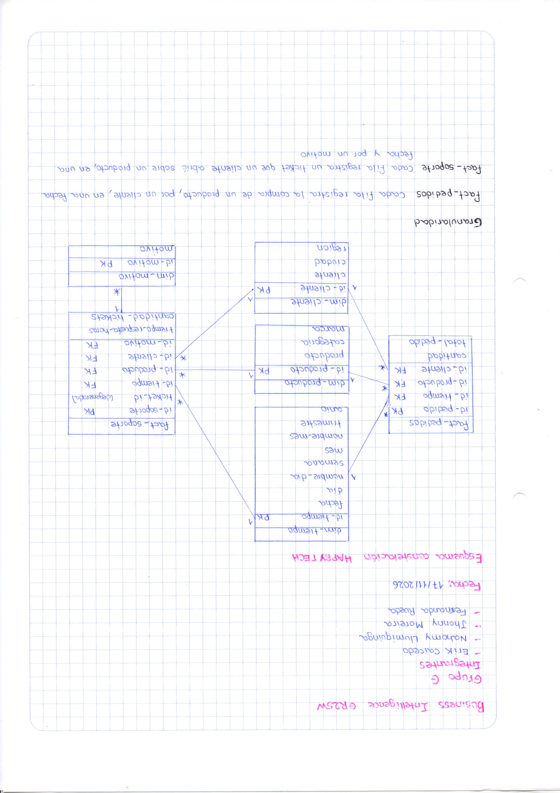

**Figura 1.** Diseño del esquema constelación HAPPYTECH: `FACT_PEDIDOS` y `FACT_SOPORTE` comparten `DIM_TIEMPO`, `DIM_PRODUCTO` y `DIM_CLIENTE`; `DIM_MOTIVO` solo se relaciona con el soporte.

Al compartir dimensiones, un mismo filtro por producto, cliente, ciudad o fecha afecta a la vez a pedidos y tickets.

### 3.3. Implementación en PostgreSQL

#### 3.3.1. Creación de la base de datos

Se creó la base de datos **`happytech`** desde pgAdmin 4. Las tablas del modelo se crearon en el esquema por defecto **`public`** (Figura 2).

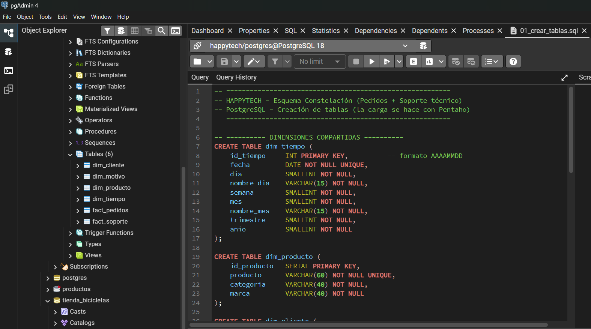

**Figura 2.** Base de datos `happytech` creada en pgAdmin 4.

#### 3.3.2. Script de creación de tablas

Se ejecutó el script `01_crear_tablas.sql`, que define las claves primarias, las claves foráneas y las restricciones de cada tabla [3]. Fragmento principal:

```sql
-- Las tablas se crean en el esquema por defecto (public)
DROP TABLE IF EXISTS fact_pedidos, fact_soporte, dim_tiempo,
                     dim_producto, dim_cliente, dim_motivo CASCADE;

-- Dimensiones compartidas
CREATE TABLE dim_tiempo (
    id_tiempo   INT PRIMARY KEY,          -- AAAAMMDD
    fecha       DATE NOT NULL UNIQUE,
    dia         SMALLINT NOT NULL,
    nombre_dia  VARCHAR(15) NOT NULL,
    semana      SMALLINT NOT NULL,
    mes         SMALLINT NOT NULL,
    nombre_mes  VARCHAR(15) NOT NULL,
    trimestre   SMALLINT NOT NULL,
    anio        SMALLINT NOT NULL
);

CREATE TABLE dim_producto (
    id_producto SERIAL PRIMARY KEY,
    producto    VARCHAR(60) NOT NULL UNIQUE,
    categoria   VARCHAR(40) NOT NULL,
    marca       VARCHAR(40) NOT NULL
);

CREATE TABLE dim_cliente (
    id_cliente  SERIAL PRIMARY KEY,
    cliente     VARCHAR(60) NOT NULL UNIQUE,
    ciudad      VARCHAR(40) NOT NULL,
    region      VARCHAR(20) NOT NULL
);

-- Dimensión exclusiva de soporte
CREATE TABLE dim_motivo (
    id_motivo   SERIAL PRIMARY KEY,
    motivo      VARCHAR(60) NOT NULL UNIQUE
);

-- Tablas de hechos
CREATE TABLE fact_pedidos (
    id_pedido    SERIAL PRIMARY KEY,
    id_tiempo    INT NOT NULL REFERENCES dim_tiempo(id_tiempo),
    id_producto  INT NOT NULL REFERENCES dim_producto(id_producto),
    id_cliente   INT NOT NULL REFERENCES dim_cliente(id_cliente),
    cantidad     INT NOT NULL CHECK (cantidad > 0),
    total_pedido NUMERIC(12,2) NOT NULL CHECK (total_pedido >= 0)
);

CREATE TABLE fact_soporte (
    id_soporte             SERIAL PRIMARY KEY,
    ticket_id              INT NOT NULL,   -- dimensión degenerada
    id_tiempo              INT NOT NULL REFERENCES dim_tiempo(id_tiempo),
    id_producto            INT NOT NULL REFERENCES dim_producto(id_producto),
    id_cliente             INT NOT NULL REFERENCES dim_cliente(id_cliente),
    id_motivo              INT NOT NULL REFERENCES dim_motivo(id_motivo),
    tiempo_respuesta_horas INT NOT NULL CHECK (tiempo_respuesta_horas >= 0),
    cantidad_tickets       INT NOT NULL DEFAULT 1
);
```

Además se crearon índices sobre las claves foráneas de ambas tablas de hechos para mejorar el rendimiento de las consultas.

### 3.4. Proceso ETL con Pentaho Data Integration

#### 3.4.1. Conexión a la base de datos

En todas las transformaciones y en el job se definió la conexión **`pg_happytech`** de tipo PostgreSQL (acceso nativo JDBC) [4].

#### 3.4.2. Transformaciones de dimensiones

**`dim_producto`, `dim_cliente` y `dim_motivo`** siguen el mismo flujo [7]:

1. **Excel input:** lee el archivo fuente. Producto y cliente leen las dos hojas, porque un producto o un cliente puede aparecer solo en una de ellas; motivo lee solo `hechos_soporte`.
2. **Select values:** conserva solo los atributos de la dimensión.
3. **Sort rows:** ordena por la clave natural y, con la opción *Only pass unique rows*, elimina duplicados.
4. **Insert/Update:** inserta los registros nuevos y actualiza los existentes, comparando por la clave natural (producto, cliente o motivo). Así la carga es idempotente: se puede volver a ejecutar sin generar duplicados.


**`dim_tiempo`** genera los atributos de calendario a partir de las fechas de la fuente:

1. **Excel input:** lee la columna `fecha` de ambas hojas (en el Excel está como texto `yyyy-MM-dd`).
2. **Sort rows:** elimina fechas repetidas.
3. **Modified JavaScript value:** calcula `id_tiempo` (AAAAMMDD), `dia`, `nombre_dia`, `semana` (ISO 8601), `mes`, `nombre_mes`, `trimestre` y `anio`.
4. **Select values:** convierte `fecha` de texto a tipo Date con la máscara `yyyy-MM-dd`.
5. **Insert/Update:** carga `dim_tiempo` usando `id_tiempo` como clave.

#### 3.4.3. Transformaciones de hechos

**`fact_pedidos`:**

1. **Excel input:** lee la hoja `hechos_pedidos`.
2. **Select values:** convierte `fecha` a tipo Date.
3. **Database lookup (×3):** obtiene las claves sustitutas `id_tiempo`, `id_producto` e `id_cliente` buscando en las dimensiones por fecha, producto y cliente.
4. **Table output:** inserta en `fact_pedidos` las claves foráneas y las medidas `cantidad` y `total_pedido`.

**`fact_soporte`:** sigue el mismo flujo sobre la hoja `hechos_soporte`, con un lookup adicional a `dim_motivo` para obtener `id_motivo`. Inserta en `fact_soporte` el `ticket_id`, las claves foráneas y `tiempo_respuesta_horas`. La columna `cantidad_tickets` toma su valor por defecto, 1.

#### 3.4.4. Job de carga

El job **`job_carga_happytech`** ejecuta el proceso completo en el orden que muestra la Figura 3.

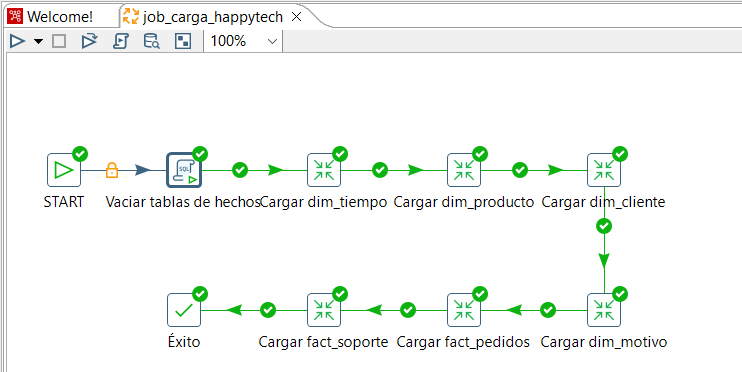

**Figura 3.** Secuencia de ejecución del job `job_carga_happytech`.

- **Vaciar tablas de hechos:** paso SQL que ejecuta `TRUNCATE TABLE fact_pedidos, fact_soporte RESTART IDENTITY;`. Evita duplicar hechos al volver a ejecutar el job.
- **Las dimensiones se cargan primero**, porque las tablas de hechos necesitan sus claves sustitutas (integridad referencial).
- Cada paso continúa solo si el anterior terminó con éxito.

### 3.5. Verificación de la carga en PostgreSQL

#### 3.5.1. Conteo de registros

Después de ejecutar el job se verificó el número de registros de cada tabla con el script `02_consultas.sql`:

```sql
SELECT 'dim_tiempo' tabla, COUNT(*) FROM dim_tiempo UNION ALL
SELECT 'dim_producto', COUNT(*) FROM dim_producto UNION ALL
SELECT 'dim_cliente', COUNT(*) FROM dim_cliente UNION ALL
SELECT 'dim_motivo', COUNT(*) FROM dim_motivo UNION ALL
SELECT 'fact_pedidos', COUNT(*) FROM fact_pedidos UNION ALL
SELECT 'fact_soporte', COUNT(*) FROM fact_soporte;
```

La Tabla 6 compara los registros esperados según la fuente con los registros cargados (Figura 4).

**Tabla 6.** Registros esperados por tabla.

| Tabla | Registros esperados |
|---|---|
| dim_tiempo | 30 |
| dim_producto | 5 |
| dim_cliente | 5 |
| dim_motivo | 4 |
| fact_pedidos | 50 |
| fact_soporte | 50 |

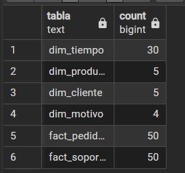

**Figura 4.** Resultado de la consulta de conteo de registros en las seis tablas.

#### 3.5.2. Consultas de los requerimientos

**Requerimiento 1: productos y categorías más vendidos por ciudad**

```sql
SELECT c.ciudad, p.categoria, p.producto,
       SUM(f.cantidad) AS unidades, SUM(f.total_pedido) AS ventas
FROM fact_pedidos f
JOIN dim_producto p ON p.id_producto = f.id_producto
JOIN dim_cliente  c ON c.id_cliente  = f.id_cliente
GROUP BY c.ciudad, p.categoria, p.producto
ORDER BY c.ciudad, unidades DESC;
```

En Ambato lidera Vigilancia (Cámara IP C20, 9 unidades); en Guayaquil, Redes (Router AX10) y Servidores (Servidor Rack M3), con 9 unidades cada uno; en Manta y en Quito, Impresoras (Impresora Z500, 9 unidades). En Cuenca empatan Vigilancia, Servidores e Impresoras con 3 unidades cada una (Figura 5).

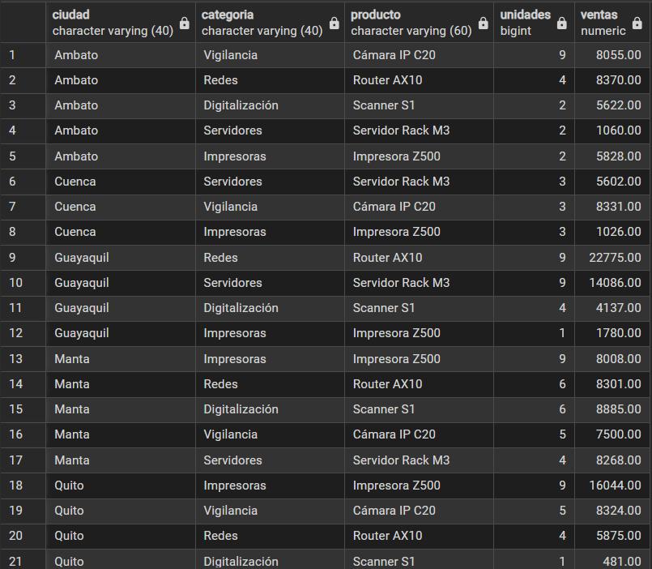

**Figura 5.** Resultado del requerimiento 1: unidades y ventas por ciudad, categoría y producto.

**Requerimiento 2: clientes que más compran por ciudad**

```sql
SELECT c.ciudad, c.cliente,
       SUM(f.cantidad) AS unidades, SUM(f.total_pedido) AS ventas
FROM fact_pedidos f
JOIN dim_cliente c ON c.id_cliente = f.id_cliente
GROUP BY c.ciudad, c.cliente
ORDER BY unidades DESC;
```

Empresa Épsilon (Manta) es el cliente que más unidades compra (30), mientras que Empresa Beta (Guayaquil) es el que más factura ($42.778) (Figura 6).

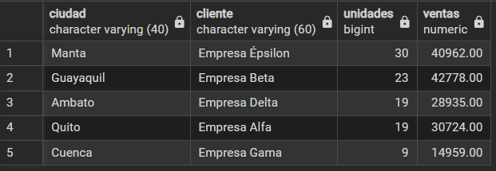

**Figura 6.** Resultado del requerimiento 2: unidades y ventas por cliente y ciudad.

**Requerimiento 3: productos y categorías con más tickets**

```sql
SELECT p.categoria, p.producto, COUNT(*) AS tickets,
       ROUND(AVG(f.tiempo_respuesta_horas),1) AS horas_promedio
FROM fact_soporte f
JOIN dim_producto p ON p.id_producto = f.id_producto
GROUP BY p.categoria, p.producto
ORDER BY tickets DESC;
```

Router AX10 (Redes) es el producto con más tickets (14), seguido de Scanner S1 (Digitalización), con 10 (Figura 7).

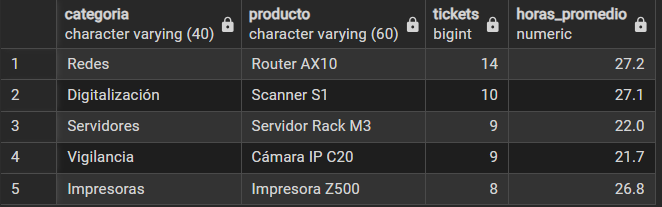

**Figura 7.** Resultado del requerimiento 3: tickets y tiempo promedio de respuesta por producto.

**Requerimiento 4: clientes con más tickets**

```sql
SELECT c.cliente, c.ciudad, COUNT(*) AS tickets
FROM fact_soporte f
JOIN dim_cliente c ON c.id_cliente = f.id_cliente
GROUP BY c.cliente, c.ciudad
ORDER BY tickets DESC;
```

Empresa Épsilon (Manta) registra más tickets (16), seguida de Empresa Gama (Cuenca), con 11 (Figura 8).

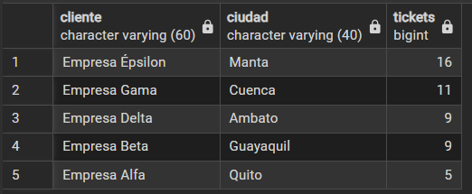

**Figura 8.** Resultado del requerimiento 4: tickets por cliente.

**Análisis cruzado: tickets por cada 10 unidades vendidas**

Gracias a la dimensión compartida `dim_producto`, se pueden combinar ambas tablas de hechos en una misma consulta:

```sql
WITH v AS (SELECT id_producto, SUM(cantidad) u FROM fact_pedidos GROUP BY id_producto),
     t AS (SELECT id_producto, COUNT(*) n FROM fact_soporte GROUP BY id_producto)
SELECT p.producto, v.u AS unidades_vendidas, COALESCE(t.n,0) AS tickets,
       ROUND(10.0*COALESCE(t.n,0)/v.u,2) AS tickets_por_10_unidades
FROM dim_producto p
LEFT JOIN v ON v.id_producto = p.id_producto
LEFT JOIN t ON t.id_producto = p.id_producto
ORDER BY tickets_por_10_unidades DESC;
```

Scanner S1 tiene la mayor proporción de tickets respecto a lo vendido (7,69 tickets por cada 10 unidades), e Impresora Z500, la menor (3,33) (Figura 9).

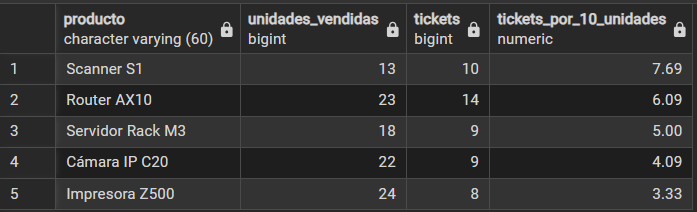

**Figura 9.** Resultado del análisis cruzado: tickets por cada 10 unidades vendidas por producto.

### 3.6. Importación del modelo en Power BI

#### 3.6.1. Conexión a PostgreSQL

La conexión se realizó con el conector nativo de PostgreSQL de Power BI Desktop [5]:

1. Se seleccionó **Obtener datos → Base de datos PostgreSQL**.
2. Se ingresó el servidor `localhost` y la base de datos `happytech`, en modo **Importar**.
3. Se autenticó con el usuario de la base de datos.
4. En el navegador se seleccionaron las 6 tablas del esquema `public`.

La Figura 10 muestra las tablas seleccionadas.

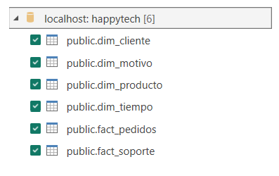

**Figura 10.** Navegador de Power BI con las seis tablas del esquema `public` seleccionadas.

#### 3.6.2. Ajuste de nombres de tablas

Power BI nombra las tablas con el prefijo del esquema (por ejemplo, `public dim_tiempo`). Para mejorar la legibilidad se renombraron como `dim_tiempo`, `dim_producto`, `dim_cliente`, `dim_motivo`, `fact_pedidos` y `fact_soporte`. El cambio no altera las relaciones del modelo.

#### 3.6.3. Modelo de datos y relaciones

Power BI detectó automáticamente las relaciones 1 : N a partir de las claves foráneas [6]. En la vista de **Modelo** se verificaron las 7 relaciones del esquema constelación, que se resumen en la Tabla 7.

**Tabla 7.** Relaciones del modelo en Power BI.

| Desde (1) | Hacia (N) | Columna | Dirección del filtro |
|---|---|---|---|
| dim_tiempo | fact_pedidos | id_tiempo | Única |
| dim_producto | fact_pedidos | id_producto | Única |
| dim_cliente | fact_pedidos | id_cliente | Única |
| dim_tiempo | fact_soporte | id_tiempo | Única |
| dim_producto | fact_soporte | id_producto | Única |
| dim_cliente | fact_soporte | id_cliente | Única |
| dim_motivo | fact_soporte | id_motivo | Única |

Todas las relaciones tienen cardinalidad **uno a varios (1 : N)** y dirección de filtro única, de la dimensión hacia los hechos. Las dimensiones `dim_tiempo`, `dim_producto` y `dim_cliente` filtran a la vez ambas tablas de hechos, lo que confirma el funcionamiento del esquema constelación (Figura 11).


**Figura 11.** Vista de modelo en Power BI: dos tablas de hechos conectadas a las dimensiones compartidas mediante siete relaciones 1 : N.

#### 3.6.4. Medidas DAX

Para responder a los requerimientos se crearon cuatro medidas DAX [8], descritas en la Tabla 8.

**Tabla 8.** Medidas DAX del modelo.

| Medida | Expresión DAX | Tabla de hechos |
|---|---|---|
| Unidades Vendidas | `SUM(fact_pedidos[cantidad])` | fact_pedidos |
| Ventas Totales | `SUM(fact_pedidos[total_pedido])` | fact_pedidos |
| Total Tickets | `SUM(fact_soporte[cantidad_tickets])` | fact_soporte |
| Promedio Respuesta (h) | `AVERAGE(fact_soporte[tiempo_respuesta_horas])` | fact_soporte |

`Promedio Respuesta (h)` usa un promedio porque el tiempo de respuesta no es aditivo: sumar horas de varios tickets no tiene significado de negocio.

### 3.7. Dashboard en Power BI

El dashboard reúne en una sola página los indicadores de pedidos y de soporte técnico (Figura 12). Los cuatro indicadores clave son: **100** unidades vendidas, **$158,36 mil** en ventas totales, **50** tickets y un tiempo promedio de respuesta de **25,2 horas**. Debajo se ubican cuatro gráficos de barras apiladas, uno por requerimiento:

- **Unidades vendidas por categoría, producto y ciudad** (requerimiento 1).
- **Unidades vendidas por cliente y ciudad** (requerimiento 2).
- **Total de tickets por categoría, producto y motivo** (requerimiento 3).
- **Total de tickets por cliente y motivo** (requerimiento 4).

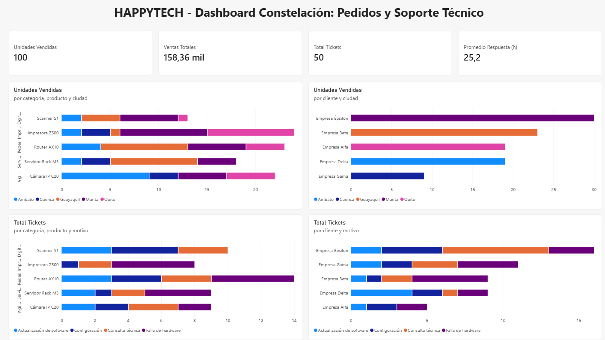

**Figura 12.** Dashboard HAPPYTECH: pedidos y soporte técnico.

**Enlace al dashboard publicado:** [https://app.powerbi.com/view?r=eyJrIjoiYzc0YWRjNWUtN2VjOS00OGMxLWIyNDItNjNkOTZkMzM2ZTJlIiwidCI6IjY4MmE0ZTZhLWE3N2YtNDk1OC1hM2FjLTllMjY2ZDE4YWEzNyIsImMiOjR9](https://app.powerbi.com/view?r=eyJrIjoiYzc0YWRjNWUtN2VjOS00OGMxLWIyNDItNjNkOTZkMzM2ZTJlIiwidCI6IjY4MmE0ZTZhLWE3N2YtNDk1OC1hM2FjLTllMjY2ZDE4YWEzNyIsImMiOjR9)

## 4. Análisis de resultados

La Tabla 9 resume la respuesta a cada requerimiento según las consultas SQL y el dashboard.

**Tabla 9.** Resultados por requerimiento.

| # | Requerimiento | Resultado principal |
|---|---|---|
| 1 | Productos y categorías más vendidos por ciudad | Impresoras es la categoría con más unidades (24), seguida de Redes (23) y Vigilancia (22). Redes es la que más ingresos genera ($45.321). En Quito y Manta lideran las Impresoras, en Guayaquil Redes y Servidores, y en Ambato Vigilancia. |
| 2 | Clientes que más compran por ciudad | Empresa Épsilon (Manta) compra más unidades (30); Empresa Beta (Guayaquil) tiene el mayor monto ($42.778). Empresa Gama (Cuenca) es la de menor volumen (9 unidades). |
| 3 | Productos y categorías con más tickets | Router AX10 (Redes) concentra más tickets (14), seguido de Scanner S1 (10). La causa más frecuente es Falla de hardware (16 de 50 tickets). |
| 4 | Clientes con más tickets | Empresa Épsilon registra más tickets (16), seguida de Empresa Gama (11). El tiempo de respuesta promedio general es de 25,2 horas. |

El análisis cruzado, posible gracias a las dimensiones compartidas, muestra que Redes es la categoría que más factura, pero también la que más soporte demanda. Empresa Gama, con pocas compras, genera muchos tickets. En proporción a lo vendido, Scanner S1 es el producto más problemático (7,69 tickets por cada 10 unidades). Estos son puntos a revisar en la calidad del producto y en la atención postventa.

## 5. Conclusiones

1. El esquema constelación permitió integrar dos procesos de negocio, pedidos y soporte técnico, en un mismo data warehouse. Las dimensiones conformadas `dim_tiempo`, `dim_producto` y `dim_cliente` se reutilizan en ambas tablas de hechos y evitan duplicar información.

2. Definir la granularidad al mismo nivel de detalle (día, producto y cliente) en las dos tablas de hechos hizo posible el análisis cruzado entre ventas y tickets sin agregaciones previas, como se comprobó con el indicador de tickets por cada 10 unidades vendidas.

3. La revisión de la fuente evidenció que `ticket_id` se repite (ticket 7221), por lo que se modeló como dimensión degenerada y se usó una clave sustituta como clave primaria de `fact_soporte`. Revisar la calidad de los datos antes de diseñar las claves evitó errores en la carga.

4. El job de Pentaho cargó primero las dimensiones y después los hechos, respetando la integridad referencial. El uso de `Insert/Update` y el vaciado previo de las tablas de hechos hacen que la carga pueda repetirse sin generar duplicados. Los conteos finales (30, 5, 5, 4, 50 y 50 registros) coinciden con la fuente.

5. Power BI reconoció las siete relaciones 1 : N del modelo. Con cuatro medidas DAX se construyó un dashboard que responde a los cuatro requerimientos y que, al filtrar por una dimensión compartida, actualiza a la vez los indicadores de pedidos y de soporte.

## 6. Referencias bibliográficas

[1] D. Martínez, «Caso de estudio: Esquema constelación – HAPPYTECH», material de clase de Business Intelligence, Facultad de Ingeniería de Sistemas, Escuela Politécnica Nacional, Quito, Ecuador, 2026.

[2] R. Kimball y M. Ross, *The Data Warehouse Toolkit: The Definitive Guide to Dimensional Modeling* [El kit de herramientas del data warehouse: guía definitiva del modelado dimensional], 3.ª ed. Indianápolis, IN, EE. UU.: Wiley, 2013.

[3] PostgreSQL Global Development Group, «CREATE TABLE», *PostgreSQL Documentation*. [En línea]. Disponible en: [https://www.postgresql.org/docs/current/sql-createtable.html](https://www.postgresql.org/docs/current/sql-createtable.html). [Consulta: 16 de noviembre de 2026].

[4] Pentaho, «Getting Started with PDI» [Introducción a PDI], *Documentación de Pentaho*. [En línea]. Disponible en: [https://docs.pentaho.com/pdia-try-pdia/getting-started-with-pdi](https://docs.pentaho.com/pdia-try-pdia/getting-started-with-pdi). [Consulta: 16 de noviembre de 2026].

[5] Microsoft, «Base de datos PostgreSQL», *Documentación de Power Query*, Microsoft Learn. [En línea]. Disponible en: [https://learn.microsoft.com/es-es/power-query/connectors/postgresql](https://learn.microsoft.com/es-es/power-query/connectors/postgresql). [Consulta: 16 de noviembre de 2026].

[6] Microsoft, «Creación y administración de relaciones en Power BI Desktop», *Documentación de Power BI*, Microsoft Learn. [En línea]. Disponible en: [https://learn.microsoft.com/es-es/power-bi/transform-model/desktop-create-and-manage-relationships](https://learn.microsoft.com/es-es/power-bi/transform-model/desktop-create-and-manage-relationships). [Consulta: 16 de noviembre de 2026].

[7] Pentaho, «PDI transformation steps» [Pasos de transformación de PDI], *Documentación de Pentaho Data Integration, versión 10.2*. [En línea]. Disponible en: [https://docs.pentaho.com/pdia-data-integration/10.2-data-integration/pdi-transformation-steps-reference-overview](https://docs.pentaho.com/pdia-data-integration/10.2-data-integration/pdi-transformation-steps-reference-overview). [Consulta: 16 de noviembre de 2026].

[8] Microsoft, «Referencia de DAX (Expresiones de análisis de datos)», Microsoft Learn. [En línea]. Disponible en: [https://learn.microsoft.com/es-es/dax/](https://learn.microsoft.com/es-es/dax/). [Consulta: 16 de noviembre de 2026].

## 7. Declaración de uso de la IA

En el desarrollo de este caso de estudio se utilizó una herramienta de inteligencia artificial generativa como apoyo en aproximadamente un **20% del trabajo**, principalmente para la revisión de los scripts SQL y la redacción y estructuración del informe. El **80% restante** fue realizado directamente por los integrantes del grupo, incluyendo el diseño del modelo a mano, la creación de la base de datos en PostgreSQL, la implementación y ejecución de las transformaciones y del job ETL, la construcción del modelo y del dashboard en Power BI, la validación de resultados y la recopilación de evidencias. Todo el contenido proporcionado por la IA fue revisado, adaptado y validado por los integrantes del equipo.
