<p align="center">
  &nbsp;&nbsp;&nbsp;&nbsp;&nbsp;&nbsp;
</p>


<div align="center">

<h3>Escuela Politécnica Nacional</h3>
<h4>Facultad de Ingeniería de Sistemas</h4>
<h5>Business Intelligence GR2SW</h5>

</div>

<hr>

**Integrantes Grupo G**

- Erick Caicedo
- Nahomy Llumiquinga
- Jhonny Moreira
- Fernanda Rueda

**Docente:** PhD. Diana Martínez

**Fecha de entrega:** 27 de noviembre de 2026

<h3 align="center">
Proyecto Primer Bimestre - La Tradicional
</h3>

<p align="center">
  
</p>

---

## Índice

- [Índice](#índice)
- [1. Introducción](#1-introducción)
- [2. Objetivos](#2-objetivos)
  - [Objetivo general](#objetivo-general)
  - [Objetivos específicos](#objetivos-específicos)
- [3. Descripción del negocio y problema](#3-descripción-del-negocio-y-problema)
- [4. Fuentes de datos](#4-fuentes-de-datos)
- [5. Preguntas de negocio](#5-preguntas-de-negocio)
- [6. Modelo dimensional](#6-modelo-dimensional)
  - [6.1 Justificación del modelo](#61-justificación-del-modelo)
  - [6.2 Granularidad](#62-granularidad)
  - [6.3 Implementación en PostgreSQL](#63-implementación-en-postgresql)
- [7. Proceso ETL en Pentaho](#7-proceso-etl-en-pentaho)
  - [7.1 Carga a staging](#71-carga-a-staging)
  - [7.2 Calidad de datos](#72-calidad-de-datos)
  - [7.3 Dimensiones](#73-dimensiones)
  - [7.4 Tablas de hechos](#74-tablas-de-hechos)
  - [7.5 Job de orquestación](#75-job-de-orquestación)
  - [7.6 Validación de la carga](#76-validación-de-la-carga)
- [8. Resultados: consultas SQL](#8-resultados-consultas-sql)
- [9. Dashboard en Power BI](#9-dashboard-en-power-bi)
  - [Enlace de visualización del dashboard](#enlace-de-visualización-del-dashboard)
- [10. Análisis OLAP](#10-análisis-olap)
- [11. Insights y recomendaciones](#11-insights-y-recomendaciones)
- [12. Conclusiones](#12-conclusiones)
- [13. Estructura del repositorio](#13-estructura-del-repositorio)
- [14. Referencias bibliográficas](#14-referencias-bibliográficas)
- [15. Declaración de uso de inteligencia artificial](#15-declaración-de-uso-de-inteligencia-artificial)

---

<a id="introduccion"></a>
## 1. Introducción

La Tradicional – Boulangerie es un negocio ecuatoriano que elabora postres tradicionales de la Sierra, como aplanchados, mojicones, orejas y melvas, además de bocadillos de sal. El negocio registra sus ventas en un sistema contable y recibe las facturas de sus proveedores como comprobantes electrónicos del Servicio de Rentas Internas (SRI). Ambas fuentes existen por separado, lo que impide responder con rapidez preguntas como qué productos sostienen los ingresos o cómo se relacionan las ventas con las compras de cada mes.

Este proyecto desarrolla una solución de Business Intelligence que integra esas dos fuentes en un data warehouse [1]. El proceso abarca un ETL construido en Pentaho Data Integration [2], un modelo dimensional implementado en PostgreSQL [3], consultas SQL que responden seis preguntas de negocio y un dashboard en Power BI [4] con análisis OLAP.

<a id="objetivos"></a>
## 2. Objetivos

### Objetivo general

Desarrollar una solución de Business Intelligence para La Tradicional – Boulangerie que integre sus datos de ventas y compras mediante un proceso ETL en Pentaho, un modelo dimensional en PostgreSQL y un dashboard en Power BI con análisis OLAP, para responder preguntas del negocio y apoyar la toma de decisiones.

### Objetivos específicos

1. Identificar las fuentes de datos del negocio y plantear preguntas de negocio que puedan responderse con ellas.
2. Diseñar un modelo dimensional de tipo constelación que integre las ventas y las compras a través de una dimensión de tiempo compartida.
3. Implementar en Pentaho las transformaciones y el job que extraen, limpian y cargan los datos en PostgreSQL.
4. Validar la integridad de la carga mediante controles SQL contra los archivos originales.
5. Construir un dashboard en Power BI y aplicar operaciones OLAP para obtener insights y recomendaciones.

<a id="negocio"></a>
## 3. Descripción del negocio y problema

**Negocio.** La Tradicional – Boulangerie produce y comercializa dos líneas de productos: **postres** (aplanchados, mojicones, orejas, melvas, poncakes, roscones, entre otros) y **bocadillos de sal** (cueros de cerdo, cayambeños, bizcochos de sal, cueros de soya y allullas). Vende tanto a consumidores finales como a clientes identificados con cédula o RUC.

**Problema.** La información del negocio está dispersa en dos fuentes con formatos distintos: un reporte de ventas en Excel exportado del sistema contable y archivos de texto con los comprobantes recibidos del SRI. Además, los datos presentan problemas de calidad: fechas con año de dos dígitos, un mismo producto registrado con dos códigos y una categoría de producto que no distingue entre postres y bocadillos. Esto impide analizar el desempeño del negocio de forma confiable y comparar ingresos con gastos.

<a id="fuentes"></a>
## 4. Fuentes de datos

Los datos fueron facilitados y autorizados por el negocio para fines académicos. La Tabla 1 resume las dos fuentes utilizadas.

**Tabla 1.** *Fuentes de datos del proyecto*

| Fuente | Proceso de negocio | Formato | Registros | Contenido principal |
|---|---|---|---|---|
| Comprobantes recibidos del SRI | Compras | 6 archivos `.txt` separados por tabulador | 491 facturas | Proveedor (RUC y razón social), fecha de emisión, clave de acceso, subtotal, IVA e importe total |
| Reporte de ventas del sistema contable | Ventas | 1 archivo `.xls` (hoja *Documento1*, encabezado en la fila 4) | 6.768 líneas de venta | Cliente, producto, cantidad, precio, descuento, IVA, total, saldo, estado y forma de pago |

Durante el perfilado inicial se confirmó que los 491 comprobantes de compra son facturas con clave de acceso única, y que cada fila del archivo de ventas corresponde a una línea de producto dentro de una factura.

> **Confidencialidad:** los archivos originales contienen identificaciones, nombres y correos de clientes. Por ese motivo no se publican en este repositorio; solo se incluyen los scripts y los resultados agregados.

<a id="preguntas"></a>
## 5. Preguntas de negocio

La Tabla 2 presenta las seis preguntas que guían el diseño del data warehouse.

**Tabla 2.** *Preguntas de negocio y datos que las responden*

| # | Pregunta | Tablas de hechos | Dimensiones |
|---|---|---|---|
| P1 | ¿Cuánto se vende cada mes y en qué línea: postres o bocadillos de sal? | `fact_ventas` | `dim_tiempo`, `dim_producto` |
| P2 | ¿Cuáles son los productos más vendidos por ingreso y por unidades? | `fact_ventas` | `dim_producto` |
| P3 | ¿Quiénes son los principales clientes, sin contar al consumidor final? | `fact_ventas` | `dim_cliente` |
| P4 | ¿Cómo se comparan las ventas y las compras de cada mes? | `fact_ventas`, `fact_compras` | `dim_tiempo` |
| P5 | ¿En qué proveedores se concentra el gasto del negocio? | `fact_compras` | `dim_proveedor` |
| P6 | ¿Cómo pagan los clientes y cuánto queda por cobrar? | `fact_ventas` | (atributos de la factura) |

<a id="modelo"></a>
## 6. Modelo dimensional

La Figura 1 muestra la arquitectura general de la solución, desde los archivos originales hasta el dashboard.

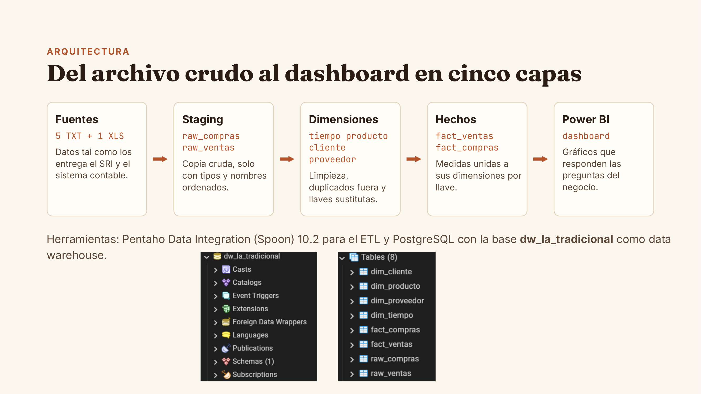
<!-- Captura sugerida: diapositiva "Del archivo crudo al dashboard en cinco capas" de la presentación. -->

**Figura 1.** *Arquitectura de la solución en cinco capas.* Los datos pasan de las fuentes a una capa de staging, luego a las dimensiones y a las tablas de hechos en PostgreSQL, y finalmente al dashboard de Power BI.

<a id="justificacion"></a>
### 6.1 Justificación del modelo

Se eligió un modelo de **constelación** (*galaxy schema*) porque el negocio tiene **dos procesos** que se quieren analizar juntos: las ventas y las compras. Cada proceso tiene su propia tabla de hechos, y ambas comparten la dimensión de tiempo. Esta dimensión compartida, denominada *conformed dimension* por Kimball y Ross [5], permite comparar ventas y compras mes a mes sin relacionar directamente las tablas de hechos entre sí. Un modelo estrella simple no permitiría responder la pregunta P4.

La Figura 2 presenta el modelo implementado.

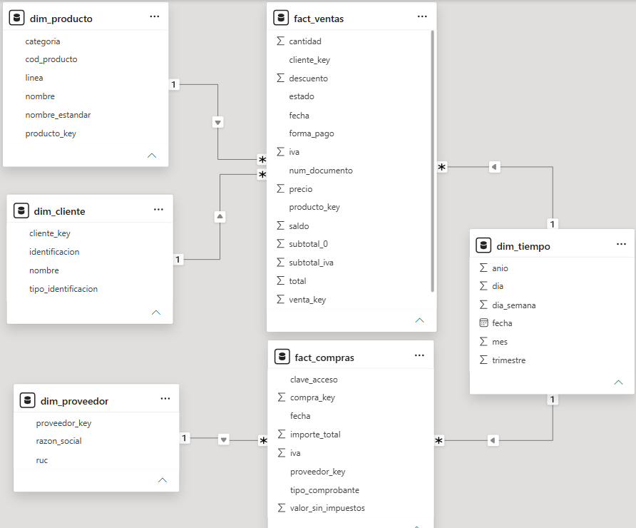
<!-- Captura sugerida: Vista de modelo de Power BI con las 6 tablas y las 5 relaciones, o la diapositiva del modelo constelación. -->

**Figura 2.** *Modelo dimensional de constelación.* `dim_tiempo` se conecta con las dos tablas de hechos; `dim_producto` y `dim_cliente` describen las ventas, y `dim_proveedor` describe las compras. Todas las relaciones son de uno a muchos por llave sustituta.

La Tabla 3 describe las dimensiones del modelo.

**Tabla 3.** *Dimensiones del modelo*

| Dimensión | Llave | Atributos | Propósito |
|---|---|---|---|
| `dim_tiempo` | `fecha` (natural) | año, mes, día, trimestre, día de la semana | Calendario compartido por ventas y compras |
| `dim_producto` | `producto_key` (sustituta) | código, nombre, categoría del sistema, **nombre estándar**, **línea** | Agrupar productos y distinguir postres de bocadillos de sal |
| `dim_cliente` | `cliente_key` (sustituta) | identificación, nombre, **tipo de identificación** | Separar cédula, RUC, consumidor final y extranjeros |
| `dim_proveedor` | `proveedor_key` (sustituta) | RUC, razón social | Analizar la concentración del gasto |

Los atributos en negrita no existían en las fuentes: se crearon en el ETL para responder las preguntas de negocio.

<a id="granularidad"></a>
### 6.2 Granularidad

La granularidad se definió al nivel más detallado disponible en cada fuente, lo que permite agregar los datos a cualquier nivel superior [5]. La Tabla 4 resume ambas tablas de hechos.

**Tabla 4.** *Tablas de hechos y su granularidad*

| Tabla de hechos | Grano (una fila es…) | Medidas | Registros |
|---|---|---|---|
| `fact_ventas` | Una **línea de producto** dentro de una factura de venta | cantidad, precio, descuento, subtotales, IVA, total, saldo | 6.768 |
| `fact_compras` | Un **comprobante** recibido del SRI | valor sin impuestos, IVA, importe total | 491 |

En ventas se eligió la línea de producto, y no la factura completa, porque las preguntas P1 y P2 necesitan saber **qué producto** se vendió. En compras, los comprobantes del SRI no traen el detalle de productos, por lo que el grano más fino disponible es el comprobante.

<a id="postgresql"></a>
### 6.3 Implementación en PostgreSQL

El modelo se implementó en la base de datos `dw_la_tradicional` mediante el script [`queries sql/01_creacion_tablas.sql`](queries%20sql/01_creacion_tablas.sql), siguiendo el procedimiento de la guía de creación de un data warehouse [6]. El script crea:

- **2 tablas de staging** (`raw_compras`, `raw_ventas`), que reciben los datos crudos.
- **4 dimensiones**, con **claves primarias** (`SERIAL` en las llaves sustitutas y `DATE` en `dim_tiempo`).
- **2 tablas de hechos**, con **5 claves foráneas** hacia sus dimensiones (`fk_ventas_producto`, `fk_ventas_cliente`, `fk_ventas_tiempo`, `fk_compras_proveedor` y `fk_compras_tiempo`).

Las claves foráneas garantizan la integridad referencial y, además, permiten que Power BI importe automáticamente las relaciones del modelo. La Figura 3 muestra las tablas y sus relaciones en PostgreSQL.

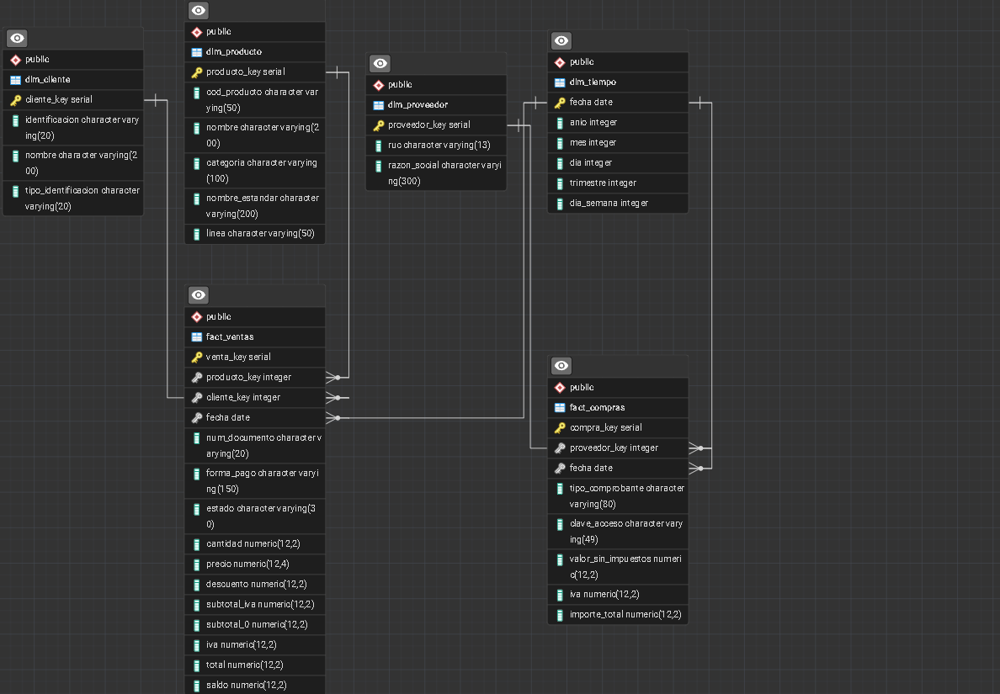
<!-- Captura sugerida: pgAdmin → clic derecho sobre la base → ERD For Database, o el resultado de la comprobación 4.2 del script con las 5 llaves foráneas. -->

**Figura 3.** *Tablas y claves foráneas en PostgreSQL.* Las tablas de hechos referencian a las dimensiones mediante sus llaves primarias.

<a id="etl"></a>
## 7. Proceso ETL en Pentaho

El ETL se construyó en Pentaho Data Integration (Spoon) 10.2 con **8 transformaciones** y **1 job**. La Tabla 5 resume cada transformación.

**Tabla 5.** *Transformaciones del proceso ETL*

| # | Archivo | Destino | Pasos principales |
|---|---|---|---|
| 01 | `01_carga_raw_compras.ktr` | `raw_compras` | Text file input → Table output |
| 02 | `02_carga_raw_ventas.ktr` | `raw_ventas` | Microsoft Excel input → Replace in string → Select values → Table output |
| 03 | `03_dim_tiempo.ktr` | `dim_tiempo` | Table input → Calculator → Select values → Table output |
| 04 | `04_dim_producto.ktr` | `dim_producto` | Table input → String operations → Sort rows → Unique rows → Stream lookup (catálogo CSV) → Table output |
| 05 | `05_dim_cliente.ktr` | `dim_cliente` | Table input → String operations → Sort rows → Unique rows → Formula → Table output |
| 06 | `06_dim_proveedor.ktr` | `dim_proveedor` | Table input → String operations → Sort rows → Unique rows → Table output |
| 07 | `07_fact_ventas.ktr` | `fact_ventas` | Table input → 3 Stream lookup (producto, cliente, fecha) → Select values → Table output |
| 08 | `08_fact_compras.ktr` | `fact_compras` | Table input → Sort rows → Unique rows → 2 Stream lookup (proveedor, fecha) → Select values → Table output |

<a id="staging"></a>
### 7.1 Carga a staging

**Compras (transformación 01).** El paso *Text file input* lee los seis archivos de una sola vez mediante la expresión regular `.*\.txt`, con tabulador como separador y formato Unix. La clave de acceso, el RUC y la identificación se definieron como texto para no perder dígitos ni ceros iniciales, y el campo `archivo_origen` registra de qué archivo proviene cada fila (Figura 4).

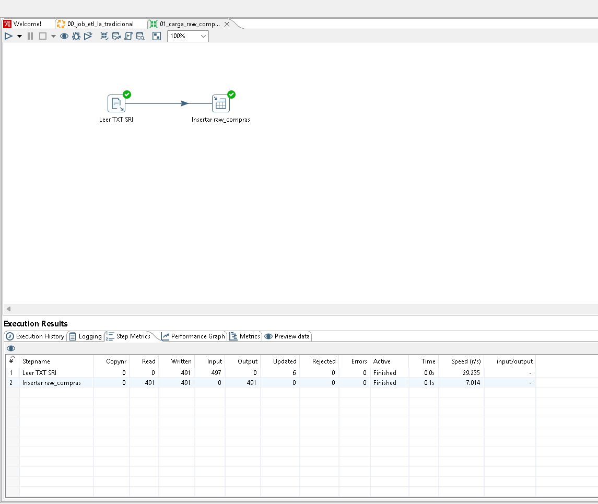
<!-- Captura sugerida: lienzo de Spoon de 01_carga_raw_compras.ktr con Step Metrics (491 filas, 0 errores). -->

**Figura 4.** *Transformación de carga de compras.* Se cargan 491 comprobantes sin errores.

**Ventas (transformación 02).** El paso *Microsoft Excel input* lee la hoja *Documento1* desde la fila 4 (*Start row* = 3). Luego, un paso *Replace in string* corrige el año de las fechas y *Select values* conserva 25 de las 43 columnas con nombres normalizados (Figura 5).

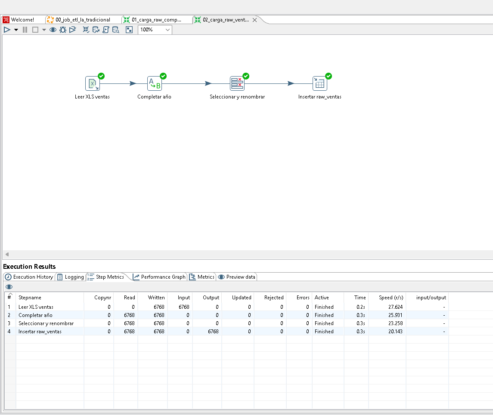
<!-- Captura sugerida: lienzo de 02_carga_raw_ventas.ktr con Step Metrics (6.768 filas, 0 errores). -->

**Figura 5.** *Transformación de carga de ventas.* Se cargan 6.768 líneas de venta sin errores.

<a id="calidad"></a>
### 7.2 Calidad de datos

Durante el desarrollo se detectaron y resolvieron los problemas que muestra la Tabla 6.

**Tabla 6.** *Problemas de calidad de datos y solución aplicada*

| Problema detectado | Solución aplicada en el ETL |
|---|---|
| La clave de acceso de 49 dígitos se interpretaba como número y se recortaba | Tipo *String* en *Text file input* y control `LENGTH(clave_acceso) = 49` |
| El Excel muestra fechas como `30/06/26` y Pentaho las leía como el año 0026 | *Replace in string* con la expresión regular `^(\d{1,2})/(\d{1,2})/(?:00\|20)?(\d{2})$` → `$1/$2/20$3`, antes de convertir a fecha |
| Sumar 2000 años a la fecha ya convertida corría las fechas 14 días | Se descartó esa fórmula: las fechas anteriores a 1582 usan el calendario juliano, por lo que la corrección se hace sobre el texto y no sobre la fecha |
| El mapeo automático (*Guess*) cruzó los campos `descuento`, `iva` y `total` | Revisión y corrección manual del mapeo en *Table output* |
| Un mismo producto registrado con dos códigos (Aplanchados, Mojicón y Quesadilla) | Atributo `nombre_estandar` en `dim_producto`, que unifica 24 códigos en 21 productos |
| La categoría del sistema (*General* / *PRINCIPAL*) no distingue el tipo de producto | Catálogo `clasificacion_productos.csv` cruzado con *Stream lookup* para crear el atributo `linea` |

<a id="dimensiones"></a>
### 7.3 Dimensiones

Todas las dimensiones siguen el mismo patrón: lectura desde staging, limpieza de texto con *String operations*, ordenamiento con *Sort rows* y eliminación de duplicados con *Unique rows*. El ordenamiento previo es necesario porque *Unique rows* solo elimina duplicados consecutivos. Las llaves sustitutas las genera PostgreSQL (`SERIAL`).

- **`dim_tiempo`** se construye con la unión de las fechas de ventas y compras, de modo que ambas tablas de hechos encuentren su fecha. El paso *Calculator* obtiene año, mes, día, trimestre y día de la semana.
- **`dim_producto`** agrega el nombre estándar y la línea mediante el catálogo de clasificación (Figura 6). El resultado son 16 productos en la línea *Postres* y 5 en *Bocadillos de sal*.
- **`dim_cliente`** calcula el tipo de identificación con un paso *Formula*: *CONSUMIDOR FINAL* para `9999999999999`, *RUC* para 13 dígitos, *CEDULA* para 10 dígitos y *OTRO* para identificaciones extranjeras.
- **`dim_proveedor`** contiene un registro por RUC emisor.

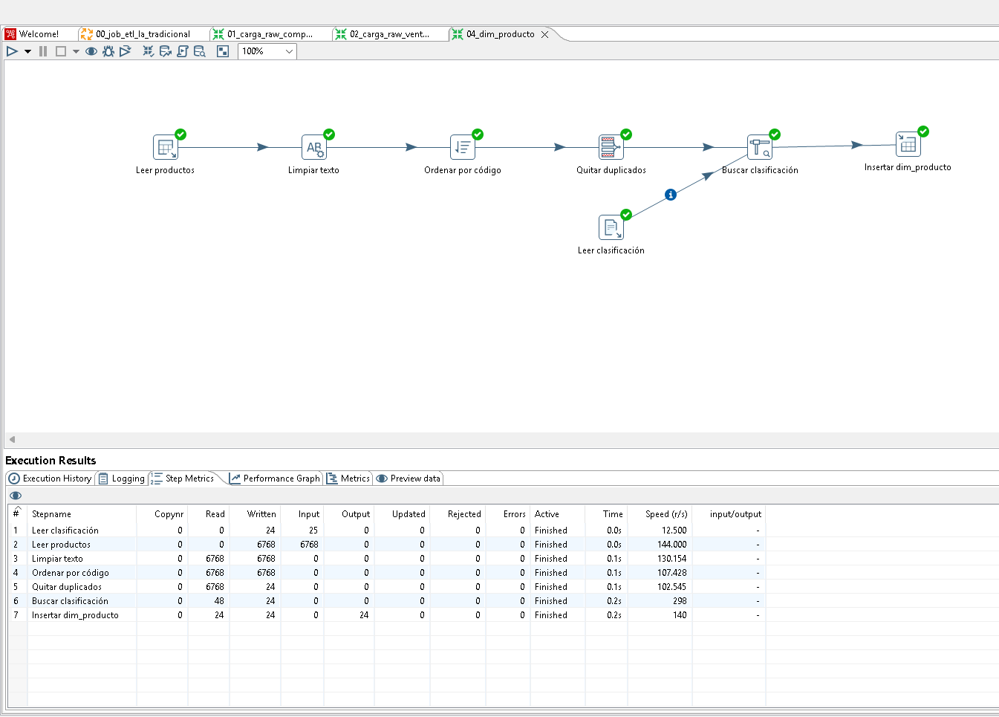
<!-- Captura sugerida: lienzo de 04_dim_producto.ktr mostrando el Stream lookup con el CSV de clasificación. -->

**Figura 6.** *Transformación de la dimensión producto.* El catálogo de clasificación entra como flujo de referencia del *Stream lookup* y aporta el nombre estándar y la línea de cada producto.

<a id="hechos"></a>
### 7.4 Tablas de hechos

**`fact_ventas` (transformación 07).** Cada línea de venta obtiene sus llaves mediante tres *Stream lookup* en serie: `producto_key` desde `dim_producto`, `cliente_key` desde `dim_cliente` y la fecha validada contra `dim_tiempo` (Figura 7).

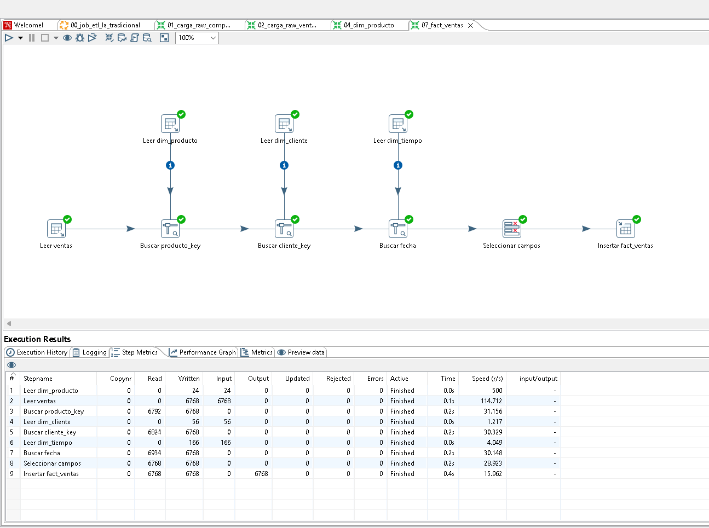
<!-- Captura sugerida: lienzo de 07_fact_ventas.ktr con los tres Stream lookup y Step Metrics en 6.768. -->

**Figura 7.** *Transformación de la tabla de hechos de ventas.* Cada *Stream lookup* recibe el flujo principal y un flujo de referencia que lee la dimensión.

**`fact_compras` (transformación 08).** Antes de buscar las llaves, los pasos *Sort rows* y *Unique rows* eliminan comprobantes repetidos por clave de acceso. Esto protege la carga si dos archivos del SRI se superponen en fechas.

<a id="job"></a>
### 7.5 Job de orquestación

El job `00_job_etl_la_tradicional.kjb` ejecuta todo el proceso con un solo clic (Figura 8). Su primer paso, *Limpiar tablas*, vacía las ocho tablas con `TRUNCATE ... RESTART IDENTITY`, lo que permite repetir la carga sin duplicar datos. Luego ejecuta las transformaciones en orden: staging, dimensiones y hechos. Los saltos condicionales garantizan que cada transformación se ejecute solo si la anterior terminó correctamente.

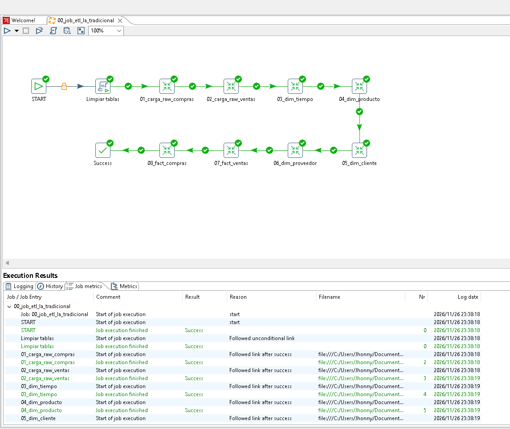
<!-- Captura sugerida: lienzo del job en Spoon con todas las entradas en verde y la pestaña Job metrics. -->

**Figura 8.** *Job del proceso ETL completo.* Las dimensiones se cargan antes que los hechos, porque los hechos buscan sus llaves en ellas.

<a id="validacion"></a>
### 7.6 Validación de la carga

El script [`queries sql/02_verificacion_contenido.sql`](queries%20sql/02_verificacion_contenido.sql) reúne 26 controles en una sola consulta. Cada control compara el valor obtenido con el esperado y devuelve *OK* o *REVISAR*. La Tabla 7 resume los más importantes.

**Tabla 7.** *Principales controles de validación*

| Control | Criterio de aceptación |
|---|---|
| Filas de `raw_compras` y `fact_compras` | 491 en ambas |
| Clave de acceso | 49 caracteres y ninguna repetida |
| Filas de `raw_ventas` y `fact_ventas` | 6.768 en ambas |
| Fechas de venta | Solo año 2026, igual que en el Excel |
| Identificaciones | Largos 8, 10 y 13: ningún cero inicial perdido |
| Dimensiones | 0 llaves duplicadas y 0 productos sin clasificar |
| Llaves de las tablas de hechos | 0 valores nulos |
| Total de ventas | $58.349,00 en staging y en `fact_ventas` |

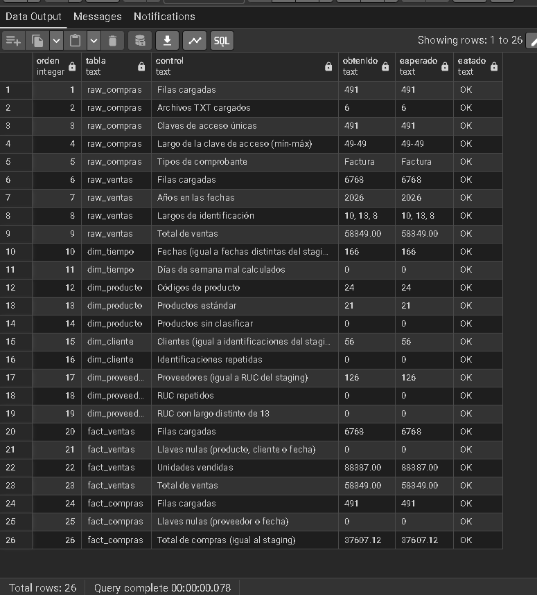
<!-- Captura sugerida: resultado en pgAdmin de 02_verificacion_contenido.sql con todas las filas en OK. -->

**Figura 9.** *Resultado de la validación de la carga.* Los 26 controles devuelven *OK*.

<a id="consultas"></a>
## 8. Resultados: consultas SQL

Las seis preguntas de negocio se responden con las consultas del script [`queries sql/03_preguntas_negocio.sql`](queries%20sql/03_preguntas_negocio.sql), que trabajan únicamente sobre las tablas `fact_` y `dim_`.

<details>
<summary><b>Ver las consultas SQL de las preguntas P1 a P6</b></summary>

**P1. Ventas por mes y línea**

```sql
SELECT t.anio, t.mes,
       SUM(f.total) FILTER (WHERE p.linea = 'Postres')           AS ventas_postres,
       SUM(f.total) FILTER (WHERE p.linea = 'Bocadillos de sal') AS ventas_bocadillos,
       SUM(f.total)                                              AS ventas_total,
       COUNT(DISTINCT f.num_documento)                           AS facturas
FROM fact_ventas f
JOIN dim_tiempo   t ON f.fecha        = t.fecha
JOIN dim_producto p ON f.producto_key = p.producto_key
GROUP BY t.anio, t.mes
ORDER BY t.anio, t.mes;
```

**P2. Productos más vendidos por ingreso y por unidades**

```sql
SELECT RANK() OVER (ORDER BY SUM(f.total)    DESC) AS puesto_ingreso,
       RANK() OVER (ORDER BY SUM(f.cantidad) DESC) AS puesto_unidades,
       p.nombre_estandar, p.linea,
       SUM(f.cantidad) AS unidades, SUM(f.total) AS ventas
FROM fact_ventas f
JOIN dim_producto p ON f.producto_key = p.producto_key
GROUP BY p.nombre_estandar, p.linea
ORDER BY ventas DESC
LIMIT 10;
```

**P3. Principales clientes sin consumidor final**

```sql
SELECT c.nombre, c.tipo_identificacion,
       COUNT(DISTINCT f.num_documento) AS facturas,
       SUM(f.total)                    AS ventas
FROM fact_ventas f
JOIN dim_cliente c ON f.cliente_key = c.cliente_key
WHERE c.tipo_identificacion <> 'CONSUMIDOR FINAL'
GROUP BY c.cliente_key, c.nombre, c.tipo_identificacion
ORDER BY ventas DESC
LIMIT 10;
```

**P4. Ventas frente a compras por mes**

```sql
WITH ventas AS (
  SELECT t.anio, t.mes, SUM(f.total) AS ventas
  FROM fact_ventas f JOIN dim_tiempo t ON f.fecha = t.fecha
  GROUP BY t.anio, t.mes
), compras AS (
  SELECT t.anio, t.mes, SUM(f.importe_total) AS compras
  FROM fact_compras f JOIN dim_tiempo t ON f.fecha = t.fecha
  GROUP BY t.anio, t.mes
)
SELECT COALESCE(v.anio, c.anio) AS anio, COALESCE(v.mes, c.mes) AS mes,
       COALESCE(v.ventas, 0) AS ventas, COALESCE(c.compras, 0) AS compras,
       COALESCE(v.ventas, 0) - COALESCE(c.compras, 0) AS diferencia
FROM ventas v FULL JOIN compras c ON v.anio = c.anio AND v.mes = c.mes
ORDER BY anio, mes;
```

**P5. Concentración del gasto por proveedor (Pareto)**

```sql
WITH gasto AS (
  SELECT p.razon_social, COUNT(*) AS facturas, SUM(f.importe_total) AS compras
  FROM fact_compras f JOIN dim_proveedor p ON f.proveedor_key = p.proveedor_key
  GROUP BY p.proveedor_key, p.razon_social
)
SELECT razon_social, facturas, compras,
       ROUND(100.0 * compras / SUM(compras) OVER (), 1) AS pct_gasto,
       ROUND(100.0 * SUM(compras) OVER (ORDER BY compras DESC ROWS UNBOUNDED PRECEDING)
             / SUM(compras) OVER (), 1) AS pct_acumulado
FROM gasto
ORDER BY compras DESC
LIMIT 10;
```

**P6. Formas de pago y saldo por cobrar**

```sql
SELECT COALESCE(f.forma_pago, 'TOTAL') AS forma_pago,
       COUNT(DISTINCT f.num_documento) AS facturas,
       SUM(f.total)                    AS ventas,
       SUM(f.saldo)                    AS saldo_por_cobrar
FROM fact_ventas f
GROUP BY ROLLUP (f.forma_pago)
ORDER BY GROUPING(f.forma_pago), ventas DESC;
```

</details>

**P1. Ventas por mes y línea.** Las ventas totales del periodo suman **$58.349,00**. La línea de postres concentra **$55.733,60 (95,5 %)** y los bocadillos de sal **$2.615,40 (4,5 %)**. El mes de mayor venta fue **junio ($12.236,65 en 269 facturas)**, seguido de marzo ($12.137,15); mayo fue el más bajo ($4.160,30 en 92 facturas). En todos los meses los postres superan el 94 % de las ventas (Figura 10).

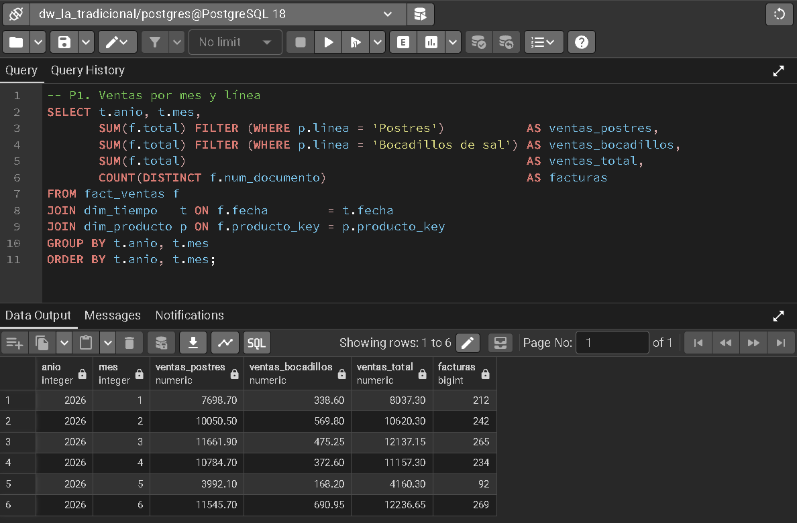
<!-- Captura sugerida: resultado en pgAdmin de la consulta P1. -->

**Figura 10.** *Resultado de la consulta P1: ventas por mes y línea de producto.*

**P2. Productos más vendidos.** La Tabla 8 presenta el top 10 por ingreso. Los cinco primeros productos concentran el **79,5 %** de las ventas.

**Tabla 8.** *Top 10 de productos por ingreso*

| Puesto | Producto | Línea | Unidades | Ventas | % ventas | % acumulado |
|---|---|---|---|---|---|---|
| 1 | Aplanchados | Postres | 43.447 | $25.984,65 | 44,5 % | 44,5 % |
| 2 | Mojicón | Postres | 10.182 | $6.093,60 | 10,4 % | 55,0 % |
| 3 | Poncake | Postres | 7.383 | $4.912,40 | 8,4 % | 63,4 % |
| 4 | Melvas | Postres | 6.849 | $4.790,75 | 8,2 % | 71,6 % |
| 5 | Orejas | Postres | 7.560 | $4.593,55 | 7,9 % | 79,5 % |
| 6 | Parada de mini mojicones | Postres | 25 | $2.995,75 | 5,1 % | 84,6 % |
| 7 | Chavelitas | Postres | 1.831 | $1.274,30 | 2,2 % | 86,8 % |
| 8 | Roscones | Postres | 1.642 | $1.150,70 | 2,0 % | 88,8 % |
| 9 | Cueros de cerdo | Bocadillos de sal | 1.541 | $1.070,45 | 1,8 % | 90,6 % |
| 10 | Mini mojicón | Postres | 1.344 | $942,50 | 1,6 % | 92,2 % |

El ranking cambia al ordenar por unidades: **Orejas** pasa del quinto al **tercer** lugar (7.560 unidades), por delante de Poncake y Melvas. Esto indica que las orejas se venden en mayor volumen, pero a un precio unitario menor.

**P3. Principales clientes.** De las 6.768 líneas de venta, **3.308 (48,9 %)** corresponden a consumidor final, 3.083 a clientes con cédula, 352 a clientes con RUC y 25 a un cliente extranjero. Sin embargo, en valor el consumidor final aporta solo el **22,9 %** de las ventas ($13.365,70), mientras que los clientes identificados suman **$44.983,30 (77,1 %)**: 58,6 % los clientes con cédula, 17,2 % los clientes con RUC y 1,3 % el cliente extranjero. Los **10 principales clientes** compran **$33.556,20**, es decir, el **74,6 %** de las ventas a clientes identificados y el 57,5 % de las ventas totales. El primer cliente aporta por sí solo **$8.669,90 (14,9 % del total)**, casi el doble que el segundo ($4.950,35) (Figura 12). Por confidencialidad, en este informe no se publican las identificaciones de los clientes.

**P4. Ventas frente a compras.** En el semestre, las compras a proveedores suman **$37.607,12**, el **64,5 %** de las ventas, por lo que las ventas superan a las compras en **$20.741,88**. La diferencia fue positiva en cinco de los seis meses. La mayor se dio en **marzo ($6.160,78)**, cuando las compras representaron solo el 49,2 % de las ventas, seguida de abril ($5.427,28) y febrero ($5.217,13). **Mayo es el único mes con diferencia negativa (−$2.107,83)**: las compras ($6.268,13) superaron en un 50,7 % a las ventas ($4.160,30). En junio las compras alcanzaron su valor más alto ($8.461,02, el 69,1 % de las ventas) (Figura 13). Las compras corresponden al importe total de los comprobantes recibidos, por lo que incluyen IVA y gastos que no son materia prima; la diferencia no equivale a la utilidad del negocio.

**P5. Concentración del gasto.** El gasto se concentra en pocos proveedores. El principal, **Moderna Alimentos S.A.**, recibe **$4.674,77 (12,4 %)**, y los **3 primeros** (Moderna Alimentos S.A., Lavictoriacorp Cía. Ltda. y La Fabril S.A.) concentran el **32,4 %** de las compras ($12.181,23). Los **10 primeros proveedores** suman **$26.704,60**, el **71,0 %** del gasto total; el 29 % restante se reparte entre muchos proveedores con montos pequeños, como muestra el treemap (Figura 13). Entre los principales proveedores figuran empresas industriales de insumos como harinas, aceites y grasas (Moderna Alimentos, La Fabril e Industrial Danec).

**P6. Formas de pago y saldo por cobrar.** Las ventas se reparten entre dos formas de pago: **transferencia u otros** (cerca de $31.000) y **efectivo, sin utilización del sistema financiero** (cerca de $27.000). El saldo por cobrar del periodo es de **$31.219,65**, el **53,5 %** de las ventas. Prácticamente todo el saldo pendiente corresponde a ventas por transferencia u otros, mientras que las ventas en efectivo no registran saldo. Esto sugiere que varias transferencias ya cobradas no se marcan como pagadas en el sistema contable, por lo que el saldo real por cobrar podría ser menor (Figura 12).

<a id="dashboard"></a>
## 9. Dashboard en Power BI

### Enlace de visualización del dashboard

El dashboard está publicado en Power BI y puede consultarse en línea, sin instalar Power BI Desktop, en el siguiente enlace:

<p align="center">
  <a href="https://app.powerbi.com/view?r=eyJrIjoiMjAzOWUxMWItYzA0MS00ZmQ0LWI2NWItM2I5MzFiMjY2M2IzIiwidCI6IjY4MmE0ZTZhLWE3N2YtNDk1OC1hM2FjLTllMjY2ZDE4YWEzNyIsImMiOjR9"><b>📊 Ver el dashboard de La Tradicional en Power BI</b></a>
</p>

El informe en línea es interactivo: permite navegar entre las cuatro páginas (*Ventas y productos*, *Clientes y cobros*, *Compras y proveedores* y *Análisis OLAP*), usar las segmentaciones de datos y aplicar las operaciones OLAP descritas en la sección 10.

El dashboard se construyó siguiendo la guía de laboratorio de Power BI [7] y se conectó directamente a PostgreSQL en modo *Importar* y carga solo las seis tablas del modelo dimensional. Las cinco relaciones se importaron desde las claves foráneas de la base. Para garantizar que el dashboard calcule igual que las consultas SQL, se crearon medidas DAX equivalentes (Tabla 9).

**Tabla 9.** *Correspondencia entre medidas DAX y consultas SQL*

| Medida DAX | Fórmula | Equivalente SQL |
|---|---|---|
| Ventas | `SUM(fact_ventas[total])` | `SUM(f.total)` |
| Facturas | `DISTINCTCOUNT(fact_ventas[num_documento])` | `COUNT(DISTINCT f.num_documento)` |
| Ticket promedio | `DIVIDE([Ventas], [Facturas])` | `ventas / facturas` |
| % Postres | `DIVIDE(CALCULATE([Ventas], dim_producto[linea] = "Postres"), [Ventas])` | `pct_postres` (P1) |
| Ventas clientes identificados | `CALCULATE([Ventas], dim_cliente[tipo_identificacion] <> "CONSUMIDOR FINAL")` | `WHERE tipo_identificacion <> 'CONSUMIDOR FINAL'` (P3) |
| Compras | `SUM(fact_compras[importe_total])` | `SUM(f.importe_total)` (P4, P5) |
| Saldo por cobrar | `SUM(fact_ventas[saldo])` | `SUM(f.saldo)` (P6) |

El diseño visual usa los colores de la marca: azul (`#1F4FBF`) para postres y ventas, y dorado (`#F2A516`) para bocadillos de sal y compras. Cada gráfico indica en su título la pregunta que responde. El dashboard tiene cuatro páginas: las tres primeras se muestran a continuación y la cuarta, *Análisis OLAP*, se describe en la sección 10.

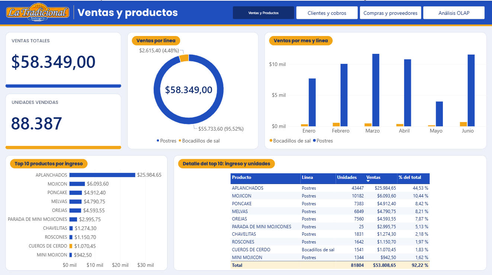
<!-- Captura sugerida: página "Ventas y productos" completa. -->

**Figura 11.** *Página "Ventas y productos" (P1 y P2).* Muestra las ventas totales, las unidades vendidas (88.387), la distribución por línea, las ventas por mes y el top 10 de productos.

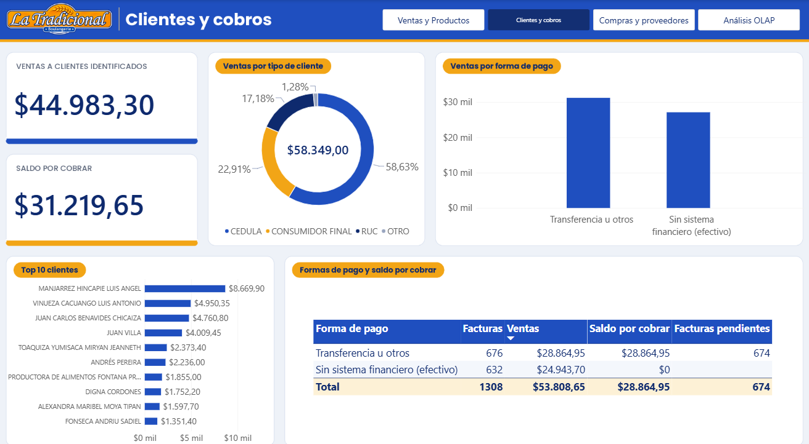
<!-- Captura sugerida: página "Clientes y cobros" completa. -->

**Figura 12.** *Página "Clientes y cobros" (P3 y P6).* Muestra las ventas por tipo de cliente, el top 10 de clientes identificados y el detalle por forma de pago con el saldo por cobrar.

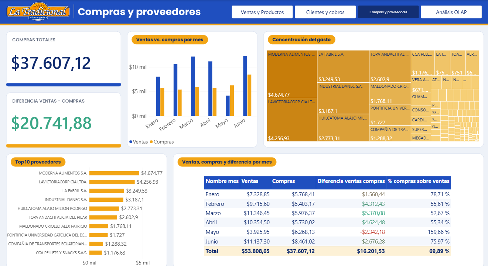
<!-- Captura sugerida: página "Compras y proveedores" completa. -->

**Figura 13.** *Página "Compras y proveedores" (P4 y P5).* Compara ventas y compras por mes y muestra la concentración del gasto por proveedor mediante un treemap y un top 10.

<a id="olap"></a>
## 10. Análisis OLAP

El análisis OLAP se realizó sobre un cubo de tres dimensiones con la medida *Ventas*, siguiendo el concepto de análisis multidimensional propuesto por Codd *et al.* [8]:

- **Eje X:** tiempo (`dim_tiempo`, jerarquía año → trimestre → mes → fecha).
- **Eje Y:** producto (`dim_producto[linea]`).
- **Eje Z:** cliente (`dim_cliente[tipo_identificacion]`).

En SQL, el cubo se calcula con `GROUP BY CUBE`, que genera todas las combinaciones de agregación, incluidos los subtotales y el total general:

```sql
SELECT COALESCE(t.mes::TEXT, 'TODOS')           AS eje_x_tiempo_mes,
       COALESCE(p.linea, 'TODAS')               AS eje_y_producto_linea,
       COALESCE(c.tipo_identificacion, 'TODOS') AS eje_z_cliente_tipo,
       SUM(f.total)                             AS ventas
FROM fact_ventas f
JOIN dim_tiempo   t ON f.fecha        = t.fecha
JOIN dim_producto p ON f.producto_key = p.producto_key
JOIN dim_cliente  c ON f.cliente_key  = c.cliente_key
GROUP BY CUBE (t.mes, p.linea, c.tipo_identificacion)
ORDER BY t.mes, p.linea, c.tipo_identificacion;
```

En Power BI, el cubo se representa con una matriz (filas: jerarquía de tiempo; columnas: línea de producto) y segmentaciones de datos para el tipo de cliente y el producto (Figura 14). La Tabla 10 describe cómo se aplicó cada operación OLAP.

**Tabla 10.** *Operaciones OLAP aplicadas en el dashboard*

| Operación | Aplicación en Power BI | Pregunta de ejemplo |
|---|---|---|
| Drill-down | Bajar de año a trimestre, mes y fecha en la matriz | ¿Qué día del mes concentra las ventas? |
| Roll-up | Subir de fecha a mes o trimestre | ¿Cómo se comporta el trimestre completo? |
| Slice | Fijar un tipo de cliente en la segmentación (eje Z) | ¿Cuánto compran solo los clientes con RUC? |
| Dice | Combinar un tipo de cliente con un grupo de productos | ¿Cuántos aplanchados compran los consumidores finales cada mes? |
| Pivot | Intercambiar filas y columnas de la matriz | Ver las líneas de producto como filas y los meses como columnas |

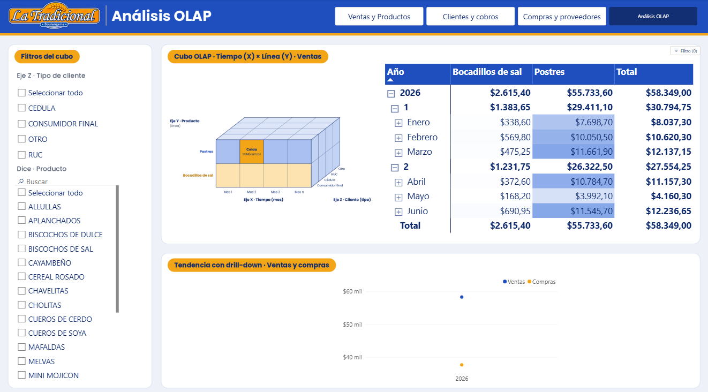
<!-- Captura sugerida: página "Análisis OLAP" con la matriz expandida a nivel de mes. -->

**Figura 14.** *Cubo OLAP en Power BI.* La fila y la columna *Total* corresponden a los subtotales del `GROUP BY CUBE`, y la celda inferior derecha al total general de $58.349,00.


<!-- Captura sugerida: la misma página con un tipo de cliente seleccionado en la segmentación (slice). -->

**Figura 15.** *Operación slice sobre el cubo.* Al seleccionar el tipo de cliente *CEDULA*, el cubo muestra solo esa rebanada del eje Z: $34.208,30 (58,6 % de las ventas). La línea de compras no cambia, porque las compras no se relacionan con los clientes: solo comparten la dimensión de tiempo.

<a id="insights"></a>
## 11. Insights y recomendaciones

**Tabla 11.** *Insights obtenidos y recomendaciones para el negocio*

| # | Insight | Recomendación |
|---|---|---|
| 1 | Los **aplanchados** generan el **44,5 %** de los ingresos y el **49,2 %** de las unidades vendidas. El negocio depende fuertemente de un solo producto. | Proteger la disponibilidad y la calidad de los aplanchados como prioridad de producción, y evaluar promociones cruzadas que impulsen otros productos junto con ellos. |
| 2 | Los **cinco productos principales** concentran el **79,5 %** de las ventas, mientras que 11 productos aportan menos del 2 % cada uno. | Revisar la rentabilidad de los productos de baja rotación y decidir si se mantienen, se promocionan o se retiran del catálogo. |
| 3 | La línea de **bocadillos de sal** representa solo el **4,5 %** de las ventas; su producto principal son los cueros de cerdo ($1.070,45). | Si la línea es estratégica, probar acciones de visibilidad o combos con postres; si no, priorizar recursos en postres. |
| 4 | La **parada de mini mojicones** vendió 25 unidades por **$2.995,75** (unos $120 por pedido): son pedidos para eventos de alto valor. | Formalizar una oferta de pedidos para eventos (bodas, empresas, celebraciones), con precios y anticipación definidos. |
| 5 | Las **orejas** suben al tercer lugar por unidades, aunque son quintas por ingreso. | Analizar si su precio cubre el costo de producción, dado su alto volumen. |
| 6 | Casi la **mitad de las líneas de venta (48,9 %)** son a consumidor final, por lo que el negocio no sabe quiénes son esos clientes. | Implementar un registro simple de clientes frecuentes o un programa de fidelización para conocer mejor a ese segmento. |
| 7 | Las compras equivalen al **64,5 %** de las ventas del semestre. En **mayo** las compras ($6.268,13) superaron a las ventas ($4.160,30), y en junio alcanzaron su máximo ($8.461,02). | Planificar las compras según la demanda esperada para no acumular inventario en los meses de menor venta, y registrar por separado las compras de insumos y los demás gastos para medir el margen real. |
| 8 | Los **3 principales proveedores** concentran el **32,4 %** del gasto y los **10 primeros**, el **71,0 %**; el principal es Moderna Alimentos S.A. (12,4 %). | Negociar precios, descuentos por volumen y plazos de pago con los proveedores principales, y contar con proveedores alternativos para los insumos clave (harinas y grasas) para reducir la dependencia. |
| 9 | Los **10 principales clientes** generan el **57,5 %** de las ventas y el primero aporta el 14,9 %. Aunque el consumidor final ocupa casi la mitad de las líneas de venta, representa solo el 22,9 % del valor vendido. | Cuidar la relación con los clientes principales (atención preferente, pedidos programados y condiciones de pago) y vigilar el riesgo de depender de pocos compradores. |
| 10 | El **saldo por cobrar ($31.219,65) equivale al 53,5 %** de las ventas y corresponde casi por completo a ventas por transferencia u otros. | Conciliar cada mes las transferencias recibidas con las facturas del sistema contable para conocer el saldo real por cobrar y dar seguimiento a los clientes con deudas pendientes. |
| 11 | Se encontraron productos registrados con dos códigos y una categoría sin significado en el sistema contable. | Depurar el catálogo de productos del sistema contable y agregar una categoría real (postre o bocadillo) para facilitar futuros análisis. |

<a id="conclusiones"></a>
## 12. Conclusiones

1. Se desarrolló una solución de Business Intelligence completa para La Tradicional – Boulangerie, que integra las ventas del sistema contable y las compras registradas en el SRI en un único data warehouse.
2. El modelo de constelación, con `dim_tiempo` como dimensión compartida, permitió analizar dos procesos de negocio y compararlos mes a mes, algo que un modelo estrella simple no habría permitido.
3. La etapa de transformación del ETL fue determinante para la calidad de los resultados: sin corregir las fechas, unificar los códigos de producto y crear la línea de producto, los rankings y los totales del dashboard habrían sido incorrectos.
4. La validación sistemática con 26 controles SQL y la definición de claves primarias y foráneas aseguraron que los datos del data warehouse coincidan con las fuentes originales, con un total de ventas de $58.349,00 en ambas.
5. El dashboard en Power BI y el análisis OLAP mostraron que el negocio depende principalmente de los aplanchados y de cinco productos que concentran casi el 80 % de las ventas, información útil para decisiones de producción, catálogo y fidelización.
6. La comparación de ventas y compras a través de la dimensión de tiempo compartida mostró que las compras equivalen al 64,5 % de las ventas y que mayo fue el único mes en que las compras superaron a las ventas. Además, el gasto se concentra en pocos proveedores: los diez primeros reciben el 71,0 % de las compras, lo que da margen para negociar mejores condiciones, pero también expone al negocio a depender de ellos.
7. El saldo por cobrar equivale a más de la mitad de las ventas y se concentra en las ventas por transferencia, lo que muestra la necesidad de conciliar los cobros en el sistema contable para conocer la situación real de la cartera.

<a id="repositorio"></a>
## 13. Estructura del repositorio

```
├── README.md                              ← este informe
├── SQL/
│   ├── 01_creacion_tablas.sql             ← staging, dimensiones, hechos, PK y FK
│   ├── 02_verificacion_contenido.sql      ← 26 controles de validación
│   └── 03_preguntas_negocio.sql           ← consultas de las 6 preguntas
├── Pentaho/
│   ├── 00_job_etl_la_tradicional.kjb
│   └── 01_carga_raw_compras.ktr … 08_fact_compras.ktr
├── Entradas/
│   └── catalogo/clasificacion_productos.csv ← catálogo de líneas de producto
├── PowerBI/
│   ├── Dashboard_La_Tradicional.pbix
│   ├── tema/tema_la_tradicional_plantilla.json
│   └── fondos/fondo_1 … fondo_4 (.png)
└── Capturas/                              ← figuras de este informe
```

Los datos originales no se incluyen por contener información personal de los clientes.

<a id="referencias"></a>
## 14. Referencias bibliográficas

[1] W. H. Inmon, *Building the Data Warehouse*, 4th ed. Indianapolis, IN, USA: Wiley, 2005.

[2] Hitachi Vantara, "Pentaho Data Integration documentation." [En línea]. Disponible: https://docs.hitachivantara.com/ (consultado: 27 de noviembre de 2026).

[3] The PostgreSQL Global Development Group, "PostgreSQL documentation." [En línea]. Disponible: https://www.postgresql.org/docs/ (consultado: 27 de noviembre de 2026).

[4] Microsoft, "Documentación de Power BI," Microsoft Learn. [En línea]. Disponible: https://learn.microsoft.com/es-es/power-bi/ (consultado: 27 de noviembre de 2026).

[5] R. Kimball y M. Ross, *The Data Warehouse Toolkit: The Definitive Guide to Dimensional Modeling*, 3rd ed. Indianapolis, IN, USA: Wiley, 2013.

[6] Escuela Politécnica Nacional, "Práctica 5: Creación de un data warehouse," guía de laboratorio, Facultad de Ingeniería de Sistemas, Quito, Ecuador, 2025.

[7] D. Martínez Mosquera, "Mi primer dashboard con Power BI," guía de laboratorio, Escuela Politécnica Nacional, Quito, Ecuador, 2025.

[8] E. F. Codd, S. B. Codd y C. T. Salley, "Providing OLAP (On-Line Analytical Processing) to user-analysts: An IT mandate," E. F. Codd & Associates, 1993.

<a id="ia"></a>
## 15. Declaración de uso de inteligencia artificial

En el desarrollo de este proyecto se utilizó **Claude (Anthropic)** como herramienta de apoyo.

**Porcentaje estimado de uso de IA:** 

En el desarrollo de este caso de estudio se utilizó una herramienta de inteligencia artificial generativa como apoyo en aproximadamente un **20% del trabajo**, principalmente para la revisión de los scripts SQL y la redacción y estructuración del informe. El **80% restante** fue realizado directamente por los integrantes del grupo, incluyendo el diseño del modelo a mano, la creación de la base de datos en PostgreSQL, la implementación y ejecución de las transformaciones y del job ETL, la construcción del modelo y del dashboard en Power BI, la validación de resultados y la recopilación de evidencias. Todo el contenido proporcionado por la IA fue revisado, adaptado y validado por los integrantes del equipo.