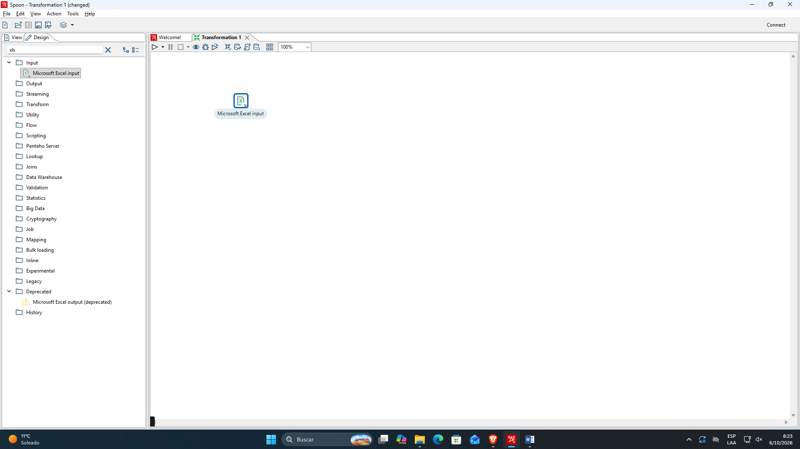
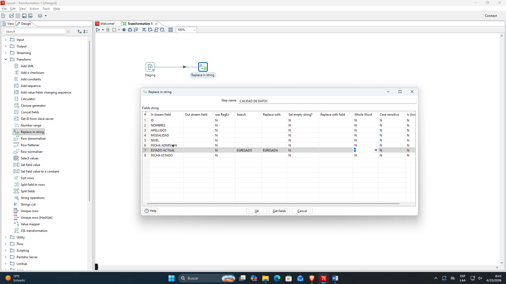
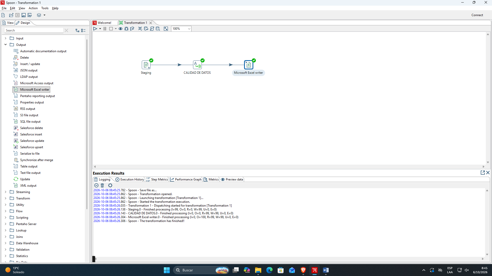
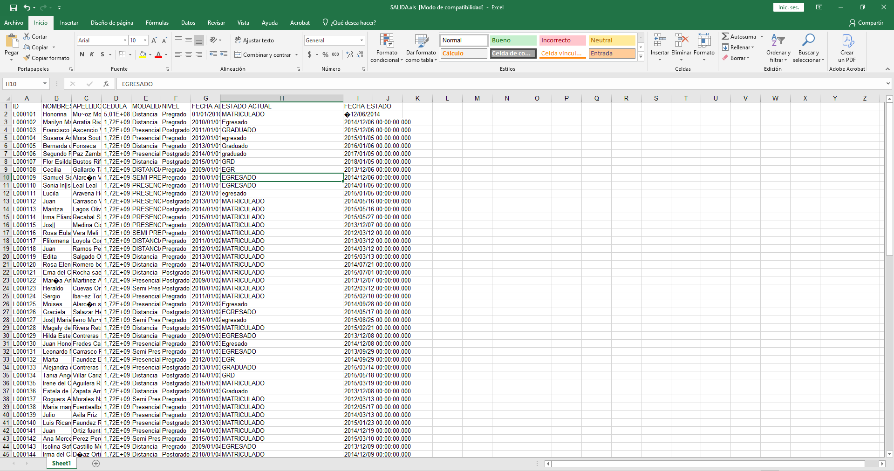

  &nbsp;&nbsp;&nbsp;&nbsp;&nbsp;&nbsp;

<h3>Escuela Politécnica Nacional</h3>
<h4>Facultad de Ingeniería de Sistemas</h4>
<h5>Business Intelligence GR2SW</h5>

**Integrantes**

- Erick Caicedo
- Nahomy Llumiquinga
- Jhonny Moreira
- Fernanda Rueda

**Docente:** PhD. Diana Martínez

**Fecha de entrega:** 13 de octubre de 2026

<h3 align="center">
Práctica 1: Implementación de un proceso ETL y Staging Area con Pentaho Data Integration
</h3>

## Índice
- [Índice](#índice)
- [1. Objetivo del proceso](#1-objetivo-del-proceso)
- [2. Fuentes de datos utilizadas](#2-fuentes-de-datos-utilizadas)
- [3. Problemas encontrados en los datos](#3-problemas-encontrados-en-los-datos)
  - [3.1. Valores de categorías escritos de distintas formas](#31-valores-de-categorías-escritos-de-distintas-formas)
- [4. Transformaciones aplicadas](#4-transformaciones-aplicadas)
  - [4.1. Estandarización mediante `Replace in string`](#41-estandarización-mediante-replace-in-string)
- [5. Flujo ETL desarrollado](#5-flujo-etl-desarrollado)
  - [5.1. Extract – Extracción](#51-extract--extracción)
  - [5.2. Staging Area](#52-staging-area)
  - [5.3. Transform – Transformación](#53-transform--transformación)
  - [5.4. Load – Carga](#54-load--carga)
- [6. Evidencia del resultado](#6-evidencia-del-resultado)
- [7. Relación con una arquitectura de Data Warehouse](#7-relación-con-una-arquitectura-de-data-warehouse)
- [8. Conclusiones](#8-conclusiones)
- [9. Referencias bibliográficas](#9-referencias-bibliográficas)
- [10. Declaración de porcentaje de uso de IA](#10-declaración-de-porcentaje-de-uso-de-ia)

---

## 1. Objetivo del proceso

Implementar un proceso **ETL** (Extract, Transform, Load) mediante Pentaho Data Integration (PDI), utilizando Spoon como herramienta gráfica para diseñar y ejecutar el flujo de integración de datos.

---

## 2. Fuentes de datos utilizadas

Se utilizó el componente **Microsoft Excel Input** para incorporar al proceso ETL un archivo que contiene los datos originales.

Durante su configuración se realizaron las siguientes acciones:

1. Se agregó el componente **Microsoft Excel Input** al área de trabajo.
2. Se seleccionó el archivo de entrada.
3. Se configuró la hoja del libro que debía ser procesada.
4. Se revisó el contenido del archivo desde Pentaho.
5. Se identificaron automáticamente los campos y tipos de datos disponibles.

Los campos observados durante la práctica incluyen información como:

- nombres;
- apellidos;
- cédula;
- modalidad;
- fecha de ingreso;
- fecha de egreso;
- fecha de estado.

**Figura 1.** Configuración de la fuente de datos mediante Microsoft Excel Input.

---

## 3. Problemas encontrados en los datos

La revisión de los datos permitió identificar la necesidad de aplicar operaciones de limpieza y estandarización antes de utilizar la información como entrada.

Entre los problemas considerados se encuentran:

### 3.1. Valores de categorías escritos de distintas formas

Diferentes representaciones de un mismo valor deben convertirse a una única forma:

| Valor original | Valor estandarizado |
|---|---|
| Egresado | EGRESADO |
| egresado | EGRESADO |
| EGR | EGRESADO |
| Graduado | GRADUADO |
| graduado | GRADUADO |
| GRD | GRADUADO |

Es necesario estandarizar para evitar que un mismo concepto sea interpretado como categorías diferentes debido a variaciones de escritura.

---

## 4. Transformaciones aplicadas

### 4.1. Estandarización mediante `Replace in string`

Dentro del flujo se utilizó el paso **Replace in string** para sustituir distintas representaciones textuales por valores estandarizados. De esta manera, términos equivalentes quedan almacenados bajo una misma categoría.

Por ejemplo, valores como `Egresado`, `egresado` y `EGR` pueden convertirse en `EGRESADO`, `EGRESADA`.

**Figura 2.** Transformación para homogeneizar valores textuales.

---

## 5. Flujo ETL desarrollado

El proceso implementado sigue la estructura general:

**Fuente de datos → Staging Area → Transformación → Destino**

### 5.1. Extract – Extracción

La etapa de extracción comienza con la incorporación de las fuentes de datos al flujo de Pentaho. Para el archivo Excel se utilizó **Microsoft Excel Input**, donde se seleccionó el archivo, la hoja correspondiente y los campos que debían ingresar al proceso.

### 5.2. Staging Area

Los datos extraídos son recibidos en una etapa intermedia de preparación. Esta **Staging Area** permite trabajar con la información antes de generar el resultado final, evitando utilizar directamente los datos originales sin haberlos revisado y transformado.

### 5.3. Transform – Transformación

Una vez extraídos los datos, se aplicaron operaciones de limpieza y estandarización.Por ejemplo la homogeneización de valores textuales.

### 5.4. Load – Carga

Para la salida del proceso se configuró **Microsoft Excel Writer**, encargado de almacenar los datos procesados en un nuevo archivo Excel.

El flujo construido en Spoon conecta los componentes de entrada, transformación y salida, permitiendo ejecutar el proceso ETL de forma secuencial.

**Figura 3.** Flujo ETL desarrollado y ejecutado en Pentaho Data Integration.

---

## 6. Evidencia del resultado

Durante la ejecución se verificó el funcionamiento del proceso desde la ventana de resultados de Pentaho. Posteriormente, se abrió el archivo generado para comprobar visualmente la información procesada.

Las evidencias obtenidas muestran:

1. la creación de la transformación en Spoon;
2. la selección y configuración del archivo de entrada;
3. la identificación de la hoja del archivo Excel;
4. la obtención y revisión de los campos;
5. la previsualización de los registros;
6. la incorporación de pasos de transformación;
7. la configuración del archivo de salida;
8. la conexión de los componentes del flujo;
9. la ejecución del proceso;
10. la verificación del archivo final en Microsoft Excel.

**Figura 4.** Verificación de los datos procesados en el archivo de salida.

Al abrir el archivo final se puede comprobar que Pentaho generó correctamente la salida y se aplicaron las reglas.

---

## 7. Relación con una arquitectura de Data Warehouse

El proceso desarrollado representa de forma simplificada una arquitectura utilizada en soluciones de **Business Intelligence**.

La relación puede describirse de la siguiente manera:

| Elemento de la práctica | Elemento en una arquitectura de Data Warehouse |
|---|---|
| Archivos de entrada | Fuentes de datos |
| Microsoft Excel Input / otros componentes de entrada | Extracción |
| Staging Area | Área temporal de integración y preparación |
| Transformaciones de limpieza | Transformación y calidad de datos |
| Microsoft Excel Writer | Destino de los datos procesados |
| Archivo final | Representación didáctica de una carga hacia un repositorio analítico |

En un entorno empresarial, el archivo Excel utilizado como salida podría ser reemplazado por una **base de datos**, un **Data Warehouse** o un **Data Mart**. La Staging Area actuaría como una zona intermedia en la que los datos provenientes de diferentes sistemas son consolidados, limpiados y estandarizados antes de incorporarse al repositorio analítico.

Por tanto, la práctica permite comprender el principio fundamental de una arquitectura de integración: los datos no deberían cargarse directamente desde sus fuentes hacia el repositorio final sin pasar previamente por procesos que garanticen su consistencia y calidad.

---

## 8. Conclusiones

La práctica permitió aplicar de manera introductoria las etapas de un proceso ETL utilizando Pentaho Data Integration. Mediante Spoon se configuraron componentes de entrada, transformación y salida, observando cómo los datos pueden recorrer un flujo definido hasta generar un nuevo conjunto de información procesada.

La utilización de una Staging Area permitió comprender la importancia de disponer de una etapa intermedia para preparar la información. Asimismo, las transformaciones de limpieza y estandarización muestran que la calidad de los datos es un aspecto fundamental antes de utilizarlos en procesos de análisis.

Finalmente, la generación y revisión del archivo de salida permitió validar el funcionamiento general del flujo y relacionar el ejercicio con una arquitectura de Data Warehouse, donde las fuentes operacionales pasan por procesos ETL antes de ser almacenadas en repositorios destinados al análisis y la toma de decisiones.

---

## 9. Referencias bibliográficas

- Hitachi Vantara. (s. f.). *Pentaho Data Integration Documentation*. Pentaho.
- Escuela Politécnica Nacional, Facultad de Ingeniería de Sistemas. (2026). *Práctica 1. Implementación de un proceso ETL y Staging Area con Pentaho Data Integration* [Guía de práctica de Business Intelligence].

## 10. Declaración de porcentaje de uso de IA
