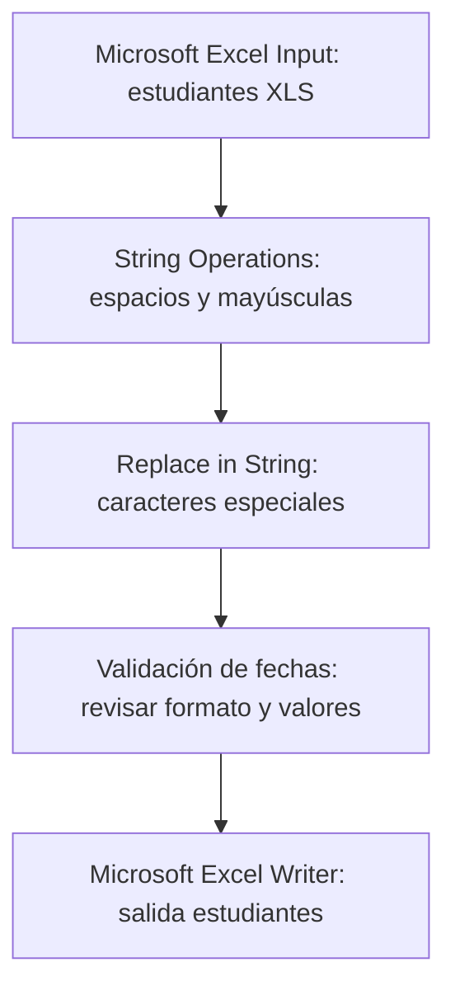
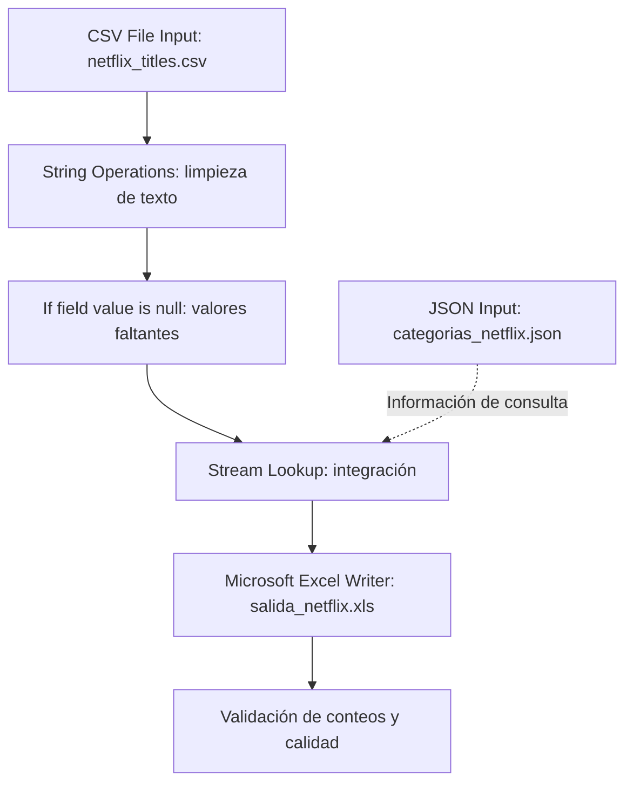
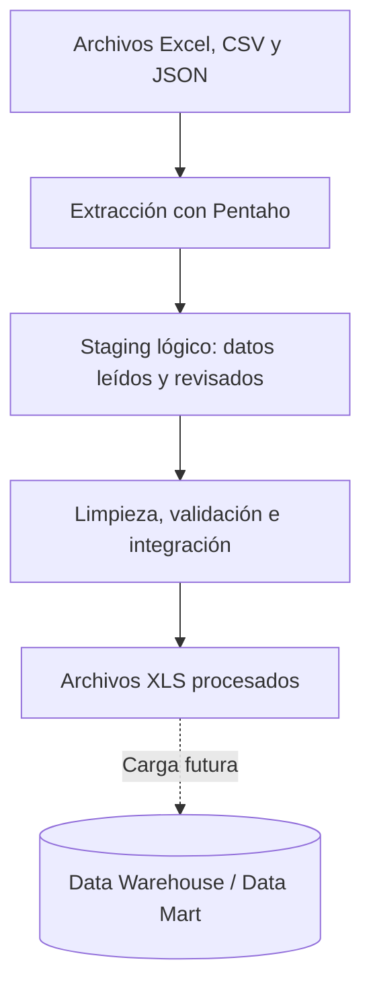

  &nbsp;&nbsp;&nbsp;&nbsp;&nbsp;&nbsp;

<h3>Escuela Politécnica Nacional</h3>
<h4>Facultad de Ingeniería de Sistemas</h4>
<h5>Business Intelligence GR2SW</h5>

**Integrantes**

- Erick Caicedo
- Nahomy Llumiquinga
- Jhonny Moreira
- Fernanda Rueda

**Docente:** PhD. Diana Martínez

**Fecha de entrega:** 13 de octubre de 2026

<h3 align="center">
Práctica 1: Implementación de un proceso ETL y Staging Area con Pentaho Data Integration
</h3>

## Índice
- [Índice](#índice)
- [1. Introducción](#1-introducción)
- [2. Objetivos](#2-objetivos)
  - [2.1. Objetivo general](#21-objetivo-general)
  - [2.2. Objetivos específicos](#22-objetivos-específicos)
- [3. Herramientas y fuentes](#3-herramientas-y-fuentes)
- [4. Desarrollo](#4-desarrollo)
  - [4.1 Parte 1: Transformaciones al dataset provisto](#41-parte-1-transformaciones-al-dataset-provisto)
    - [4.1.1. Fuente y problemas identificados](#411-fuente-y-problemas-identificados)
    - [4.1.2. Flujo ETL de la parte 1](#412-flujo-etl-de-la-parte-1)
    - [4.1.3. Transformación 1: nombres y apellidos](#413-transformación-1-nombres-y-apellidos)
    - [4.1.4 Transformación 2: validación de fechas](#414-transformación-2-validación-de-fechas)
    - [4.1.5. Salida y validación de la parte 1](#415-salida-y-validación-de-la-parte-1)
  - [4.2. Parte 2: Diseño y ejecución de un proceso ETL](#42-parte-2-diseño-y-ejecución-de-un-proceso-etl)
    - [4.2.1 Fuentes de datos utilizadas](#421-fuentes-de-datos-utilizadas)
    - [4.2.2. Problemas encontrados en los datos](#422-problemas-encontrados-en-los-datos)
    - [4.2.3. Flujo ETL desarrollado](#423-flujo-etl-desarrollado)
    - [4.2.4. Extracción](#424-extracción)
    - [4.2.5. Primera transformación: String Operations](#425-primera-transformación-string-operations)
    - [4.2.6. Segunda transformación: If field value is null](#426-segunda-transformación-if-field-value-is-null)
    - [4.2.7. Integración de las fuentes con Stream Lookup](#427-integración-de-las-fuentes-con-stream-lookup)
    - [4.2.8. Carga de datos procesados](#428-carga-de-datos-procesados)
    - [4.2.9. Resultado esperado y verificación](#429-resultado-esperado-y-verificación)
- [5. Validación y evidencias](#5-validación-y-evidencias)
  - [5.1. Tabla de evidencias por actividad](#51-tabla-de-evidencias-por-actividad)
  - [5.2. Criterios de calidad](#52-criterios-de-calidad)
- [6. Relación con la arquitectura de un Data Warehouse](#6-relación-con-la-arquitectura-de-un-data-warehouse)
- [7. Conclusiones](#7-conclusiones)
- [8. Referencias bibliográficas](#8-referencias-bibliográficas)
- [9. Declaración de uso de la IA](#9-declaración-de-uso-de-la-ia)

## 1. Introducción

La integración de datos mediante **ETL (Extract, Transform, Load)** permite extraer información de fuentes de datos, detectar inconsistencias y aplicar reglas de limpieza y normalización para cargarlos en un almacén de datos. 

La presente práctica se desarrolla en **Pentaho Data Integration (Spoon)** y se divide en dos partes: En la primera se realiza la corrección de nombres y apellidos y validación de fechas en un archivo de estudiantes y en la segunda se desarrolla la integración de dos tipos de fuente, CSV y JSON, mediante transformaciones de limpieza y una salida procesada.

En la práctica se implementó la versión simplificada del proceso de integración de datos: **Fuente de datos → Staging Area → Transformación → Destino**.

## 2. Objetivos

### 2.1. Objetivo general

Implementar el proceso **ETL** (Extract, Transform, Load) mediante Pentaho Data Integration (PDI), utilizando Spoon como herramienta gráfica para diseñar y ejecutar el flujo de integración de datos.

### 2.2. Objetivos específicos

- Identificar problemas de codificación de caracteres y formatos de fecha en registros de estudiantes.
- Aplicar mecanismos de corrección de texto y validación de fechas, conservando los datos originales para su comparación.
- Extraer un dataset de Netflix en formato CSV y un catálogo de clasificación de audiencia en formato JSON.
- Estandarizar textos, tratar valores nulos e integrar las dos fuentes mediante una clave de búsqueda.
- Generar archivos de salida y verificar cantidades, correspondencias y registros que requieran revisión. 
  
## 3. Herramientas y fuentes

**Herramientas:** Pentaho Data Integration (Spoon).

**Archivos de trabajo:**

| Archivo | Formato | Función |
|---|---|---|
| `Caso Estudiantes Fechas Cedula.xls` | XLS | [Dataset provisto para la parte 1](input/parte%201/Caso%20Estudiantes%20Fechas%20Cedula.xls) |
| `netflix_titles.csv` | CSV | [Fuente principal de la parte 2: títulos de Netflix](input/parte%202/netflix_titles.csv) |
| `categorias_netflix.json` | JSON | [Catálogo complementario para clasificaciones de audiencia](input/parte%202/categorias_netflix.json) |
| `resultado_estandarizado.xls` | XLS | [Salida de la parte 1](output/parte%201/resultado_estandarizado.xls) |
| `salida_netflix.xls` | XLS | [Salida de la parte 2](output/parte%202/salida_netflix.xls) |

## 4. Desarrollo
### 4.1 Parte 1: Transformaciones al dataset provisto

#### 4.1.1. Fuente y problemas identificados

**Fuente:** `Caso Estudiantes Fechas Cedula.xls`, archivo proporcionado para la práctica.

Los problemas observados son los siguientes:

| Campo | Problema | Ejemplo o condición | Riesgo |
|---|---|---|---|
| Nombres y apellidos | Sustitución de caracteres | `~` aparece donde debería ir `ñ` | Nombres inconsistentes (Figura 1) |
| Nombres y apellidos | Representación ambigua de tildes | `\|\|` en lugar de una vocal acentuada | Reemplazos incorrectos si se corrige de manera indiscriminada (Figura 1)|
| `FECHA ESTADO` | Representaciones distintas | `12/06/2014`, `12/06/14`, `05/27/15` | Fechas interpretadas en meses o días equivocados (Figura 2)|
| `FECHA ESTADO` | Celdas con fórmulas | `=+G12+1100`, `=+G38+800` | Una operación numérica podría confundirse con una fecha (Figura 3)|

<!--  -->

**Figura 1.** Inconsistencias en nombres y apellidos.

<!--  -->

**Figura 2.** Ejemplos de fechas con presentaciones diferentes en el Excel original.

<!--  -->

**Figura 3.** Ejemplo de una celda con fórmula en la columna de fechas.

#### 4.1.2. Flujo ETL de la parte 1

> **[POR CONFIRMAR CON EL COMPAÑERO]** Este diagrama representa el **flujo metodológico previsto**. Sustituirlo o ajustarlo según los pasos, nombres y conexiones reales del archivo `.ktr` que desarrolló el compañero. La guía exige dos transformaciones: corrección de nombres/apellidos y validación de fechas; no exige un componente específico para lograrlas.

#### 4.1.3. Transformación 1: nombres y apellidos

**Propósito:** uniformar el texto de los nombres sin perder los valores originales.

**Reglas consideradas:**

1. Eliminar espacios al principio y al final mediante `String Operations`.
2. Normalizar las mayúsculas/minúsculas según el formato definido para el conjunto de datos.
3. Corregir `~` por `Ñ` o `ñ` cuando el contexto y el uso de mayúsculas lo permitan.
4. **No reemplazar automáticamente `\|\|` por una sola vocal**, porque no permite identificar cuál tilde corresponde. Registrar esos casos para revisión o usar un diccionario de equivalencias comprobadas.

| Valor original (ilustrativo) | Resultado esperado | Regla |
|---|---|---|
| `  PE~A  ` | `PEÑA` | Recortar espacios y corregir ñ |
| `MU~OZ` | `MUÑOZ` | Corregir ñ |
| `MAR\|\|A` | `REVISAR` | Tilde ambigua; requiere revisión |

**Evidencia pendiente:** [POR COMPLETAR: captura del componente configurado, vista previa antes/después y conteo de registros corregidos].

#### 4.1.4 Transformación 2: validación de fechas

**Propósito:** identificar fechas interpretables e identificar los casos que no pueden convertirse con certeza.

El campo `FECHA ESTADO` puede contener texto, fechas con año de dos o cuatro cifras, valores ambiguos y resultados de fórmulas. La validación debe distinguir entre **fecha imposible**, **fecha no reconocida** y **fecha con interpretación ambigua**. Se debe establecer y documentar una convención de origen antes de normalizar fechas como `01/05/15`, que podría representar dos fechas distintas según el orden día/mes.

**Propuesta de campos de salida:** `FECHA_ESTADO_ORIGINAL`, `FECHA_NORMALIZADA` (formato `yyyy-MM-dd`) y `ESTADO_VALIDACION`.

| Valor fuente | Evaluación | Acción recomendada |
|---|---|---|
| `05/27/15` | Compatible con mes/día/año | `2015-05-27` si se confirma esa convención |
| `01/05/15` | Ambiguo entre día/mes y mes/día | Marcar para revisión si no se conoce el formato |
| `02/30/15` | Fecha imposible | Marcar inválida |
| `=+G12+1100` | Fórmula de Excel | Comprobar el resultado y el tipo leído por PDI |

**Evidencia pendiente:** [POR COMPLETAR: componente real usado por el compañero, reglas implementadas, ejemplos verificados y cantidad de fechas válidas/erróneas].

#### 4.1.5. Salida y validación de la parte 1

- **Salida:** [POR COMPLETAR: nombre exacto, formato, hoja y ubicación del archivo generado].
- **Registros de entrada:** [POR COMPLETAR].
- **Registros de salida:** [POR COMPLETAR].
- **Nombres/apellidos corregidos:** [POR COMPLETAR].
- **Fechas válidas, inválidas, ambiguas o sujetas a revisión:** [POR COMPLETAR].
- **Evidencias:** [POR COMPLETAR: captura de ejecución en Spoon y archivo de salida abierto].

**Criterio de aceptación:** comparar cada dato original con el dato transformado, verificar las correcciones justificables y conservar señalados los casos ambiguos, sin inventar tildes ni fechas.

### 4.2. Parte 2: Diseño y ejecución de un proceso ETL

#### 4.2.1 Fuentes de datos utilizadas

- **Fuente 1 (CSV):** `netflix_titles.csv`, dataset *Netflix Movies and TV Shows*. Contiene **8.807 registros** y **12 columnas**: `show_id`, `type`, `title`, `director`, `cast`, `country`, `date_added`, `release_year`, `rating`, `duration`, `listed_in` y `description`.

- **Fuente 2 — JSON:** `categorias_netflix.json`, catálogo complementario para la clasificación de audiencia. Contiene **14 objetos** con: `codigo_rating`, `categoria_audiencia`, `descripcion` y `registros_csv`.

#### 4.2.2. Problemas encontrados en los datos

La revisión de los archivos mostró la siguiente distribución del campo `rating`:

| Situación | Cantidad | Observación |
|---|---:|---|
| Ratings presentes en el catálogo JSON | 8.800 | Registros con correspondencia esperada |
| Ratings vacíos | 4 | No tienen clasificación de audiencia |
| Ratings con valores de duración | 3 | `74 min`, `84 min` y `66 min` |
| **Total CSV** | **8.807** | **Suma de los tres grupos** |

Se comprobó también que el catálogo incluye 14 claves de clasificación donde los 7 registros que no coinciden se marcaron para revisión, no se eliminaron.

#### 4.2.3. Flujo ETL desarrollado

La línea punteada representa el **information hop** desde `JSON Categorias` hacia `Stream Lookup`, que entrega datos complementarios para la búsqueda sin unir simplemente los dos flujos de registros (Figura).

**Figura 4.** Conexión de información (*information hop*) usada por `Stream Lookup`.

#### 4.2.4. Extracción

1. En `CSV File Input` se lee `netflix_titles.csv` con separador coma, comillas como delimitador de texto, cabecera y codificación UTF-8 (Figura).

**Figura 5.** Extracción de datos de `netflix_titles.csv`.

1. En `JSON Input` se lee `categorias_netflix.json` y se extraen las propiedades `codigo_rating`, `categoria_audiencia`, `descripcion` y `registros_csv` (Figura).

**Figura 6.** Extracción de datos de `categorias_netflix.json`.

#### 4.2.5. Primera transformación: String Operations

**Objetivo:** eliminar espacios sobrantes al inicio y al final de varios campos sin reemplazar los datos originales.

| Campo de entrada | Campo nuevo | Operación |
|---|---|---|
| `title` | `titulo_limpio` | `Trim = both` |
| `director` | `director_limpio` | `Trim = both` |
| `country` | `pais_limpio` | `Trim = both` |
| `rating` | `rating_limpio` | `Trim = both` |

Se conserva mayúsculas y minúsculas (`Lower/Upper = none`). Esta operación corresponde a **estandarización textual**.

**Figura 7.** Configuración de la transformación String Operations para la limpieza y estandarización de campos de texto del dataset de Netflix.

#### 4.2.6. Segunda transformación: If field value is null

**Objetivo:** gestionar valores faltantes en los campos procesados.

| Campo | Valor sustituto |
|---|---|
| `director_limpio` | `No especificado` |
| `pais_limpio` | `No especificado` |
| `rating_limpio` | `SIN_CLASIFICACION` |

Se utiliza `Select fields` para limitar el reemplazo a esos campos. Las cadenas vacías que PDI no interprete como nulas pueden requerir una regla adicional.

**Figura 8.** Configuración de la transformación If field value is null para el tratamiento de valores nulos en los datos de Netflix.

#### 4.2.7. Integración de las fuentes con Stream Lookup

La configuración observada en Spoon utiliza:

| Elemento | Configuración |
|---|---|
| Lookup step | `JSON Categorias` |
| Clave del flujo principal | `rating_limpio` |
| Clave del catálogo | `codigo_rating` |
| Valor recuperado 1 | `categoria_audiencia` → `categoria_audiencia_final` |
| Valor por defecto 1 | `REVISAR` |
| Valor recuperado 2 | `descripcion` → `descripcion_rating` |
| Valor por defecto 2 | `Sin equivalencia` |
| Tipo de ambos resultados | `String` |

**Figura 9.** Claves y campos de recuperación configurados en `Stream Lookup`.

Como la clave `rating_limpio` es de tipo **String**, no corresponde activar la optimización *Key and value are exactly one integer field*.

#### 4.2.8. Carga de datos procesados

**Componente previsto:** `Microsoft Excel Writer`.  
**Formato solicitado:** `.xls`.  
**Nombre del archivo:** `salida_netflix.xls`.  

Los campos de interés en la salida son `show_id`, `title`, `titulo_limpio`, `director_limpio`, `pais_limpio`, `rating_limpio`, `categoria_audiencia_final` y `descripcion_rating`.

**Figura 10.** Configuración de la salida.

#### 4.2.9. Resultado esperado y verificación

El proceso ETL permitió integrar las fuentes CSV y JSON de Netflix, aplicando transformaciones de limpieza y estandarización mediante Pentaho Data Integration.

Se generó el archivo `salida_netflix.xls`, que contiene los datos originales y los nuevos campos procesados.

**Resultados:**

- **8.807 registros** conservados del CSV original.
- Limpieza de espacios mediante `String Operations`.
- Sustitución de valores nulos mediante `If field value is null`.
- Incorporación de categorías de audiencia mediante `Stream Lookup`.
- Identificación de 7 registros con clasificaciones faltantes o inconsistentes.

**Verificación:**

La validación consiste en comparar los registros originales con el archivo generado, comprobar las columnas transformadas y verificar la correcta integración de las categorías.

Los conteos finales deben confirmarse con los resultados de ejecución de Pentaho.

**Archivo de salida:** [salida_netflix.xls](output/parte%202/salida_netflix.xls)

**Figura 11.** Resultado del proceso ETL con los datos limpios y las categorías de audiencia integradas.

## 5. Validación y evidencias

### 5.1. Tabla de evidencias por actividad

| Actividad | Evidencia | Estado |
|---|---|---|
| 1 | Archivo original con fechas heterogéneas | Disponible (Figura 1) |
| 1 | Captura de fórmula en fecha | Disponible (Figura 2) |
| 1 | Configuración real de limpieza de nombres | **[POR COMPLETAR]** |
| 1 | Configuración real de validación de fechas | **[POR COMPLETAR]** |
| 1 | Archivo de salida y comparación | **[POR COMPLETAR]** |
| 2 | Configuración de JSON Input | Disponible (Figura 3) |
| 2 | Information hop desde JSON | Disponible (Figura 4) |
| 2 | Configuración de Stream Lookup | Disponible (Figura 5) |
| 2 | Capturas de las dos limpiezas | **[POR COMPLETAR]** |
| 2 | Vista previa de integración y XLS final | **[POR COMPLETAR]** |
| 2 | Conteo final y ejecución sin errores | **[POR COMPLETAR]** |

### 5.2. Criterios de calidad

- **Integridad:** no perder ni duplicar filas durante el proceso.
- **Consistencia:** normalizar campos textuales y consultar clasificaciones desde un único catálogo.
- **Completitud:** identificar valores faltantes y sustituirlos de acuerdo con reglas explícitas.
- **Validez:** marcar fechas que no existen y ratings que no pertenecen al catálogo.
- **Trazabilidad:** conservar los campos originales y documentar las reglas empleadas.

## 6. Relación con la arquitectura de un Data Warehouse

Un proceso ETL constituye la etapa preparatoria para un entorno de Inteligencia de Negocios. Las fuentes operacionales proporcionan información; el área de staging recibe y prepara los registros; las transformaciones resuelven problemas de calidad e integración; y el resultado puede cargarse posteriormente en un **Data Warehouse** o **Data Mart** para análisis e informes.

En esta práctica **la salida es un archivo Excel, no un Data Warehouse implementado**. Aun así, la arquitectura desarrollada reproduce las etapas fundamentales de preparación de datos requeridas para una carga analítica futura. El catálogo JSON cumple una función similar a una pequeña tabla de referencia o dimensión de clasificaciones.

## 7. Conclusiones

1. La Parte 1 permite identificar que la limpieza de nombres y apellidos requiere reglas controladas; algunos caracteres anómalos son ambiguos y no deben sustituirse de forma automática sin evidencia.
2. La variabilidad de fechas demuestra la importancia de diferenciar formato visual, datos textuales y fórmulas antes de estandarizar la información.
3. En la Parte 2 se diseñó una integración de dos fuentes heterogéneas mediante `Stream Lookup`; las dos transformaciones seleccionadas corresponden a estandarización de texto y tratamiento de nulos.
4. El análisis de las fuentes de Netflix identificó 8.800 clasificaciones compatibles con el catálogo y 7 registros pendientes de revisión. **Es necesario comprobar estos totales en la salida final de Pentaho** antes de presentarlos como resultados de ejecución.
5. Ambos procesos ilustran la función del ETL como preparación y control de calidad previa a una posible arquitectura de Data Warehouse.

## 8. Referencias bibliográficas

1. Escuela Politécnica Nacional, Facultad de Ingeniería de Sistemas. *Práctica 1. Implementación de un proceso ETL y Staging Area con Pentaho Data Integration*. Material de clase facilitado para Business Intelligence, pp. 1–12.
2. Shivam Bansal. *Netflix Movies and TV Shows*. Kaggle. https://www.kaggle.com/datasets/shivamb/netflix-shows (consultado para la práctica; indicar fecha de descarga: **[POR COMPLETAR]**).
3. Proyecto Pentaho. *Pentaho Data Integration (Kettle)*. https://pentaho.com/pentaho-data-integration/ (referencia general de la herramienta).
4. Equipo de trabajo. `categorias_netflix.json`. Catálogo complementario elaborado a partir de los códigos de clasificación encontrados en `netflix_titles.csv`.

## 9. Declaración de uso de la IA
En el desarrollo de esta práctica se utilizó una herramienta de inteligencia artificial generativa como apoyo en aproximadamente un **20% del trabajo**, principalmente para la selección de fuentes de datos, generación del catálogo JSON de categorías de Netflix, orientación en la configuración de componentes de Pentaho Data Integration y organización y redacción de la documentación en Markdown. El **80% restante** fue realizado directamente por los integrantes del grupo, incluyendo la implementación y ejecución de los procesos ETL, aplicación de transformaciones de limpieza y estandarización, integración de fuentes de datos, generación de archivos de salida, validación de resultados y recopilación de evidencias. Todo el contenido proporcionado por la IA fue revisado, adaptado y validado por los integrantes del equipo.