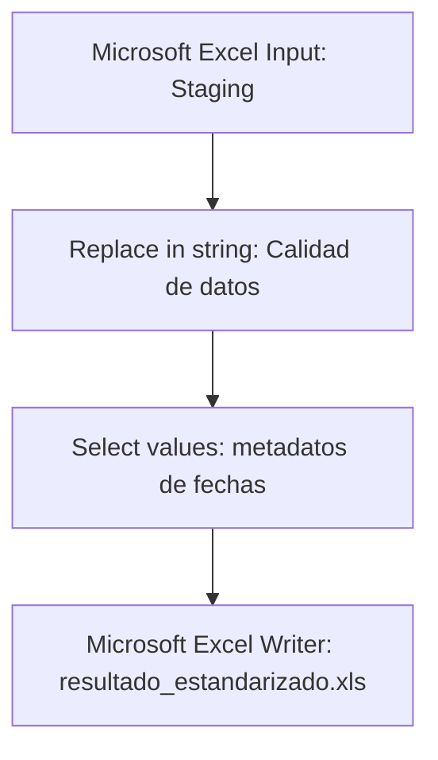
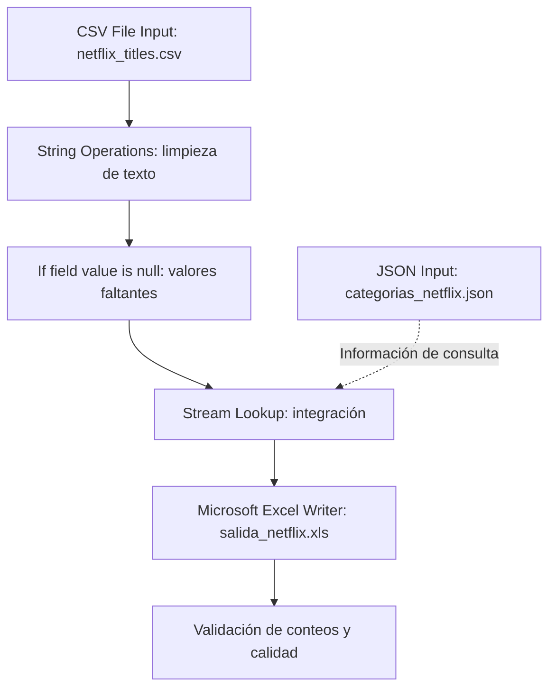
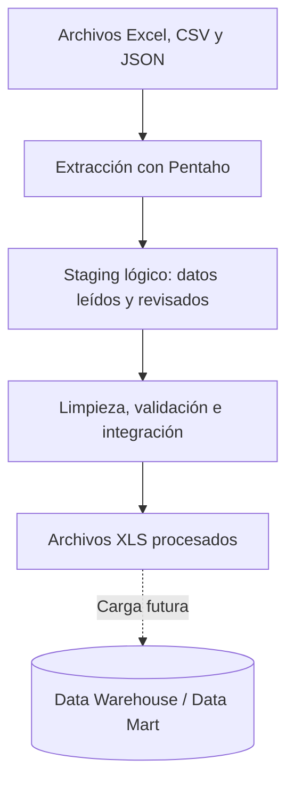

  &nbsp;&nbsp;&nbsp;&nbsp;&nbsp;&nbsp;

<h3>Escuela Politécnica Nacional</h3>
<h4>Facultad de Ingeniería de Sistemas</h4>
<h5>Business Intelligence GR2SW</h5>

**Integrantes Grupo G**

- Erick Caicedo
- Nahomy Llumiquinga
- Jhonny Moreira
- Fernanda Rueda

**Docente:** PhD. Diana Martínez

**Fecha de entrega:** 13 de octubre de 2026

<h3 align="center">
Práctica 1: Implementación de un proceso ETL y Staging Area con Pentaho Data Integration
</h3>

## Índice
- [Índice](#índice)
- [1. Introducción](#1-introducción)
- [2. Objetivos](#2-objetivos)
  - [2.1. Objetivo general](#21-objetivo-general)
  - [2.2. Objetivos específicos](#22-objetivos-específicos)
- [3. Herramientas y fuentes](#3-herramientas-y-fuentes)
- [4. Desarrollo](#4-desarrollo)
  - [4.1 Parte 1: Transformaciones al dataset provisto](#41-parte-1-transformaciones-al-dataset-provisto)
    - [4.1.1. Fuente y problemas identificados](#411-fuente-y-problemas-identificados)
    - [4.1.2. Flujo ETL](#412-flujo-etl)
    - [4.1.3. Transformación 1: nombres y apellidos](#413-transformación-1-nombres-y-apellidos)
    - [4.1.4 Transformación 2: validación de fechas](#414-transformación-2-validación-de-fechas)
    - [4.1.5. Salida y validación de la parte 1](#415-salida-y-validación-de-la-parte-1)
  - [4.2. Parte 2: Diseño y ejecución de un proceso ETL](#42-parte-2-diseño-y-ejecución-de-un-proceso-etl)
    - [4.2.1 Fuentes de datos utilizadas](#421-fuentes-de-datos-utilizadas)
    - [4.2.2. Problemas encontrados en los datos](#422-problemas-encontrados-en-los-datos)
    - [4.2.3. Flujo ETL](#423-flujo-etl)
    - [4.2.4. Extracción](#424-extracción)
    - [4.2.5. Primera transformación: String Operations](#425-primera-transformación-string-operations)
    - [4.2.6. Segunda transformación: If field value is null](#426-segunda-transformación-if-field-value-is-null)
    - [4.2.7. Integración de las fuentes con Stream Lookup](#427-integración-de-las-fuentes-con-stream-lookup)
    - [4.2.8. Carga de datos procesados](#428-carga-de-datos-procesados)
    - [4.2.9. Resultado esperado y verificación](#429-resultado-esperado-y-verificación)
- [5. Validación y evidencias](#5-validación-y-evidencias)
  - [5.1. Tabla de evidencias por actividad](#51-tabla-de-evidencias-por-actividad)
  - [5.2. Criterios de calidad](#52-criterios-de-calidad)
- [6. Relación con la arquitectura de un Data Warehouse](#6-relación-con-la-arquitectura-de-un-data-warehouse)
- [7. Conclusiones](#7-conclusiones)
- [8. Referencias bibliográficas](#8-referencias-bibliográficas)
- [9. Declaración de uso de la IA](#9-declaración-de-uso-de-la-ia)

## 1. Introducción

La integración de datos mediante **ETL (Extract, Transform, Load)** permite extraer información de fuentes de datos, detectar inconsistencias y aplicar reglas de limpieza y normalización para cargarlos en un almacén de datos [1]. 

Pentaho Data Integration permite diseñar transformaciones y trabajos ETL mediante su cliente gráfico Spoon [2]. La presente práctica sigue la guía de clase [3] y se divide en dos partes: En la primera se realiza la corrección de nombres y apellidos y validación de fechas en un archivo de estudiantes y en la segunda se desarrolla la integración de dos tipos de fuente, CSV y JSON, mediante transformaciones de limpieza y una salida procesada.

En la práctica se implementó la versión simplificada del proceso de integración de datos: **Fuente de datos → Staging Area → Transformación → Destino** [1].

## 2. Objetivos

### 2.1. Objetivo general

Implementar el proceso **ETL** (Extract, Transform, Load) mediante Pentaho Data Integration (PDI), utilizando Spoon como herramienta gráfica para diseñar y ejecutar el flujo de integración de datos.

### 2.2. Objetivos específicos

- Identificar problemas de codificación de caracteres y formatos de fecha en registros de estudiantes.
- Aplicar mecanismos de corrección de texto y validación de fechas, conservando los datos originales para su comparación.
- Extraer un dataset de Netflix en formato CSV y un catálogo de clasificación de audiencia en formato JSON.
- Estandarizar textos, tratar valores nulos e integrar las dos fuentes mediante una clave de búsqueda.
- Generar archivos de salida y verificar cantidades, correspondencias y registros que requieran revisión. 
  
## 3. Herramientas y fuentes

**Herramientas:** Pentaho Data Integration (Spoon) [2].

**Archivos de trabajo:**

La Tabla 1 reúne las fuentes y salidas de ambas partes y permite ubicar los archivos utilizados para reproducir la práctica.

**Tabla 1.** Archivos utilizados y generados en la práctica.

| Archivo | Formato | Función |
|---|---|---|
| `Caso Estudiantes Fechas Cedula.xls` | XLS | [Dataset provisto para la parte 1](input/parte%201/Caso%20Estudiantes%20Fechas%20Cedula.xls) |
| `netflix_titles.csv` | CSV | [Fuente principal de la parte 2: títulos de Netflix](input/parte%202/netflix_titles.csv) |
| `categorias_netflix.json` | JSON | [Catálogo complementario para clasificaciones de audiencia](input/parte%202/categorias_netflix.json) |
| `resultado_estandarizado.xls` | XLS | [Salida de la parte 1](output/parte%201/resultado_estandarizado.xls) |
| `salida_netflix.xls` | XLS | [Salida de la parte 2](output/parte%202/salida_netflix.xls) |

## 4. Desarrollo
### 4.1 Parte 1: Transformaciones al dataset provisto

#### 4.1.1. Fuente y problemas identificados

**Fuente:** `Caso Estudiantes Fechas Cedula.xls`, archivo proporcionado para la práctica descrita en la guía de clase [3].

La Tabla 2 relaciona las anomalías de texto y fechas con el riesgo de alterar la interpretación de los datos.

**Tabla 2.** Problemas identificados en los datos de estudiantes.

| Campo | Problema | Ejemplo o condición | Riesgo |
|---|---|---|---|
| Nombres y apellidos | Sustitución de caracteres | `~` aparece donde debería ir `ñ` | Nombres inconsistentes (Figura 1) |
| Nombres y apellidos | Representación ambigua de tildes | `\|\|` en lugar de una vocal acentuada | Reemplazos incorrectos si se corrige de manera indiscriminada (Figura 1)|
| `FECHA ESTADO` | Representaciones distintas | `12/06/2014`, `12/06/14`, `05/27/15` | Fechas interpretadas en meses o días equivocados (Figura 2)|
| `FECHA ESTADO` | Celdas con fórmulas | `=+G12+1100`, `=+G38+800` | Una operación numérica podría confundirse con una fecha (Figura 3)|

<!--  -->

**Figura 1.** Inconsistencias en nombres y apellidos.

<!--  -->

**Figura 2.** Ejemplos de fechas con presentaciones diferentes en el Excel original.

<!--  -->

**Figura 3.** Ejemplo de una celda con fórmula en la columna de fechas.

#### 4.1.2. Flujo ETL

La Figura 4 presenta las etapas del procesamiento de estudiantes: lectura del Excel, limpieza de textos y estados, ajuste de los campos de fecha y generación del archivo de salida.

**Figura 4.** Flujo ETL del procesamiento de estudiantes.

La Figura 5 muestra la lectura del Excel y la Figura 6 permite comparar los textos y fechas antes de completar su estandarización. La secuencia de conexiones debe contrastarse con el archivo `.ktr`, que no se encuentra en esta carpeta.

**Figura 5.** Configuración del paso `Staging`, con encabezado y codificación ISO-8859-1. Esta selección está documentada, pero por sí sola no demuestra la causa de los caracteres alterados.

**Figura 6.** Vista de estudiantes con pérdida de caracteres en nombres y fechas que mezclan órdenes de componentes y horas como `0:00` y `00:00:00.000`.

#### 4.1.3. Transformación 1: nombres y apellidos

El propósito es que el texto de los nombres sean uniformes sin perder los valores originales.

**Reglas consideradas:**

1. Eliminar espacios al principio y al final mediante `String Operations`, que permite guardar el resultado en un campo nuevo [4].
2. Normalizar las mayúsculas/minúsculas según el formato definido para el conjunto de datos.
3. Corregir `~` por `Ñ` o `ñ` cuando el contexto y el uso de mayúsculas lo permitan.
4. No reemplazar automáticamente `\|\|` por una sola vocal, porque no permite identificar cuál tilde corresponde. Registrar esos casos para revisión o usar un diccionario de equivalencias comprobadas.

La Tabla 3 ilustra las correcciones y los casos ambiguos que requieren revisión.

**Tabla 3.** Ejemplos de limpieza de nombres y apellidos.

| Valor original (ilustrativo) | Resultado esperado | Regla |
|---|---|---|
| `  PE~A  ` | `PEÑA` | Recortar espacios y corregir ñ |
| `MU~OZ` | `MUÑOZ` | Corregir ñ |
| `MAR\|\|A` | `REVISAR` | Tilde ambigua; requiere revisión |

La configuración de `Replace in string`, denominada `Calidad de datos`, incluye reglas sobre `NOMBRES`, `APELLIDOS` y `ESTADO ACTUAL` (Figura 7). En los nombres se sustituyen `~` y `||` por un valor vacío; esto elimina los símbolos, pero no recupera las letras perdidas. Para los estados se unifican variantes como `egresado`, `Egresado` y `EGR` en `EGRESADO`, y `Graduado`, `graduado` y `GRD` en `GRADUADO`.

**Figura 7.** Reglas de sustitución para limpiar caracteres y homogeneizar los estados académicos; las filas finales incluyen el tratamiento de fechas.

#### 4.1.4 Transformación 2: validación de fechas

En la segunda transformación se trata de estandarizar el formato de fecha.

El campo `FECHA ESTADO` presentaba texto, fechas con año de dos o cuatro cifras, valores ambiguos y resultados de fórmulas. La validación permitió distinguir entre **fecha imposible**, **fecha no reconocida** y **fecha con interpretación ambigua**. Se estableció una convención de origen antes de normalizar fechas como `01/05/15`, que podría representar dos fechas distintas según el orden día/mes.

**Propuesta de campos de salida:** `FECHA_ESTADO_ORIGINAL`, `FECHA_NORMALIZADA` (formato `yyyy-MM-dd`) y `ESTADO_VALIDACION`.

La Tabla 4 distingue fechas interpretables, ambiguas e imposibles y señala la comprobación necesaria para las fórmulas.

**Tabla 4.** Ejemplos de evaluación y validación de fechas.

| Valor fuente | Evaluación | Acción recomendada |
|---|---|---|
| `05/27/15` | Compatible con mes/día/año | `2015-05-27` si se confirma esa convención |
| `01/05/15` | Ambiguo entre día/mes y mes/día | Marcar para revisión si no se conoce el formato |
| `02/30/15` | Fecha imposible | Marcar inválida |
| `=+G12+1100` | Fórmula de Excel | Comprobar el resultado y el tipo leído por PDI |

En `Select values` ambos campos se configuran como `String` con formato `yyyy/MM/dd` (Figura 8). Al conservar el tipo texto, esta configuración no demuestra por sí sola que las fechas sean válidas.

**Figura 8.** Configuración de los campos de fecha en `Select values`, con tipo `String` y formato declarado `yyyy/MM/dd`.

`Replace in string` muestra una expresión regular con alternativas para fechas que empiezan por día o por año y el reemplazo `$3$4/$2$5/$1$6` (Figura 9). Los grupos de captura reordenan los componentes y el patrón descarta el texto posterior, incluidas horas y milisegundos. 

**Figura 9.** Detalle de las reglas RegEx para reorganizar las fechas de admisión y estado y retirar las horas sobrantes.

#### 4.1.5. Salida y validación de la parte 1

- **Salida:** archivo Excel 97-2003 [`resultado_estandarizado.xls`](output/parte%201/resultado_estandarizado.xls), hoja `Sheet1`.
- **Registros de entrada:** 99 registros, sin contar la fila de encabezados.
- **Registros de salida:** 99 registros, sin contar la fila de encabezados; la cantidad coincide con la entrada.
- **Nombres/apellidos:** se detectaron cambios en 13 registros. Sin embargo, en la salida los caracteres `~` y `||` fueron eliminados sin recuperar la letra o tilde correspondiente (por ejemplo, `Mu~oz` quedó como `Muoz`); por tanto, esos casos aún requieren corrección y revisión y no deben reportarse como corregidos satisfactoriamente.
- **Fechas:** la salida contiene 99 valores no vacíos con apariencia normalizada. No se puede confirmar cuántos son válidos, inválidos o ambiguos solo con esa apariencia: 96 celdas de fecha del archivo fuente contienen fórmulas, por lo que deben comprobarse sus resultados y la convención de fechas antes de clasificarlas. La cantidad por categoría queda pendiente de esa validación.
- **Evidencias:** archivo [`resultado_estandarizado.xls`](output/parte%201/resultado_estandarizado.xls). Las Figuras 5 a 9 complementan la configuración y el tratamiento de datos.

### 4.2. Parte 2: Diseño y ejecución de un proceso ETL

#### 4.2.1 Fuentes de datos utilizadas

- **Fuente 1 (CSV):** `netflix_titles.csv`, dataset *Netflix Movies and TV Shows*, publicado por S. Bansal en Kaggle [5]. La copia utilizada contiene **8.807 registros** y **12 columnas**: `show_id`, `type`, `title`, `director`, `cast`, `country`, `date_added`, `release_year`, `rating`, `duration`, `listed_in` y `description`.

- **Fuente 2 (JSON):** `categorias_netflix.json`, catálogo complementario elaborado por el Grupo G para la clasificación de audiencia [6]. Contiene **14 objetos** con: `codigo_rating`, `categoria_audiencia`, `descripcion` y `registros_csv`.

#### 4.2.2. Problemas encontrados en los datos

La Tabla 5 resume la correspondencia con el catálogo: 8.800 registros tienen una clave reconocida y 7 requieren revisión.

**Tabla 5.** Distribución de los valores del campo `rating` en el CSV.

| Situación | Cantidad | Observación |
|---|---:|---|
| Ratings presentes en el catálogo JSON | 8.800 | Registros con correspondencia esperada |
| Ratings vacíos | 4 | No tienen clasificación de audiencia |
| Ratings con valores de duración | 3 | `74 min`, `84 min` y `66 min` |
| **Total CSV** | **8.807** | **Suma de los tres grupos** |

Se comprobó también que el catálogo incluye 14 claves de clasificación donde los 7 registros que no coinciden se marcaron para revisión, no se eliminaron.

#### 4.2.3. Flujo ETL

La Figura 10 muestra cómo se limpian los datos del CSV de Netflix, se completan los valores nulos y se consulta el catálogo JSON para incorporar las categorías de audiencia antes de generar el Excel final.

**Figura 10.** Flujo ETL de la integración de datos de Netflix.

La línea punteada representa el information hop desde `JSON Categorias` hacia `Stream Lookup`, que entrega datos complementarios para la búsqueda sin unir simplemente los dos flujos de registros (Figura 11).

**Figura 11.** Conexión de información (*information hop*) usada por `Stream Lookup`.

#### 4.2.4. Extracción

1. En `CSV File Input` se lee `netflix_titles.csv` con separador coma, comillas como delimitador de texto, cabecera y codificación UTF-8 (Figura 12).

**Figura 12.** Extracción de datos de `netflix_titles.csv`.

2. En `JSON Input` se lee `categorias_netflix.json` y se extraen las propiedades `codigo_rating`, `categoria_audiencia`, `descripcion` y `registros_csv` (Figura 13).

**Figura 13.** Extracción de datos de `categorias_netflix.json`.

#### 4.2.5. Primera transformación: String Operations

Se eliminan espacios sobrantes al inicio y al final de varios campos y se guardan los resultados en campos nuevos mediante `String Operations` [4].

La Tabla 6 relaciona los campos originales con sus versiones limpias, conservando ambos para facilitar la comparación.

**Tabla 6.** Campos procesados mediante String Operations.

| Campo de entrada | Campo nuevo | Operación |
|---|---|---|
| `title` | `titulo_limpio` | `Trim = both` |
| `director` | `director_limpio` | `Trim = both` |
| `country` | `pais_limpio` | `Trim = both` |
| `rating` | `rating_limpio` | `Trim = both` |

Se conserva mayúsculas y minúsculas (`Lower/Upper = none`). Esta operación corresponde a la estandarización textual. La Figura 14 muestra los campos seleccionados para eliminar espacios sobrantes.

**Figura 14.** Configuración de la transformación String Operations para la limpieza y estandarización de campos de texto del dataset de Netflix.

#### 4.2.6. Segunda transformación: If field value is null

Se gestiona valores faltantes en los campos procesados. La Tabla 7 define los textos de sustitución que permiten identificar los datos faltantes sin eliminar registros.

**Tabla 7.** Valores sustitutos para campos nulos.

| Campo | Valor sustituto |
|---|---|
| `director_limpio` | `No especificado` |
| `pais_limpio` | `No especificado` |
| `rating_limpio` | `SIN_CLASIFICACION` |

Se utiliza `Select fields` para limitar el reemplazo a esos campos. Las cadenas vacías que el programa no interprete como nulas pueden requerir una regla adicional. La Figura 15 muestra los reemplazos definidos para los campos con valores nulos.

**Figura 15.** Configuración de la transformación If field value is null para el tratamiento de valores nulos en los datos de Netflix.

#### 4.2.7. Integración de las fuentes con Stream Lookup

El paso `Stream Lookup` permite recuperar valores de otro flujo de la transformación mediante claves de búsqueda [7]. La Tabla 8 resume la clave de integración, los campos recuperados y los valores usados cuando no existe correspondencia.

**Tabla 8.** Configuración de Stream Lookup.

| Elemento | Configuración |
|---|---|
| Lookup step | `JSON Categorias` |
| Clave del flujo principal | `rating_limpio` |
| Clave del catálogo | `codigo_rating` |
| Valor recuperado 1 | `categoria_audiencia` → `categoria_audiencia_final` |
| Valor por defecto 1 | `REVISAR` |
| Valor recuperado 2 | `descripcion` → `descripcion_rating` |
| Valor por defecto 2 | `Sin equivalencia` |
| Tipo de ambos resultados | `String` |

La Figura 16 muestra las claves y los valores recuperados al consultar el catálogo.

**Figura 16.** Claves y campos de recuperación configurados en `Stream Lookup`.

Como la clave `rating_limpio` es de tipo **String**, no corresponde activar la optimización *Key and value are exactly one integer field*.

#### 4.2.8. Carga de datos procesados

**Componente previsto:** `Microsoft Excel Writer`.  
**Formato solicitado:** `.xls`.  
**Nombre del archivo:** `salida_netflix.xls`.  

Los campos de interés en la salida son `show_id`, `title`, `titulo_limpio`, `director_limpio`, `pais_limpio`, `rating_limpio`, `categoria_audiencia_final` y `descripcion_rating`.

La Figura 17 muestra las opciones de escritura del archivo Excel de salida.

**Figura 17.** Configuración de Microsoft Excel Writer para generar el archivo de salida con los datos procesados de Netflix.

#### 4.2.9. Resultado esperado y verificación

El proceso ETL permitió integrar las fuentes CSV y JSON de Netflix, aplicando transformaciones de limpieza y estandarización mediante Pentaho Data Integration.

Se generó el archivo `salida_netflix.xls`, que contiene los datos originales y los nuevos campos procesados.

**Resultados:**

- **8.807 registros** conservados del CSV original.
- Limpieza de espacios mediante `String Operations`.
- Sustitución de valores nulos mediante `If field value is null`.
- Incorporación de categorías de audiencia mediante `Stream Lookup`.
- Identificación de 7 registros con clasificaciones faltantes o inconsistentes.

**Verificación:**

La validación consiste en comparar los registros originales con el archivo generado, comprobar las columnas transformadas y verificar la correcta integración de las categorías.

Los conteos finales deben confirmarse con los resultados de ejecución de Pentaho.

**Archivo de salida:** [salida_netflix.xls](output/parte%202/salida_netflix.xls)

La Figura 18 muestra los datos procesados y las categorías incorporadas en el archivo final.

**Figura 18.** Resultado del proceso ETL con los datos limpios y las categorías de audiencia integradas.

## 5. Validación y evidencias

### 5.1. Tabla de evidencias por actividad

La Tabla 9 agrupa las evidencias de ambas partes por etapa del proceso ETL, desde la extracción hasta la carga y verificación de la salida.

**Tabla 9.** Evidencias agrupadas por etapa del proceso ETL.

| Etapa | Evidencias de la Parte 1: estudiantes | Evidencias de la Parte 2: Netflix | Figuras |
|---|---|---|---|
| Flujo general | Diagrama del procesamiento de estudiantes | Diagrama de integración de CSV y JSON | Figuras 4 y 10 |
| Extracción y revisión inicial | Anomalías de nombres y fechas, configuración de lectura y vista de datos | Lectura de las fuentes CSV y JSON | Figuras 1, 2, 3, 5, 6, 12 y 13 |
| Transformación e integración | Sustitución de textos, normalización de estados y tratamiento de fechas | Limpieza de espacios, tratamiento de nulos y consulta del catálogo con Stream Lookup | Figuras 7, 9, 11, 14 y 16 |
| Carga y verificación de salida | Sin captura disponible | Configuración de escritura y archivo Excel generado | Figuras 17 y 18 |

### 5.2. Criterios de calidad

- **Integridad:** no perder ni duplicar filas durante el proceso.
- **Consistencia:** normalizar campos textuales y consultar clasificaciones desde un único catálogo.
- **Completitud:** identificar valores faltantes y sustituirlos de acuerdo con reglas explícitas.
- **Validez:** marcar fechas que no existen y ratings que no pertenecen al catálogo.
- **Trazabilidad:** conservar los campos originales y documentar las reglas empleadas.

## 6. Relación con la arquitectura de un Data Warehouse

Un proceso ETL constituye la etapa preparatoria para un entorno de Inteligencia de Negocios. Las fuentes operacionales proporcionan información, el área de staging recibe y prepara los registros, las transformaciones resuelven problemas de calidad e integración; y el resultado puede cargarse posteriormente en un **Data Warehouse** o **Data Mart** para análisis e informes [1].

La Figura 19 relaciona las etapas de la práctica con la arquitectura de un Data Warehouse: las fuentes pasan por extracción, staging y transformación hasta obtener archivos procesados que podrían alimentar un almacén de datos.

**Figura 19.** Relación del proceso ETL con la arquitectura de un Data Warehouse.

En esta práctica **la salida es un archivo Excel, no un Data Warehouse implementado**. Aun así, la arquitectura desarrollada reproduce las etapas fundamentales de preparación de datos requeridas para una carga analítica futura. El catálogo JSON cumple una función similar a una pequeña tabla de referencia o dimensión de clasificaciones.

## 7. Conclusiones

1. El desarrollo de la parte 1 de la práctica permitió identificar que la limpieza de nombres y apellidos requiere reglas controladas tomando en consideración que algunos caracteres anómalos son ambiguos y no deben sustituirse de forma automática sin evidencia.
2. La variabilidad de fechas demuestra la importancia de diferenciar formato visual, datos textuales y fórmulas antes de estandarizar la información.
3. En el desarrollo de la parte 2 se diseñó una integración de dos fuentes mediante `Stream Lookup` y las dos transformaciones seleccionadas corresponden a estandarización de texto y tratamiento de nulos.
4. Ambos procesos ilustran la función del ETL como preparación y control de calidad previa a una posible arquitectura de Data Warehouse.

## 8. Referencias bibliográficas

[1] IBM, «¿Qué es ETL (extracción, transformación, carga)?», *IBM Think*. [En línea]. Disponible en: [https://www.ibm.com/es-es/think/topics/etl](https://www.ibm.com/es-es/think/topics/etl). [Consulta: 11 de octubre de 2026].

[2] Pentaho, «Getting Started with PDI» [Introducción a PDI], *Documentación de Pentaho*. [En línea]. Disponible en: [https://docs.pentaho.com/pdia-try-pdia/getting-started-with-pdi](https://docs.pentaho.com/pdia-try-pdia/getting-started-with-pdi). [Consulta: 10 de octubre de 2026].

[3] D. Martínez, «Práctica 1. Implementación de un proceso ETL y Staging Area con Pentaho Data Integration», material de clase de Business Intelligence, Facultad de Ingeniería de Sistemas, Escuela Politécnica Nacional, Quito, Ecuador, 2026, pp. 1–12.

[4] Pentaho, «String Operations» [Operaciones con cadenas de texto], *Documentación de Pentaho*. [En línea]. Disponible en: [https://docs.pentaho.com/pdia-data-integration/pdi-transformation-steps-reference-overview/string-operations](https://docs.pentaho.com/pdia-data-integration/pdi-transformation-steps-reference-overview/string-operations). [Consulta: 11 de octubre de 2026].

[5] S. Bansal, «Netflix Movies and TV Shows» [Películas y series de Netflix], *Kaggle*, conjunto de datos. [En línea]. Disponible en: [https://www.kaggle.com/datasets/shivamb/netflix-shows](https://www.kaggle.com/datasets/shivamb/netflix-shows). [Consulta: 11 de octubre de 2026].

[6] Grupo G, «categorias_netflix.json», catálogo de clasificaciones de audiencia elaborado para la Práctica 1 de Business Intelligence, Escuela Politécnica Nacional, Quito, Ecuador, 2026. [En línea]. Disponible en: [categorias_netflix.json](input/parte%202/categorias_netflix.json).

[7] Pentaho, «PDI transformation steps» [Pasos de transformación de PDI], *Documentación de Pentaho Data Integration, versión 10.2*. [En línea]. Disponible en: [https://docs.pentaho.com/pdia-data-integration/10.2-data-integration/pdi-transformation-steps-reference-overview](https://docs.pentaho.com/pdia-data-integration/10.2-data-integration/pdi-transformation-steps-reference-overview). [Consulta: 12 de octubre de 2026].

## 9. Declaración de uso de la IA
En el desarrollo de esta práctica se utilizó una herramienta de inteligencia artificial generativa como apoyo en aproximadamente un **20% del trabajo**, principalmente para la selección de fuentes de datos, generación del catálogo JSON de categorías de Netflix y orientación en la configuración de componentes de Pentaho Data Integration. El **80% restante** fue realizado directamente por los integrantes del grupo, incluyendo la implementación y ejecución de los procesos ETL, aplicación de transformaciones de limpieza y estandarización, integración de fuentes de datos, generación de archivos de salida, validación de resultados y recopilación de evidencias. Todo el contenido proporcionado por la IA fue revisado, adaptado y validado por los integrantes del equipo.
