

  &nbsp;&nbsp;&nbsp;&nbsp;&nbsp;&nbsp;

<h3>Escuela Politécnica Nacional</h3>
<h4>Facultad de Ingeniería de Sistemas</h4>
<h5>Business Intelligence GR2SW</h5>

**Integrantes Grupo G**

- Erick Caicedo
- Nahomy Llumiquinga
- Jhonny Moreira
- Fernanda Rueda

**Docente:** PhD. Diana Martínez

**Fecha de entrega:** 20 de octubre de 2026

<h3 align="center">
Práctica 2: Implementación de un proceso ETL con base de datos y Pentaho Data Integration
</h3>

## Índice

- [1. Introducción](#1-introducción)
- [2. Objetivos](#2-objetivos)
  - [2.1. Objetivo general](#21-objetivo-general)
  - [2.2. Objetivos específicos](#22-objetivos-específicos)
- [3. Herramientas y fuentes](#3-herramientas-y-fuentes)
- [4. Desarrollo](#4-desarrollo)
  - [4.1. Preparación de la base de datos (extracción inicial)](#41-preparación-de-la-base-de-datos-extracción-inicial)
  - [4.2. Creación del entorno en Pentaho y conexión](#42-creación-del-entorno-en-pentaho-y-conexión)
  - [4.3. Extracción (Table input)](#43-extracción-table-input)
  - [4.4. Transformación y limpieza (Replace in string)](#44-transformación-y-limpieza-replace-in-string)
  - [4.5. Carga (Table output)](#45-carga-table-output)
  - [4.6. Ejecución del flujo ETL](#46-ejecución-del-flujo-etl)
- [5. Validación y evidencias](#5-validación-y-evidencias)
  - [5.1. Tabla de evidencias por actividad](#51-tabla-de-evidencias-por-actividad)
  - [5.2. Criterios de calidad](#52-criterios-de-calidad)
- [6. Conclusiones](#6-conclusiones)
- [7. Referencias bibliográficas](#7-referencias-bibliográficas)
- [8. Declaración de uso de la IA](#8-declaración-de-uso-de-la-ia)

# 1. Introducción
La integración de datos es un pilar fundamental en los entornos corporativos para la toma de decisiones informadas. En empresas con múltiples sucursales, la descentralización del registro de información suele provocar inconsistencias semánticas y de formato, dificultando la consolidación del inventario. 

El presente informe detalla la implementación de un proceso ETL (Extracción, Transformación y Carga) para el caso de estudio de la empresa "Ferretería El Tornillo Feliz", con el propósito de mitigar estas inconsistencias. Mediante la limpieza y normalización de las categorías, unidades de medida y formatos de precios de los productos, se busca obtener un catálogo único y estandarizado en un Data Warehouse que sirva como base para futuros análisis.

# 2. Objetivos

## 2.1. Objetivo general
Implementar un flujo ETL utilizando herramientas de integración de datos para limpiar, estandarizar y centralizar el catálogo de productos de múltiples sucursales en una base de datos.

## 2.2. Objetivos específicos
- Extraer los registros brutos de inventario desde una base de datos PostgreSQL mediante un proceso de conexión nativa.
- Transformar y limpiar las cadenas de texto inconsistentes del conjunto de datos, eliminando símbolos no numéricos de los precios y unificando las nomenclaturas de categorías y unidades de medida.
- Cargar los datos transformados en una nueva tabla estructurada (`productos_ferreteria_clean`) lista para su explotación analítica.

# 3. Herramientas y fuentes
Para el desarrollo y validación de la presente práctica, se configuró un entorno de pruebas local (localhost) apoyado en las siguientes tecnologías y recursos:

- **Gestor de Base de Datos Relacional (RDBMS):** PostgreSQL (versión 18) [1], utilizado como el motor principal para el almacenamiento estructurado del Data Warehouse. Para su administración se empleó pgAdmin 4, que permitió la ejecución de scripts DDL (Data Definition Language) para la creación de esquemas (`staging`) y tablas, así como sentencias DML (Data Manipulation Language) para la inserción masiva y consulta de los datos.
- **Herramienta de Integración de Datos (ETL):** Pentaho Data Integration (PDI), operado a través de su cliente gráfico Spoon (Community Edition) [2]. PDI es una plataforma basada en Java que permite el modelado visual de flujos de datos. En este proyecto se configuró una conexión nativa mediante el controlador JDBC para comunicarse directamente con PostgreSQL, facilitando las tareas de extracción, transformación en memoria (limpieza de cadenas) y carga por lotes (batch).
- **Fuentes de datos (dataset inicial):** La información base consistió en un script SQL documentado en el "Caso de Estudio: Ferretería El Tornillo Feliz" de la guía de laboratorio [3], con 100 registros simulados de un inventario en estado crudo (raw data). Los datos presentan intencionalmente problemas de calidad: falta de estandarización semántica, símbolo monetario (`$`) en campos que deben ser numéricos y abreviaturas inconsistentes introducidas manualmente por distintas sucursales.
- **Entorno de ejecución y conectividad:** Equipo de escritorio con el motor de base de datos ejecutándose localmente en el puerto por defecto (5432).

# 4. Desarrollo
El desarrollo de la práctica se dividió en la preparación del entorno de base de datos y la posterior construcción del flujo ETL en Pentaho. Cada paso se respalda con las capturas numeradas como figuras.

## 4.1. Preparación de la base de datos (extracción inicial)
Se creó la base de datos `FerreteriaDW` en PostgreSQL desde pgAdmin 4. Para ello se abrió el menú contextual *Databases > Create > Database* (Figura 1) y se completó el formulario con el nombre `FerreteriaDW` y el propietario `postgres` (Figura 2). Luego se abrió el *Query Tool* de la nueva base (Figura 3).

Desde el *Query Tool* se cargó el script que crea el esquema `staging` y la tabla `productos_ferreteria_raw`, cuyas columnas son todas de tipo `VARCHAR` y que inserta los registros con las inconsistencias (Figura 4). El script se ejecutó con la opción *Execute script* (F5) (Figura 5) y el motor confirmó la inserción de las 100 filas con el mensaje `INSERT 0 100` (Figura 6).

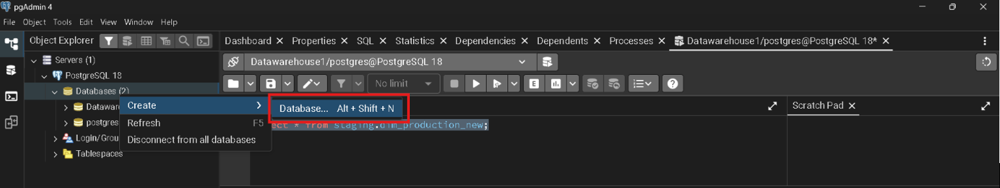 Database en pgAdmin 4">

**Figura 1.** Menú de creación de base de datos en pgAdmin 4.

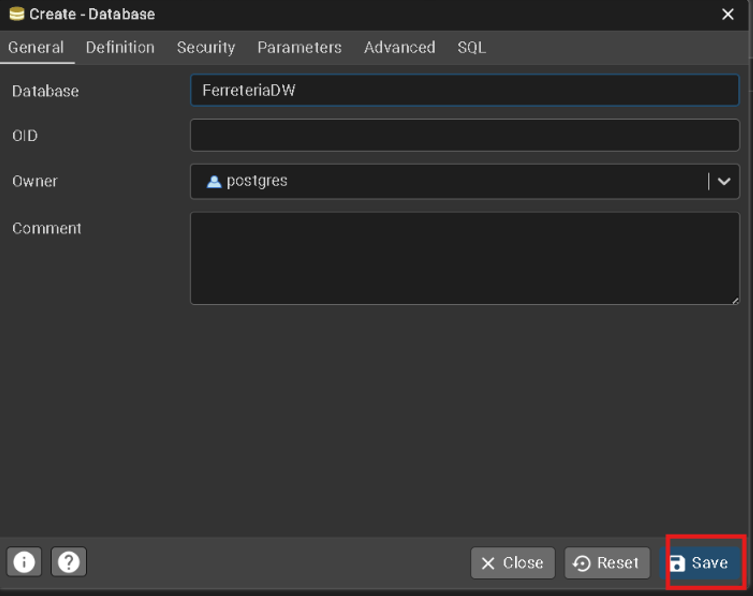

**Figura 2.** Formulario de creación de la base de datos FerreteriaDW.

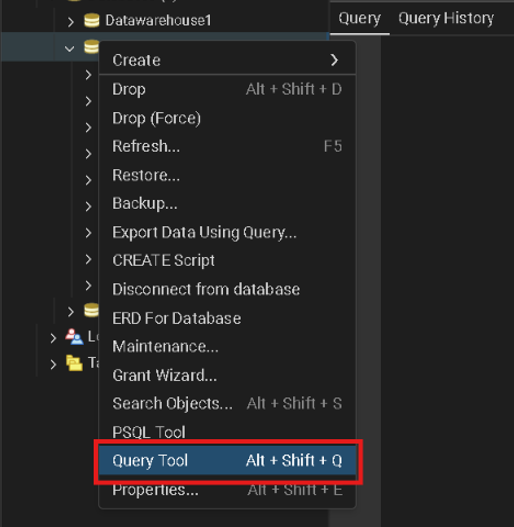

**Figura 3.** Apertura del Query Tool sobre FerreteriaDW.

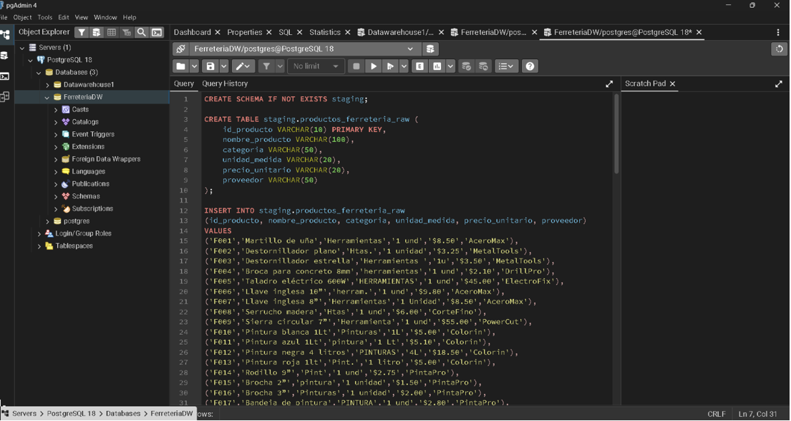

**Figura 4.** Script DDL y DML de la tabla productos_ferreteria_raw.

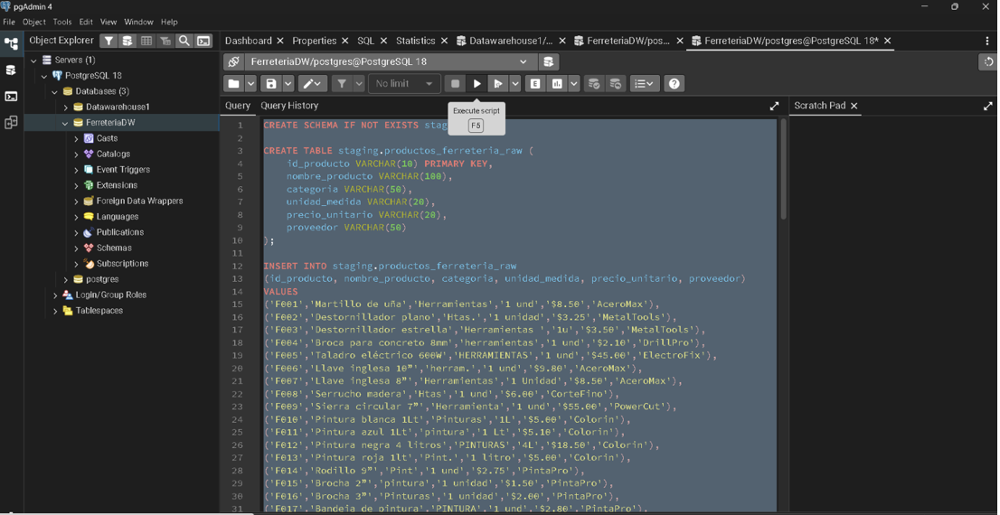

**Figura 5.** Ejecución del script con Execute script (F5).

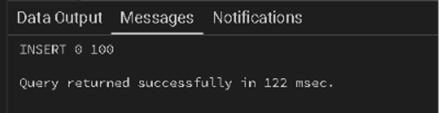

**Figura 6.** Confirmación de la inserción de 100 registros (INSERT 0 100).

## 4.2. Creación del entorno en Pentaho y conexión
En Spoon se creó una nueva transformación mediante *File > New > Transformation* (Figura 7). Después se abrió la opción *File > New > Database Connection* (Figura 8) y se configuró la conexión "PostgreSQL Conexion" con tipo PostgreSQL, acceso Native (JDBC), host `localhost`, base `FerreteriaDW`, puerto 5432 y usuario `postgres` (Figura 9). Finalmente se presionó el botón *Test* (Figura 10) y la prueba de conexión resultó exitosa (Figura 11).

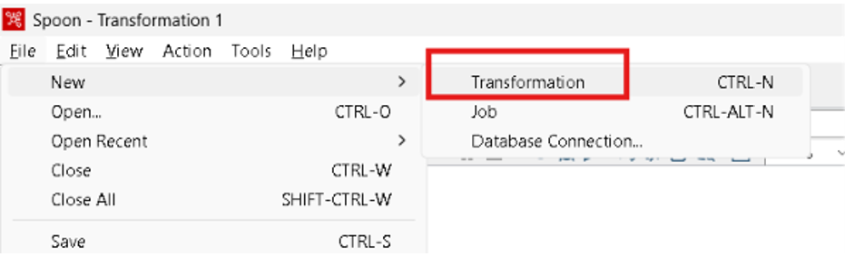 New > Transformation en Spoon">

**Figura 7.** Creación de una nueva transformación en Spoon.

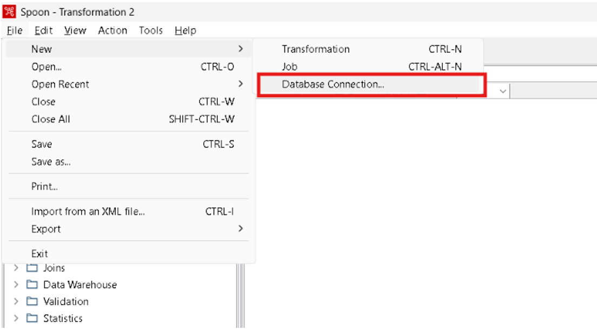 New > Database Connection">

**Figura 8.** Opción de nueva conexión de base de datos.

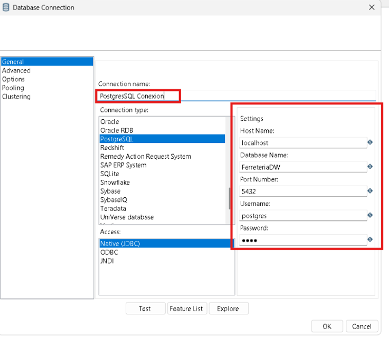

**Figura 9.** Parámetros de la conexión PostgreSQL Conexion (JDBC).

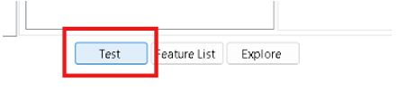

**Figura 10.** Botón de prueba de conexión (Test).

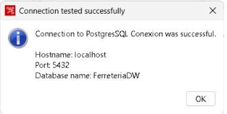

**Figura 11.** Resultado exitoso de la prueba de conexión.

## 4.3. Extracción (Table input)
Se agregó al lienzo el paso *Table input* arrastrándolo desde el panel *Design* (Figuras 12 y 13). En su configuración se seleccionó la conexión creada y se escribió la sentencia `SELECT * FROM staging.productos_ferreteria_raw` (Figura 14). Al presionar *Preview*, Pentaho solicitó el número de filas a mostrar (Figura 15) y presentó las 100 filas originales, donde se observan las inconsistencias de categoría, unidad de medida y precio (Figura 16).

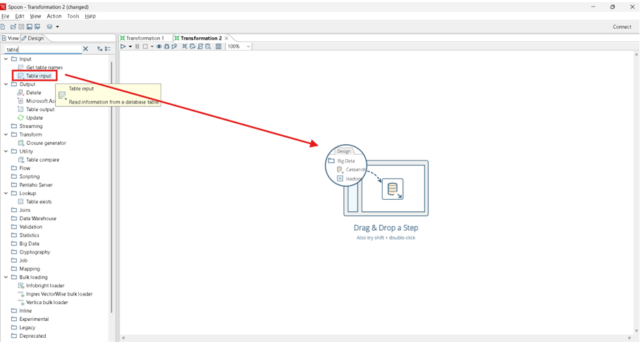

**Figura 12.** Selección del paso Table input desde el panel Design.

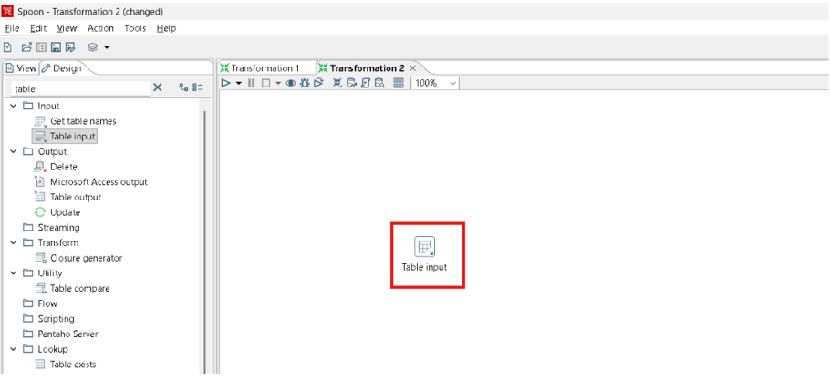

**Figura 13.** Paso Table input colocado en el lienzo.

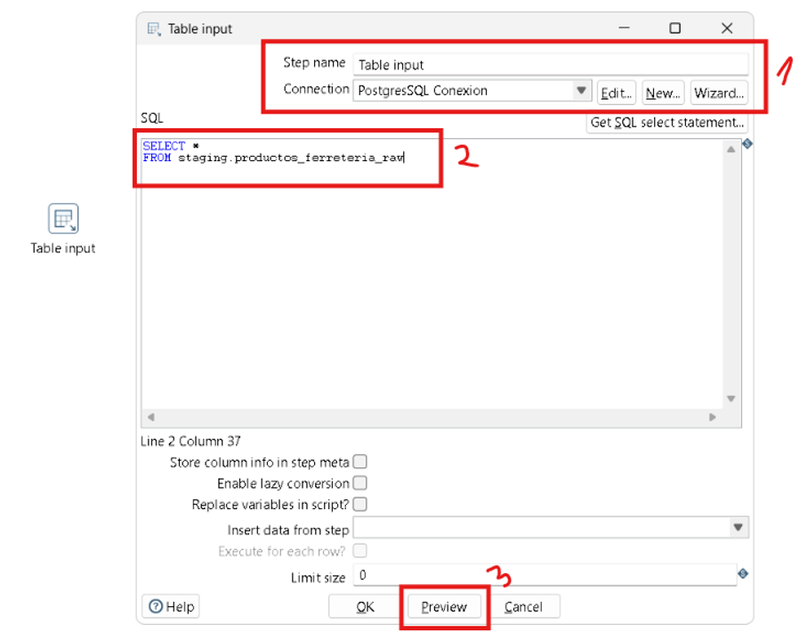

**Figura 14.** Configuración del paso Table input: conexión, consulta SQL y vista previa.

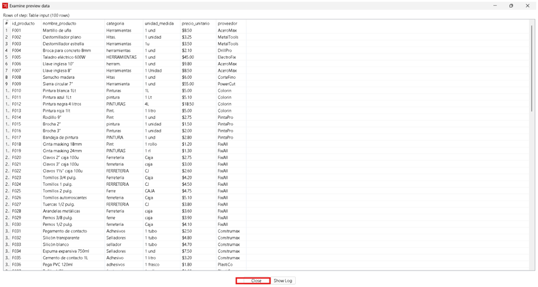

**Figura 15.** Diálogo del número de filas de la vista previa (1000).

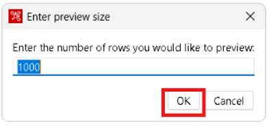

**Figura 16.** Vista previa de los datos en crudo (100 filas).

## 4.4. Transformación y limpieza (Replace in string)
Se añadió el paso *Replace in string* (Figura 17) y se conectó con *Table input* (Figura 18). Con el botón *Get fields* se cargaron las seis columnas del flujo (Figura 19). Se definieron reglas de reemplazo literal, sin distinción entre mayúsculas y minúsculas (Case sensitive: N), para:

- Eliminar el carácter `$` de `precio_unitario` y homologar `Htas` en `categoria` (Figura 20);
- Homologar variantes de `categoria` hacia "Herramientas" mediante las reglas `Htas`, `herram` y `Herramienta` (Figura 21);
- Homologar `unidad_medida`, empezando por `1 und` → "1 Unidad" (Figura 22);
- Completar las reglas de unidades: `1u` y `1 unidad` a "1 Unidad", `1 Lt` y `1L` a "1 Litro", `CJ` y `caja` a "Caja", y `1 rl` a "1 Rollo" (Figura 23).

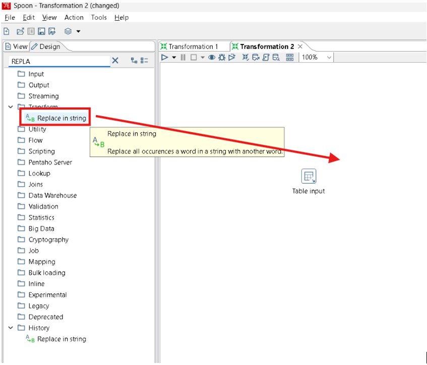

**Figura 17.** Selección del paso Replace in string.

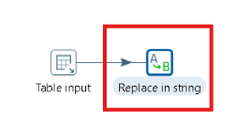

**Figura 18.** Conexión entre Table input y Replace in string.

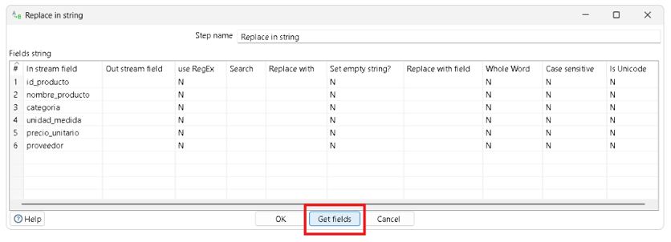

**Figura 19.** Campos del flujo cargados en Replace in string mediante Get fields.

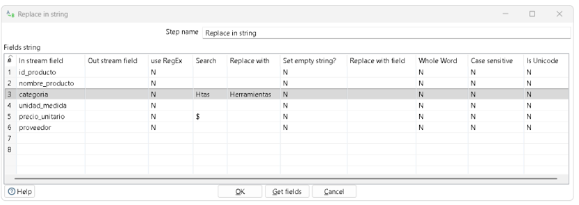

**Figura 20.** Reglas iniciales: categoría "Htas" y precio con "$".

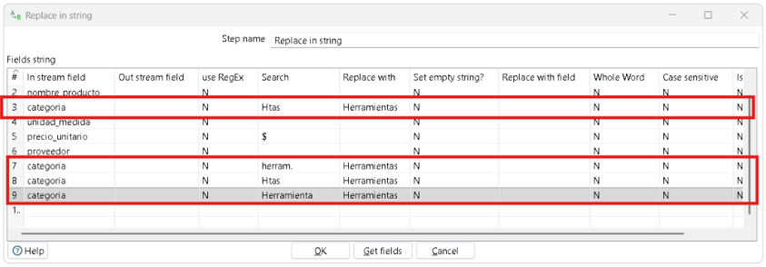

**Figura 21.** Reglas adicionales de categoría (herram., Htas, Herramienta).

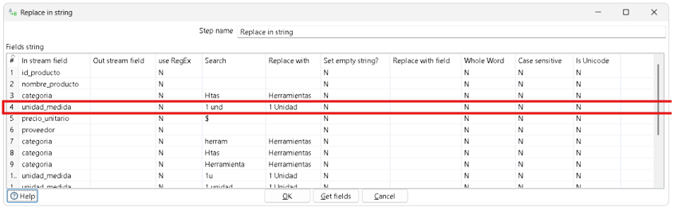

**Figura 22.** Regla de unidad de medida "1 und" → "1 Unidad".

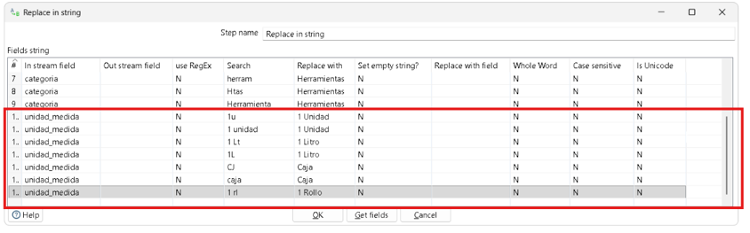

**Figura 23.** Reglas de homologación de unidades de medida.

## 4.5. Carga (Table output)
Se incorporó el paso *Table output* (Figura 24) y se lo conectó a la salida principal de *Replace in string* (Figura 25). Su configuración apunta al esquema `staging` y a la tabla `productos_ferreteria_clean`, con commit de 1000 filas y actualización por lotes (Figura 26). En la pestaña *Database fields*, inicialmente vacía (Figura 27), se mapearon las seis columnas con *Get fields* (Figura 28). Con el botón *SQL* se abrió el *Simple SQL editor* con el `CREATE TABLE` de la tabla destino (Figura 29), que se ejecutó con éxito (Figura 30). Por último se confirmó la configuración con *OK* (Figura 31).

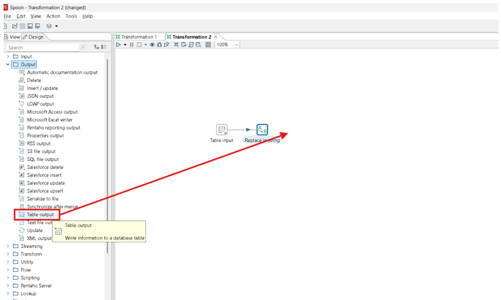

**Figura 24.** Selección del paso Table output desde la carpeta Output.

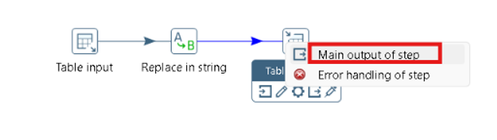

**Figura 25.** Conexión hacia Table output (Main output of step).

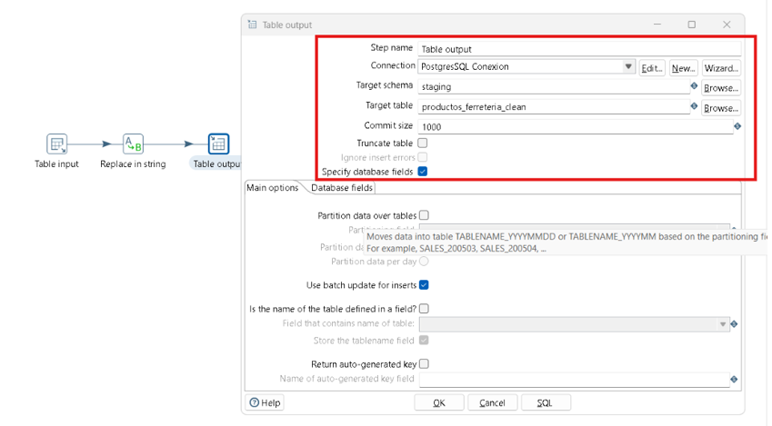

**Figura 26.** Configuración de Table output: conexión, esquema, tabla y commit.

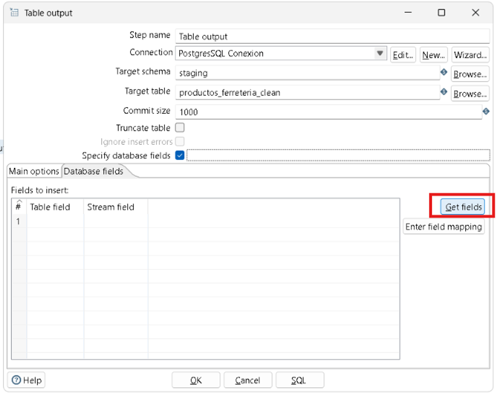

**Figura 27.** Pestaña Database fields antes de obtener los campos.

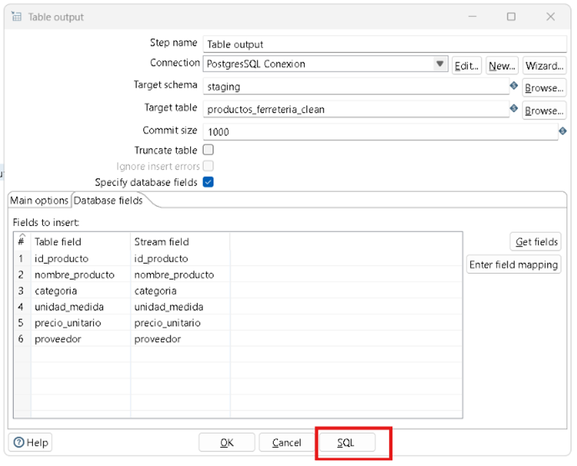

**Figura 28.** Mapeo de las seis columnas y botón SQL.

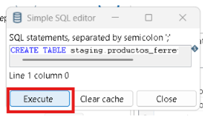

**Figura 29.** Simple SQL editor con el CREATE TABLE de la tabla destino.

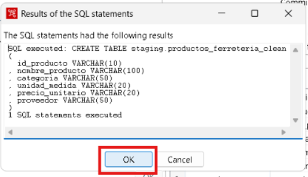

**Figura 30.** Resultado de la ejecución del DDL ("1 SQL statements executed").

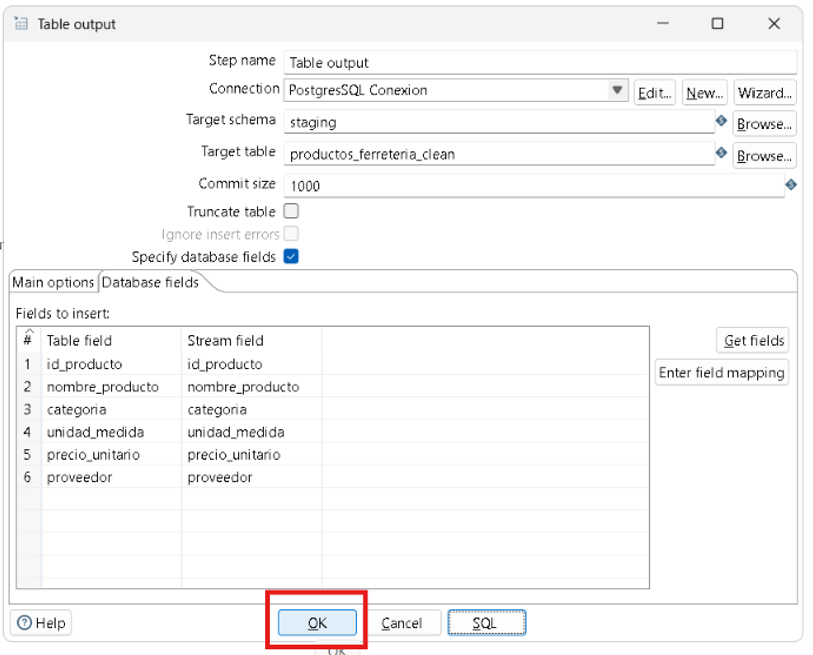

**Figura 31.** Table output con el mapeo completo y confirmación con OK.

## 4.6. Ejecución del flujo ETL
El flujo quedó formado por tres pasos conectados: *Table input*, *Replace in string* y *Table output* (Figura 32). Se ejecutó con el botón *Run* (Figura 33). La ejecución se completó sin errores: el paso *Table input* leyó 100 filas (I=100) y el paso *Table output* escribió 100 (W=100), con E=0 (Figura 34).

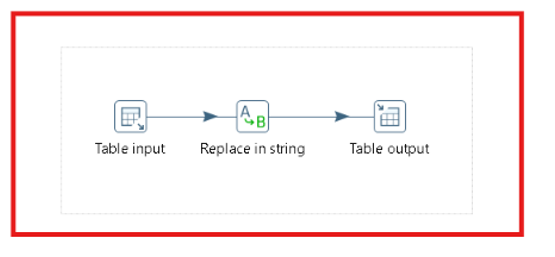

**Figura 32.** Flujo ETL completo de tres pasos.

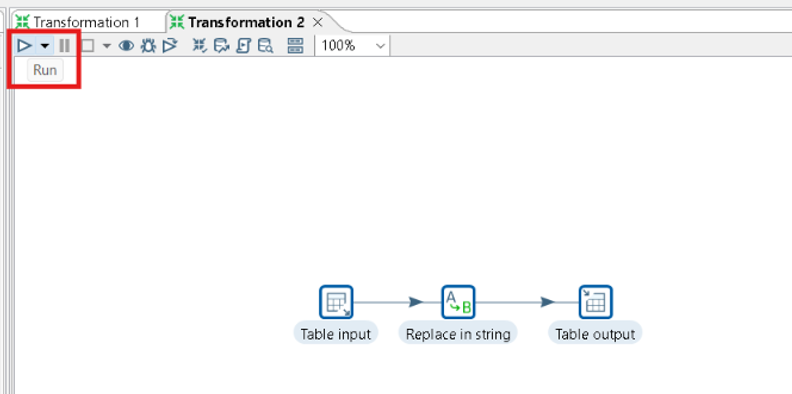

**Figura 33.** Ejecución de la transformación con el botón Run.

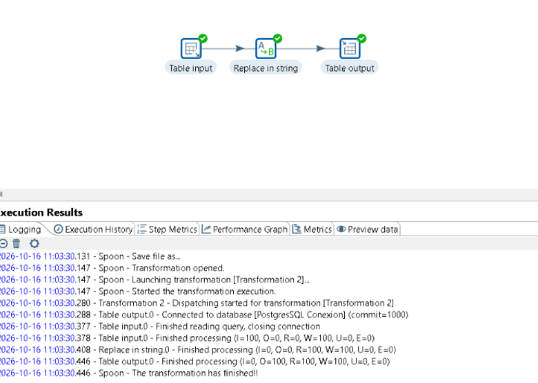

**Figura 34.** Resultados de la ejecución (Execution Results).

# 5. Validación y evidencias

## 5.1. Tabla de evidencias por actividad
La Tabla 1 resume las actividades realizadas, la herramienta empleada, las figuras que las respaldan y su estado.

**Tabla 1.** Evidencias por actividad.

| Actividad | Herramienta | Evidencia | Estado |
| :--- | :--- | :--- | :--- |
| Creación de base de datos origen | pgAdmin 4 | Figuras 1 a 6 | Completado sin errores |
| Conexión origen-ETL | Pentaho (Spoon) | Figuras 7 a 11 | Test exitoso |
| Extracción de registros brutos | Pentaho (Table input) | Figuras 12 a 16 | Completado (100 filas) |
| Limpieza de formatos | Pentaho (Replace in string) | Figuras 17 a 23 | Parcial (ver 5.2) |
| Carga de datos | Pentaho (Table output) | Figuras 24 a 34 | Completado sin errores (100 filas) |
| Validación en base destino | pgAdmin 4 | Figuras 35 y 36, Tabla 2 | Con observaciones (ver 5.2) |

## 5.2. Criterios de calidad
La validación se realizó consultando la tabla destino en pgAdmin con `SELECT * FROM staging.productos_ferreteria_clean;` (Figura 35), que devolvió las 100 filas (Figura 36).

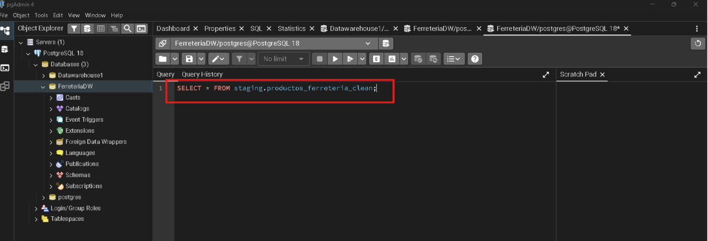

**Figura 35.** Consulta de la tabla destino productos_ferreteria_clean en pgAdmin 4.

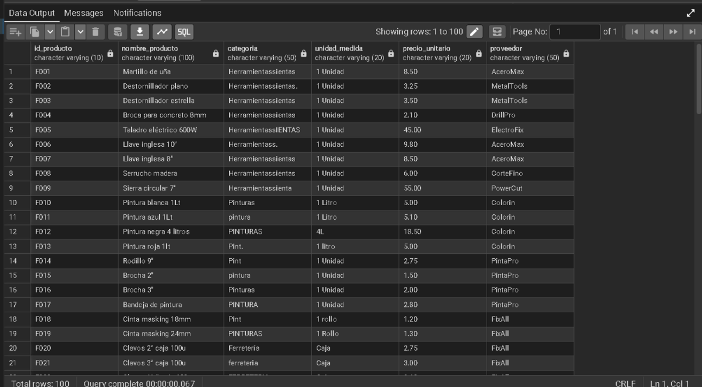

**Figura 36.** Datos cargados en la tabla destino (100 filas).

La Tabla 2 resume los resultados observados en la Figura 36 por cada columna evaluada.

**Tabla 2.** Resultados del control de calidad de la tabla destino.

| Columna | Resultado | Observación |
| :--- | :--- | :--- |
| `precio_unitario` | Correcto | El símbolo `$` fue eliminado (por ejemplo, `$8.50` quedó como `8.50`). La columna sigue siendo `VARCHAR(20)`; la conversión a tipo numérico queda pendiente. |
| `unidad_medida` | Parcial | Muchas variantes quedaron unificadas ("1 Unidad", "1 Litro", "1 Rollo", "Caja"), pero persisten otras (por ejemplo `4L` y `1 litro`). |
| `categoria` | Con errores | Las reglas de "Herramientas" generaron valores erróneos (por ejemplo `Herramientassientas` y `Herramientass.`) y variantes como `Pint.`, `pintura` y `ferreteria` no tenían regla asociada. |

La causa de los valores erróneos en `categoria` es que los reemplazos literales, sin coincidencia de palabra completa, volvieron a aplicarse sobre texto ya corregido.

**Acciones de mejora propuestas:** usar expresiones regulares ancladas (por ejemplo `^(htas|herram|herramienta)\.?$`), agregar reglas para el resto de categorías y unidades, eliminar espacios sobrantes y re-ejecutar la transformación con *Truncate table* activado.

# 6. Conclusiones
- Pentaho Data Integration permitió construir de forma visual y reproducible un flujo ETL completo (extracción, transformación y carga) sobre PostgreSQL, con una ejecución sin errores de las 100 filas.
- El paso *Replace in string* resolvió la limpieza del símbolo `$` y de varias variantes de unidades de medida, pero mostró un límite: los reemplazos literales sin coincidencia exacta pueden alterar valores ya corregidos. Para categorías conviene usar expresiones regulares ancladas o un paso de mapeo de valores.
- La validación en la tabla destino fue clave para detectar las inconsistencias residuales, lo que demuestra la importancia de verificar la calidad del dato después de cada carga antes de ponerlo a disposición de herramientas de Business Intelligence.

# 7. Referencias bibliográficas
[1] PostgreSQL Global Development Group, «PostgreSQL 18 documentation». [En línea]. Disponible en: [https://www.postgresql.org/docs/18/](https://www.postgresql.org/docs/18/).

[2] Hitachi Vantara, «Pentaho Data Integration documentation». [En línea]. Disponible en: [https://docs.hitachivantara.com/](https://docs.hitachivantara.com/).

[3] Martínez, D, «Práctica 2: ETL Initial Load», guía de laboratorio de Business Intelligence, Escuela Politécnica Nacional, Facultad de Ingeniería de Sistemas, 2026.

# 8. Declaración de uso de la IA
Para la elaboración de este informe, se declara un uso de Inteligencia Artificial (LLM) del 20%, utilizado exclusivamente como asistente de redacción y estructuración del documento. El 80% restante corresponde a trabajo en el diseño, desarrollo y captura de evidencias del flujo ETL en Pentaho Data Integration y la limpieza de los datos en PostgreSQL.