<p align="center">
  &nbsp;&nbsp;&nbsp;&nbsp;&nbsp;&nbsp;
</p>


<div align="center">

<h3>Escuela Politécnica Nacional</h3>
<h4>Facultad de Ingeniería de Sistemas</h4>
<h5>Business Intelligence GR2SW</h5>

</div>

<hr>

**Integrantes Grupo G**

- Erick Caicedo
- Nahomy Llumiquinga
- Jhonny Moreira
- Fernanda Rueda

**Docente:** PhD. Diana Martínez

**Fecha de entrega:** 27/10/2026

<h3 align="center">
Práctica 4: Modelo físico dimensional en PostgreSQL
</h3>

## Índice

- [1. Introducción](#1-introducción)
- [2. Objetivos](#2-objetivos)
  - [2.1. Objetivo general](#21-objetivo-general)
  - [2.2. Objetivos específicos](#22-objetivos-específicos)
- [3. Herramientas y fuentes](#3-herramientas-y-fuentes)
- [4. Desarrollo](#4-desarrollo)
  - [4.1. Parte guiada: análisis dimensional de products.csv](#41-parte-guiada-análisis-dimensional-de-productscsv)
  - [4.2. Staging e importación de productos](#42-staging-e-importación-de-productos)
  - [4.3. Validación y limpieza de productos](#43-validación-y-limpieza-de-productos)
  - [4.4. Creación y carga de dim\_product](#44-creación-y-carga-de-dim_product)
  - [4.5. Consultas de análisis sobre dim\_product](#45-consultas-de-análisis-sobre-dim_product)
  - [4.6. Parte grupal: análisis dimensional del dataset de ventas](#46-parte-grupal-análisis-dimensional-del-dataset-de-ventas)
  - [4.7. Staging, importación y validación de ventas](#47-staging-importación-y-validación-de-ventas)
  - [4.8. DDL del modelo estrella](#48-ddl-del-modelo-estrella)
  - [4.9. DML: carga de dimensiones y hechos](#49-dml-carga-de-dimensiones-y-hechos)
  - [4.10. Verificación de la carga](#410-verificación-de-la-carga)
  - [4.11. Consultas de negocio en SQL](#411-consultas-de-negocio-en-sql)
  - [4.12. Diagrama en Power Pivot](#412-diagrama-en-power-pivot)
  - [4.13. Verificación con tablas dinámicas](#413-verificación-con-tablas-dinámicas)
- [5. Validación y evidencias](#5-validación-y-evidencias)
  - [5.1. Tabla de evidencias por actividad](#51-tabla-de-evidencias-por-actividad)
  - [5.2. Criterios de calidad](#52-criterios-de-calidad)
- [6. Conclusiones](#6-conclusiones)
- [7. Referencias bibliográficas](#7-referencias-bibliográficas)
- [8. Declaración de uso de la IA](#8-declaración-de-uso-de-la-ia)

<hr>

# 1. Introducción
El modelado dimensional es la base de un Data Warehouse orientado al análisis: separa lo que describe un negocio (productos, clientes, fechas) de lo que se mide (cantidades, montos), de modo que las consultas analíticas sean simples y rápidas. El esquema estrella, en el que una tabla de hechos se rodea de tablas de dimensiones, es la forma más habitual de implementarlo.

El presente informe documenta la construcción del modelo físico dimensional en PostgreSQL. En una primera parte guiada se trabajó con el archivo `products.csv` para construir la dimensión `dim_product` a partir de una tabla de staging, aplicando validación, limpieza y una clave sustituta. En la parte grupal se modeló el archivo `Tabla_Desnormalizada_Ventas.csv` como un esquema estrella completo, con tres dimensiones (producto, cliente y fecha) y una tabla de hechos de ventas. Finalmente, el modelo se respondió con consultas SQL y se representó en Power Pivot.

# 2. Objetivos

## 2.1. Objetivo general
Implementar un modelo físico dimensional en PostgreSQL, desde la carga de datos en una zona de staging hasta un esquema estrella consultable, y validarlo mediante consultas de negocio.

## 2.2. Objetivos específicos
- Importar archivos CSV a tablas de staging, validar su carga y limpiar los datos antes de integrarlos al modelo.
- Diseñar y construir la dimensión `dim_product` con una clave sustituta y analizar sus atributos mediante consultas.
- Identificar la granularidad, las dimensiones y las medidas del dataset de ventas, y crear el DDL y el DML del esquema estrella (`dim_product`, `dim_customer`, `dim_date` y `fact_sales`).
- Resolver cinco consultas de negocio sobre el modelo y representar el esquema en Power Pivot, incluyendo la dimensión fecha con doble rol.

# 3. Herramientas y fuentes
Para el desarrollo y la validación de la práctica se configuró un entorno local con los siguientes recursos:

- **Gestor de Base de Datos Relacional (RDBMS):** PostgreSQL [1], como motor de almacenamiento del modelo. Se administró con pgAdmin 4, donde se ejecutaron los scripts DDL (creación de tablas) y DML (inserción y consulta de datos) y se utilizó la herramienta *Import/Export Data* para cargar y exportar CSV.
- **Herramienta de análisis y modelado:** Microsoft Excel con el complemento Power Pivot  [2], utilizado para cargar el modelo de datos, construir el diagrama de relaciones y verificar los resultados con tablas dinámicas.
- **Fuentes de datos:** `products.csv` (699 productos con identificador, nombre, categoría y subcategoría) y `Tabla_Desnormalizada_Ventas.csv` (100 registros y 26 columnas, delimitador `;`), proporcionados en la guía de laboratorio [3].
- **Entorno de ejecución:** equipo de escritorio con PostgreSQL ejecutándose localmente. El conector nativo de Excel para PostgreSQL requería el componente adicional Npgsql, que no estaba disponible, por lo que las tablas del modelo se exportaron a CSV desde pgAdmin y se cargaron al Modelo de datos de Excel.

# 4. Desarrollo
El desarrollo se dividió en dos partes: la parte guiada con `products.csv` y la parte grupal con el dataset de ventas. En ambas se aplicó el mismo método: cargar los datos a una tabla de staging, validarlos, limpiarlos y recién entonces poblar el modelo final. Cada paso se respalda con capturas numeradas como figuras.

## 4.1. Parte guiada: análisis dimensional de products.csv
Antes de escribir SQL se clasificó el contenido del archivo. `products.csv` describe únicamente la entidad Producto (identificador, nombre, categoría y subcategoría): no registra eventos de negocio ni contiene medidas numéricas. Por lo tanto corresponde a una **dimensión** (`dim_product`) y no a una tabla de hechos.

Se decidió además mantener `category` y `subcategory` dentro de `dim_product` (dimensión desnormalizada) en lugar de separarlas en tablas independientes. Esta decisión reduce los `JOIN` de las consultas analíticas a costa de repetir valores, algo aceptable en un esquema estrella. Separarlas daría lugar a un esquema copo de nieve.

## 4.2. Staging e importación de productos
Se abrió el *Query Tool* sobre la base de datos de trabajo (Figura 1) y se creó la tabla `stg_products`, con la misma estructura del CSV y sin restricciones, para conservar los datos tal como vienen de la fuente (Figura 2). Se comprobó que la tabla se creó con sus cuatro columnas y vacía (Figura 3).

```sql
DROP TABLE IF EXISTS stg_products;

CREATE TABLE stg_products (
    product_id      VARCHAR(5),
    product_name    VARCHAR(150),
    category        VARCHAR(80),
    subcategory     VARCHAR(80)
);
```

El archivo se importó con *Import/Export Data* de pgAdmin: formato CSV, codificación UTF-8, encabezado activado y delimitador coma (Figuras 4, 5 y 6). pgAdmin importa por posición, por lo que el orden de las columnas de la tabla coincide con el del CSV.

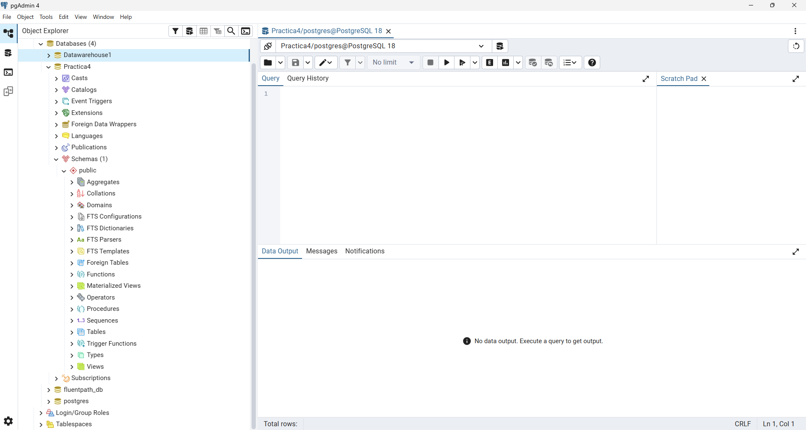

**Figura 1.** Query Tool abierto sobre la base de datos de trabajo.

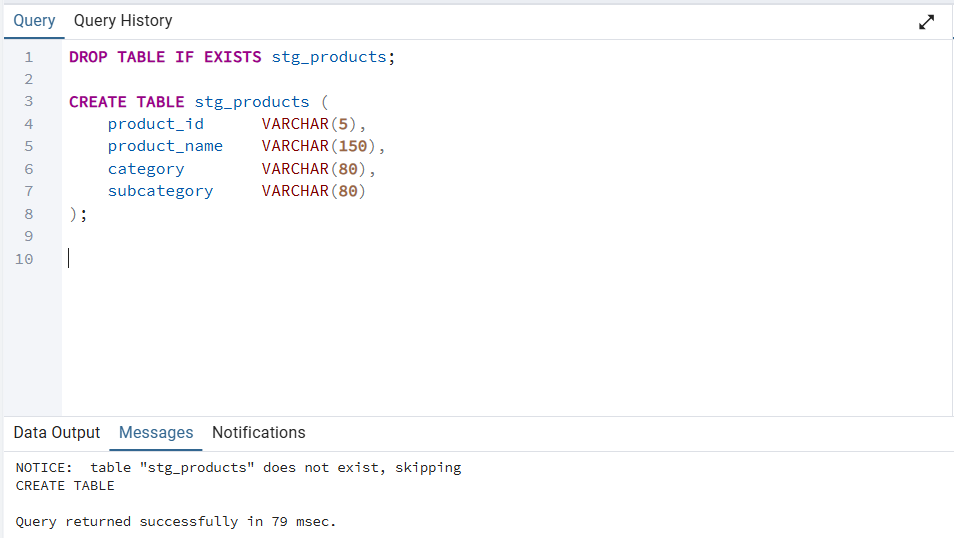

**Figura 2.** Creación de la tabla de staging stg_products.

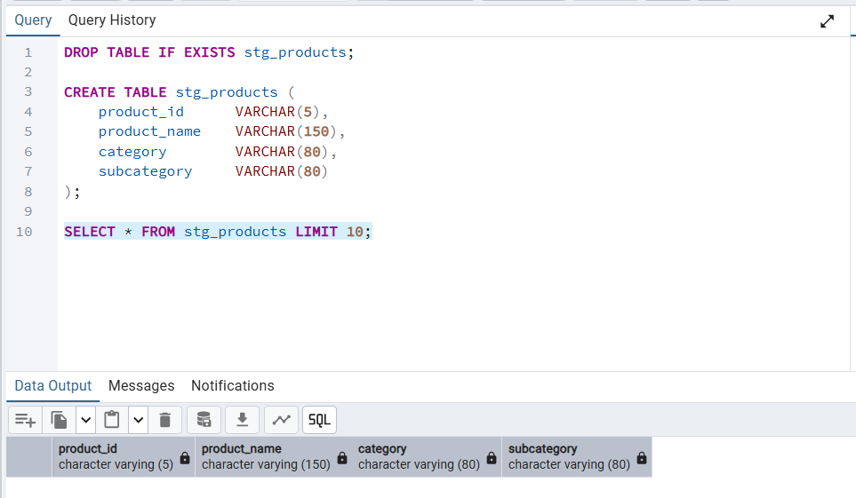

**Figura 3.** Verificación de la estructura de stg_products.

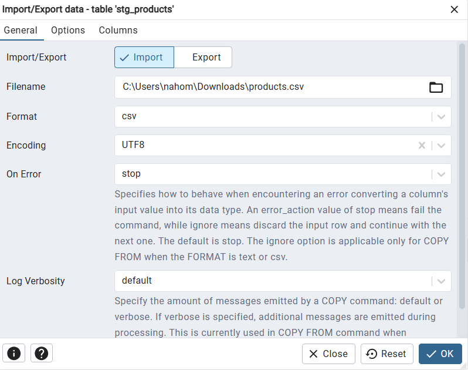

**Figura 4.** Importación del CSV: pestaña General.

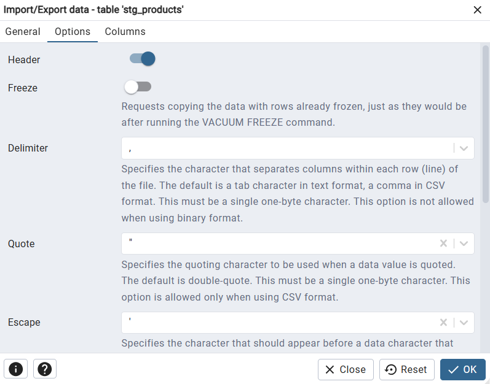

**Figura 5.** Importación del CSV: pestaña Options (encabezado y delimitador).

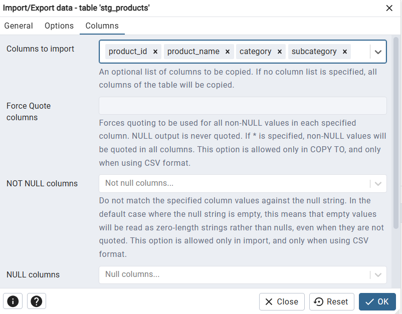

**Figura 6.** Importación del CSV: pestaña Columns.

## 4.3. Validación y limpieza de productos
Se validó la importación contrastando los conteos con lo esperado (Figura 7).

```sql
SELECT COUNT(*) AS total_registros FROM stg_products;
SELECT COUNT(DISTINCT product_id) AS productos_unicos FROM stg_products;
SELECT COUNT(DISTINCT category) AS categorias,
       COUNT(DISTINCT subcategory) AS subcategorias
FROM stg_products;
```

Se detectaron nombres de producto con espacios repetidos o tabulaciones (Figura 8), que habrían hecho que valores equivalentes se tratasen como distintos en agrupaciones y filtros. La limpieza se aplicó sobre staging, sin modificar el archivo fuente (Figura 9):

```sql
UPDATE stg_products
SET product_name = regexp_replace(btrim(product_name), '\s+', ' ', 'g'),
    category     = btrim(category),
    subcategory  = btrim(subcategory);
```

`btrim` elimina los espacios en los extremos y `regexp_replace` con la bandera `g` reemplaza, en todo el texto, cualquier grupo de espacios o tabulaciones por un único espacio. Posteriormente se repitió la consulta de detección, que no devolvió registros, y se comprobó que no hubiera identificadores nulos ni duplicados (Figura 10).

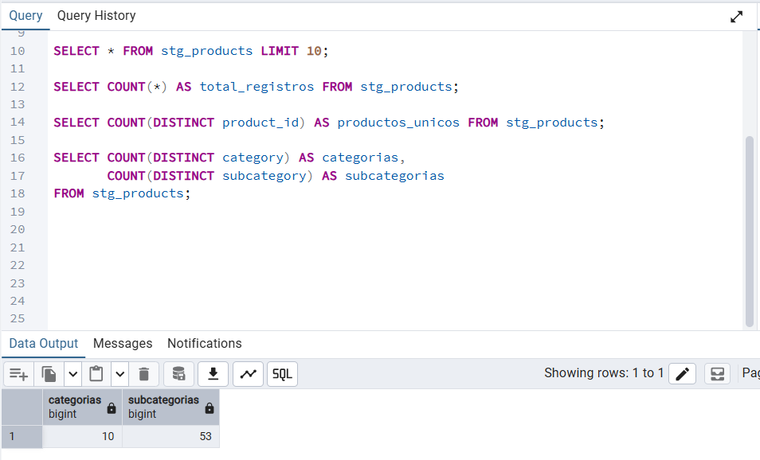

**Figura 7.** Validación de conteos tras la importación.

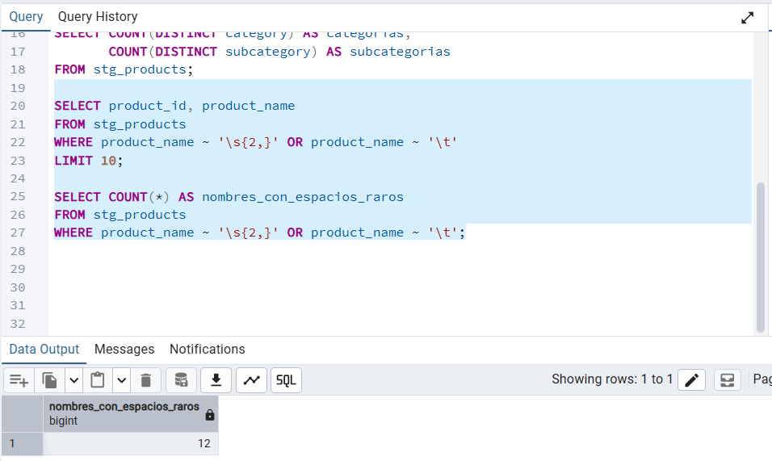

**Figura 8.** Detección de nombres con espacios repetidos o tabulaciones (antes de la limpieza).

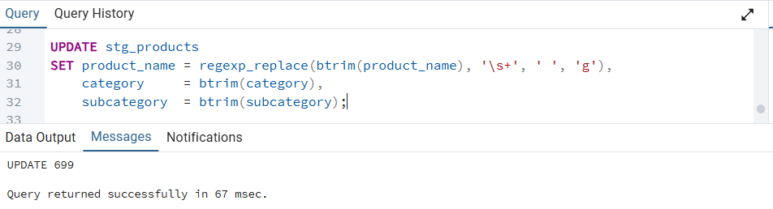

**Figura 9.** Ejecución de la limpieza sobre stg_products.

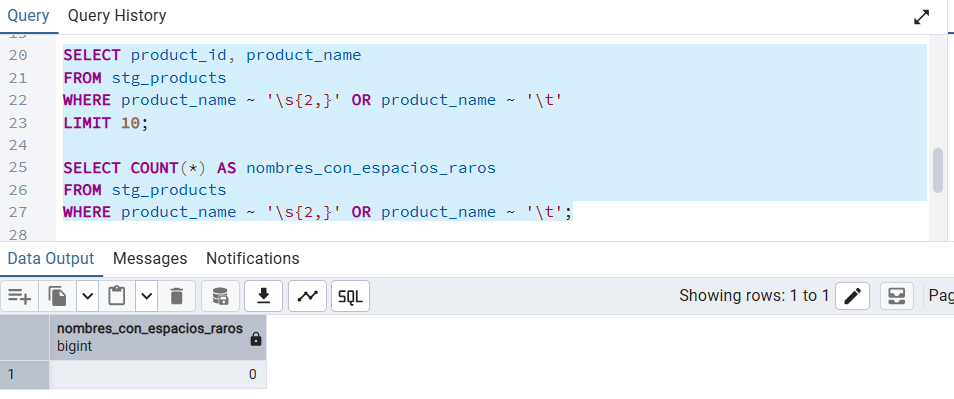

**Figura 10.** Verificación posterior: sin nombres irregulares, sin IDs nulos ni duplicados.

## 4.4. Creación y carga de dim_product
Se creó `dim_product` con una **clave sustituta** (`product_key`, `BIGSERIAL`) generada por el propio Data Warehouse (Figura 11). El identificador del sistema fuente (`product_id`) se conservó como clave natural, con restricción `UNIQUE`. De esta forma el modelo no depende del formato de los códigos de origen y la clave entera resulta más eficiente para las uniones con la tabla de hechos.

```sql
DROP TABLE IF EXISTS dim_product;

CREATE TABLE dim_product (
    product_key  BIGSERIAL PRIMARY KEY,
    product_id   VARCHAR(5) NOT NULL UNIQUE,
    product_name VARCHAR(150) NOT NULL,
    category     VARCHAR(80) NOT NULL,
    subcategory  VARCHAR(80) NOT NULL
);

INSERT INTO dim_product (product_id, product_name, category, subcategory)
SELECT DISTINCT product_id, product_name, category, subcategory
FROM stg_products
ORDER BY product_id;
```

La carga se realizó sin incluir `product_key`, que PostgreSQL asigna automáticamente (Figura 12). Se comprobó que la dimensión contiene 699 registros, con claves de 1 a 699 (Figura 13).

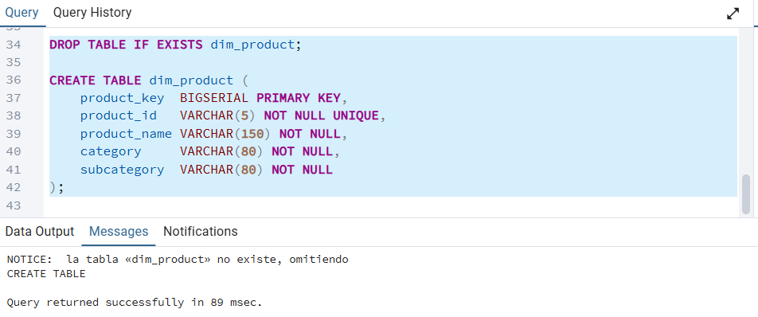

**Figura 11.** Creación de la dimensión dim_product con clave sustituta.

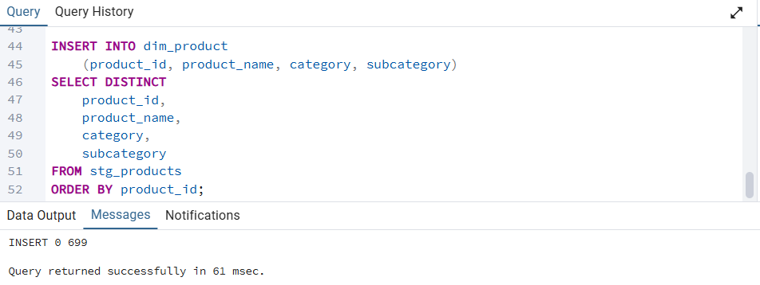

**Figura 12.** Carga de dim_product desde staging.

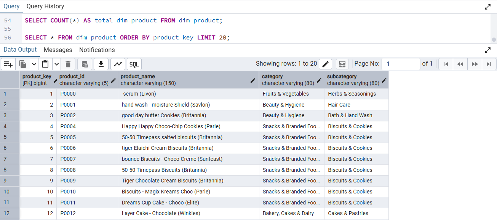

**Figura 13.** Comprobación de la carga: 699 registros.

## 4.5. Consultas de análisis sobre dim_product
Para comprobar que los atributos de la dimensión permiten agrupar y filtrar sin ningún `JOIN`, se ejecutaron cinco consultas:

```sql
-- 9.1 Productos por categoría
SELECT category, COUNT(*) AS total_productos
FROM dim_product
GROUP BY category
ORDER BY total_productos DESC;

-- 9.2 Productos por subcategoría
SELECT subcategory, COUNT(*) AS total_productos
FROM dim_product
GROUP BY subcategory
ORDER BY total_productos DESC;

-- 9.3 Productos de la categoría 'Beauty & Hygiene'
SELECT product_id, product_name, subcategory
FROM dim_product
WHERE category = 'Beauty & Hygiene'
ORDER BY product_name;

-- 9.4 Productos de la subcategoría 'Biscuits & Cookies'
SELECT product_id, product_name, category
FROM dim_product
WHERE subcategory = 'Biscuits & Cookies'
ORDER BY product_name;

-- 9.5 Subcategorías por categoría
SELECT category, COUNT(DISTINCT subcategory) AS total_subcategorias
FROM dim_product
GROUP BY category
ORDER BY total_subcategorias DESC, category;
```

Los resultados se muestran en las Figuras 14 a 18. En la consulta 9.5 se emplea `COUNT(DISTINCT ...)` porque una subcategoría se repite en muchos productos y solo debe contarse una vez por categoría.

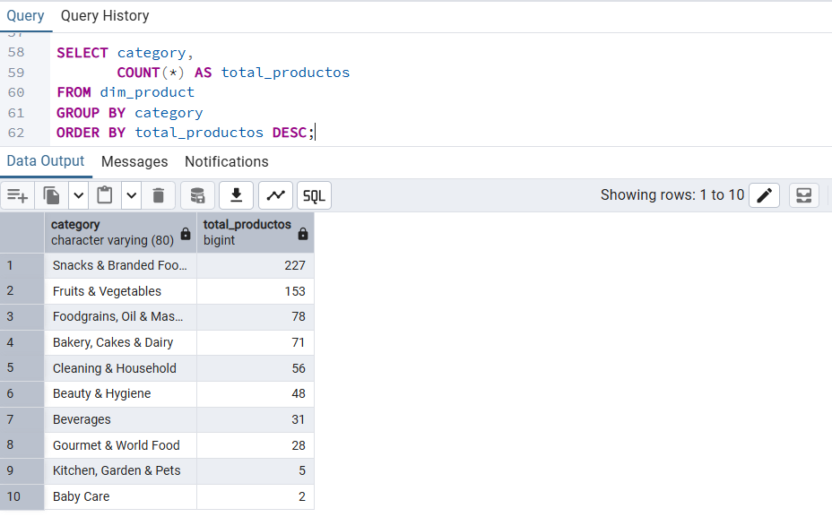

**Figura 14.** Productos por categoría.

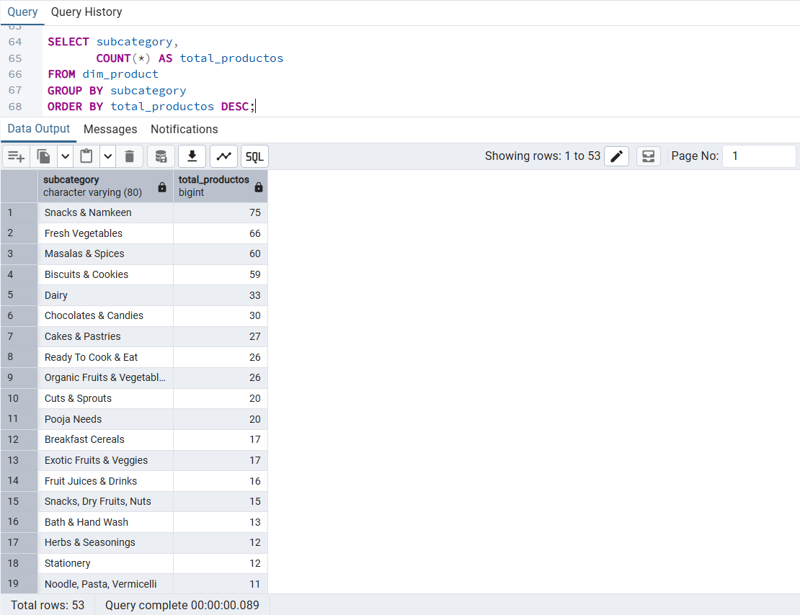

**Figura 15.** Productos por subcategoría.

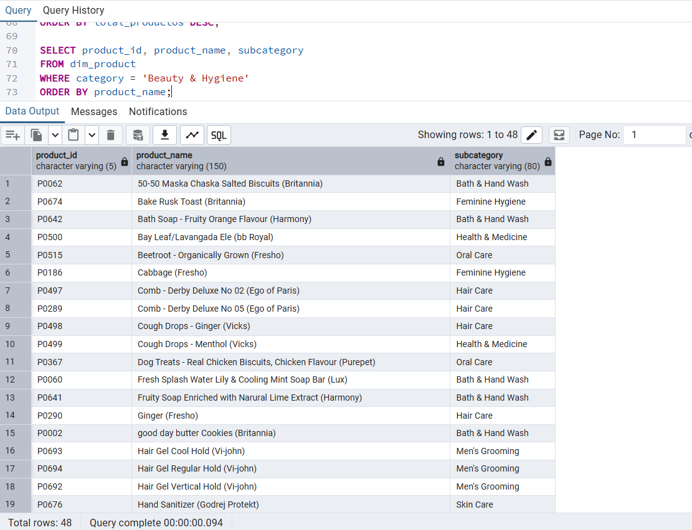

**Figura 16.** Productos de la categoría Beauty & Hygiene.

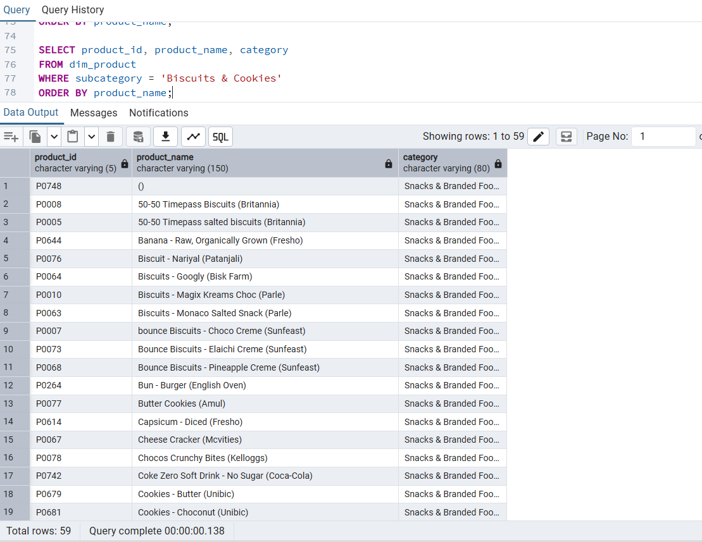

**Figura 17.** Productos de la subcategoría Biscuits & Cookies.

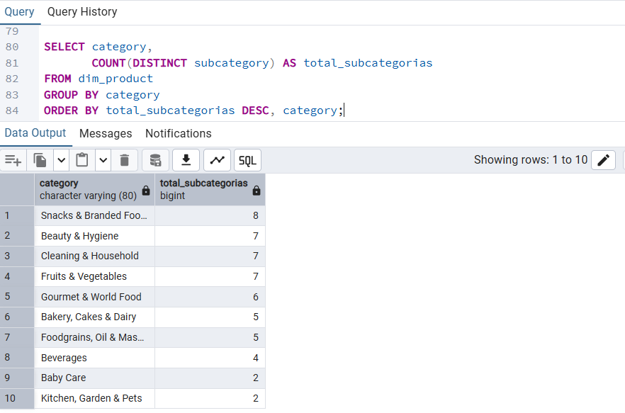

**Figura 18.** Subcategorías por categoría.

## 4.6. Parte grupal: análisis dimensional del dataset de ventas
`Tabla_Desnormalizada_Ventas.csv` contiene 100 registros y 26 columnas, sin valores nulos, con `OrderNumber` único y `OrderLineNumber` igual a 1 en todos los casos. Se verificó además que `SalesAmount = Quantity × UnitPrice` en las 100 filas y que la fecha de envío es de 1 a 3 días posterior a la del pedido. La tabla está desnormalizada: cada venta repite todos los atributos del producto y del cliente.

Se definió como **granularidad** una línea de pedido (`OrderNumber` + `OrderLineNumber`). Las columnas se clasificaron como se indica en la Tabla 1.

**Tabla 1.** Clasificación dimensional de las columnas del dataset de ventas.

| Tipo | Columnas | Criterio |
| :--- | :--- | :--- |
| Dimensión producto | ProductKey, Product Code, Product Name, List Price, Color, Size, Category, Subcategory | Describen qué se vendió |
| Dimensión cliente | CustomerKey, Birth Date, Marital Status, Gender, Income, Children, Home Owner, Cars | Describen quién compró |
| Dimensión fecha | OrderDateKey / Order Date, ShipDateKey / Ship Date | Describen cuándo ocurrió |
| Hechos (medidas) | Quantity, UnitPrice, ProductCost, SalesAmount | Valores numéricos agregables |
| Dimensiones degeneradas | OrderNumber, OrderLineNumber | Identifican la venta y no requieren tabla propia |

Se tomaron las siguientes decisiones de diseño:

- **Dimensión fecha con doble rol:** al existir fecha de pedido y fecha de envío, se utiliza una única `dim_date` y la tabla de hechos mantiene dos claves foráneas hacia ella (`order_date_key` y `ship_date_key`).
- **Claves:** se emplearon como claves primarias de las dimensiones las claves que ya trae el archivo (`ProductKey` y `CustomerKey`), que son claves sustitutas del sistema origen, y se conservó `Product Code` como clave natural. Para las fechas se usó el formato `YYYYMMDD`.
- **Precio:** `List Price` se ubicó en la dimensión (atributo del producto) y `UnitPrice` en la tabla de hechos (precio aplicado en la transacción).
- **Calendario completo:** `dim_date` se generó con todos los días de 2022 a 2025 y no únicamente con las fechas presentes en el CSV, como corresponde a una dimensión de tiempo.

## 4.7. Staging, importación y validación de ventas
Se creó la tabla `stg_ventas` con las 26 columnas del CSV, en el mismo orden y con nombres en `snake_case` (Figura 19). Se importó con delimitador **punto y coma**, codificación UTF-8 y encabezado activado, a diferencia de `products.csv`, que usa coma (Figura 20).

```sql
DROP TABLE IF EXISTS stg_ventas;

CREATE TABLE stg_ventas (
    product_key        INT,
    product_code       VARCHAR(10),
    product_name       VARCHAR(100),
    list_price         NUMERIC(10,2),
    color              VARCHAR(30),
    size               VARCHAR(20),
    category           VARCHAR(50),
    subcategory        VARCHAR(50),
    customer_key       INT,
    birth_date         DATE,
    marital_status     VARCHAR(20),
    gender             CHAR(1),
    income             NUMERIC(12,2),
    children           INT,
    home_owner         VARCHAR(3),
    cars               INT,
    order_date_key     INT,
    order_date         DATE,
    ship_date_key      INT,
    ship_date          DATE,
    order_number       VARCHAR(10),
    order_line_number  INT,
    quantity           INT,
    unit_price         NUMERIC(10,2),
    product_cost       NUMERIC(10,2),
    sales_amount       NUMERIC(12,2)
);
```

La validación de la importación (Figura 21) comprobó el total de filas, de pedidos únicos, de productos, clientes, categorías y subcategorías, y que no existieran ventas con `sales_amount` distinto de `quantity × unit_price`:

```sql
SELECT COUNT(*) AS total_filas,
       COUNT(DISTINCT order_number) AS pedidos_unicos,
       COUNT(DISTINCT product_key) AS productos,
       COUNT(DISTINCT customer_key) AS clientes,
       COUNT(DISTINCT category) AS categorias,
       COUNT(DISTINCT subcategory) AS subcategorias
FROM stg_ventas;

SELECT COUNT(*) AS ventas_inconsistentes
FROM stg_ventas
WHERE sales_amount <> quantity * unit_price;
```

Aunque el archivo no presentó problemas de calidad, se aplicó la misma estandarización de textos de la parte guiada sobre staging (Figura 22):

```sql
UPDATE stg_ventas
SET product_code   = btrim(product_code),
    product_name   = regexp_replace(btrim(product_name), '\s+', ' ', 'g'),
    color          = btrim(color),
    size           = btrim(size),
    category       = btrim(category),
    subcategory    = btrim(subcategory),
    marital_status = btrim(marital_status),
    gender         = btrim(gender),
    home_owner     = btrim(home_owner),
    order_number   = btrim(order_number);
```

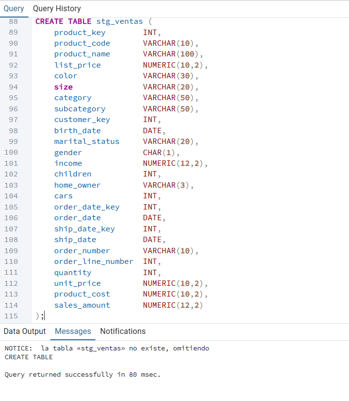

**Figura 19.** Creación de la tabla de staging stg_ventas.

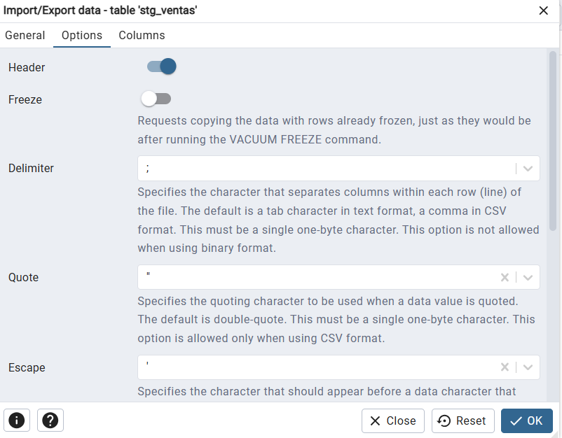

**Figura 20.** Importación del CSV de ventas (delimitador punto y coma, encabezado activado).

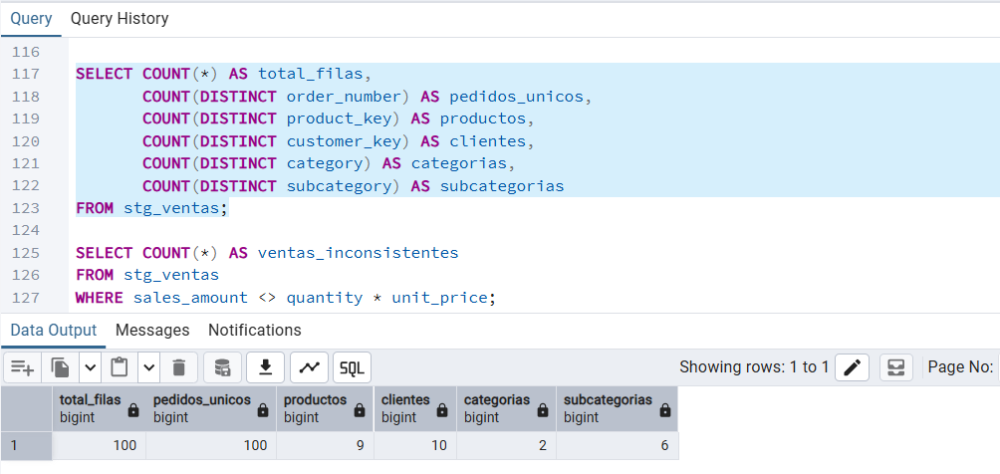

**Figura 21.** Validación de la importación de ventas.

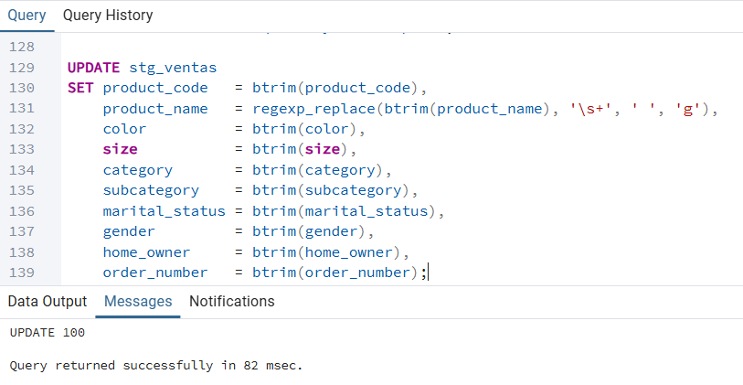

**Figura 22.** Estandarización de textos en stg_ventas.

## 4.8. DDL del modelo estrella
Se crearon las tres dimensiones y la tabla de hechos (Figura 23). Las dimensiones se crean primero porque la tabla de hechos contiene claves foráneas que las referencian. En el modelo final sí se exigen `NOT NULL` y restricciones de integridad, a diferencia de la zona de staging.

```sql
DROP TABLE IF EXISTS fact_sales;
DROP TABLE IF EXISTS dim_product;
DROP TABLE IF EXISTS dim_customer;
DROP TABLE IF EXISTS dim_date;

CREATE TABLE dim_product (
    product_key   INT PRIMARY KEY,
    product_code  VARCHAR(10) NOT NULL UNIQUE,
    product_name  VARCHAR(100) NOT NULL,
    list_price    NUMERIC(10,2) NOT NULL,
    color         VARCHAR(30) NOT NULL,
    size          VARCHAR(20) NOT NULL,
    category      VARCHAR(50) NOT NULL,
    subcategory   VARCHAR(50) NOT NULL
);

CREATE TABLE dim_customer (
    customer_key    INT PRIMARY KEY,
    birth_date      DATE NOT NULL,
    marital_status  VARCHAR(20) NOT NULL,
    gender          CHAR(1) NOT NULL,
    income          NUMERIC(12,2) NOT NULL,
    children        INT NOT NULL,
    home_owner      VARCHAR(3) NOT NULL,
    cars            INT NOT NULL
);

CREATE TABLE dim_date (
    date_key     INT PRIMARY KEY,
    full_date    DATE NOT NULL UNIQUE,
    year         INT NOT NULL,
    quarter      INT NOT NULL,
    month        INT NOT NULL,
    month_name   VARCHAR(15) NOT NULL,
    year_month   CHAR(7) NOT NULL,
    day          INT NOT NULL,
    day_of_week  INT NOT NULL,
    day_name     VARCHAR(15) NOT NULL
);

CREATE TABLE fact_sales (
    order_number       VARCHAR(10) NOT NULL,
    order_line_number  INT NOT NULL,
    product_key        INT NOT NULL REFERENCES dim_product (product_key),
    customer_key       INT NOT NULL REFERENCES dim_customer (customer_key),
    order_date_key     INT NOT NULL REFERENCES dim_date (date_key),
    ship_date_key      INT NOT NULL REFERENCES dim_date (date_key),
    quantity           INT NOT NULL,
    unit_price         NUMERIC(10,2) NOT NULL,
    product_cost       NUMERIC(10,2) NOT NULL,
    sales_amount       NUMERIC(12,2) NOT NULL,
    PRIMARY KEY (order_number, order_line_number)
);
```

La clave primaria compuesta `(order_number, order_line_number)` implementa físicamente la granularidad definida. Las dos claves foráneas hacia `dim_date` materializan el doble rol de la fecha. El atributo `year_month` evita que meses iguales de años distintos se mezclen en las agrupaciones.

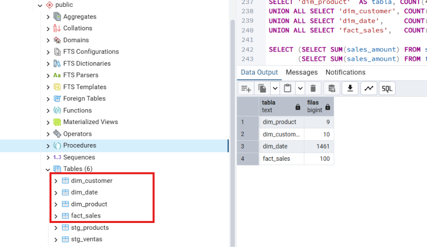

**Figura 23.** Ejecución del DDL del esquema estrella.

## 4.9. DML: carga de dimensiones y hechos
La carga respetó el orden dimensiones primero y hechos al final, para que las claves foráneas se cumplan (Figuras 24 y 25). La dimensión fecha se generó como calendario completo con `generate_series`.

```sql
-- Dimensión producto
INSERT INTO dim_product
    (product_key, product_code, product_name, list_price, color, size, category, subcategory)
SELECT DISTINCT
    product_key, product_code, product_name, list_price, color, size, category, subcategory
FROM stg_ventas
ORDER BY product_key;

-- Dimensión cliente
INSERT INTO dim_customer
    (customer_key, birth_date, marital_status, gender, income, children, home_owner, cars)
SELECT DISTINCT
    customer_key, birth_date, marital_status, gender, income, children, home_owner, cars
FROM stg_ventas
ORDER BY customer_key;

-- Dimensión fecha (calendario completo 2022-2025)
INSERT INTO dim_date
    (date_key, full_date, year, quarter, month, month_name, year_month, day, day_of_week, day_name)
SELECT
    to_char(d, 'YYYYMMDD')::INT,
    d::DATE,
    EXTRACT(YEAR FROM d)::INT,
    EXTRACT(QUARTER FROM d)::INT,
    EXTRACT(MONTH FROM d)::INT,
    (ARRAY['Enero','Febrero','Marzo','Abril','Mayo','Junio','Julio','Agosto',
           'Septiembre','Octubre','Noviembre','Diciembre'])[EXTRACT(MONTH FROM d)::INT],
    to_char(d, 'YYYY-MM'),
    EXTRACT(DAY FROM d)::INT,
    EXTRACT(ISODOW FROM d)::INT,
    (ARRAY['Lunes','Martes','Miércoles','Jueves','Viernes','Sábado','Domingo'])[EXTRACT(ISODOW FROM d)::INT]
FROM generate_series('2022-01-01'::DATE, '2025-12-31'::DATE, '1 day') AS d;

-- Tabla de hechos
INSERT INTO fact_sales
    (order_number, order_line_number, product_key, customer_key,
     order_date_key, ship_date_key, quantity, unit_price, product_cost, sales_amount)
SELECT
    order_number, order_line_number, product_key, customer_key,
    order_date_key, ship_date_key, quantity, unit_price, product_cost, sales_amount
FROM stg_ventas;
```

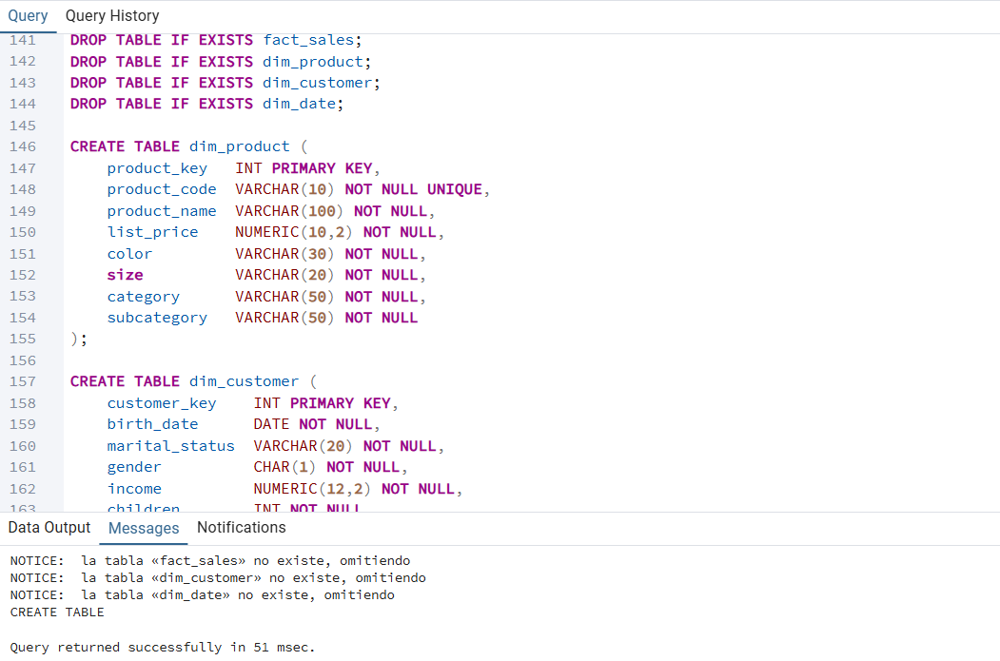

**Figura 24.** Carga de dim_product, dim_customer y dim_date.

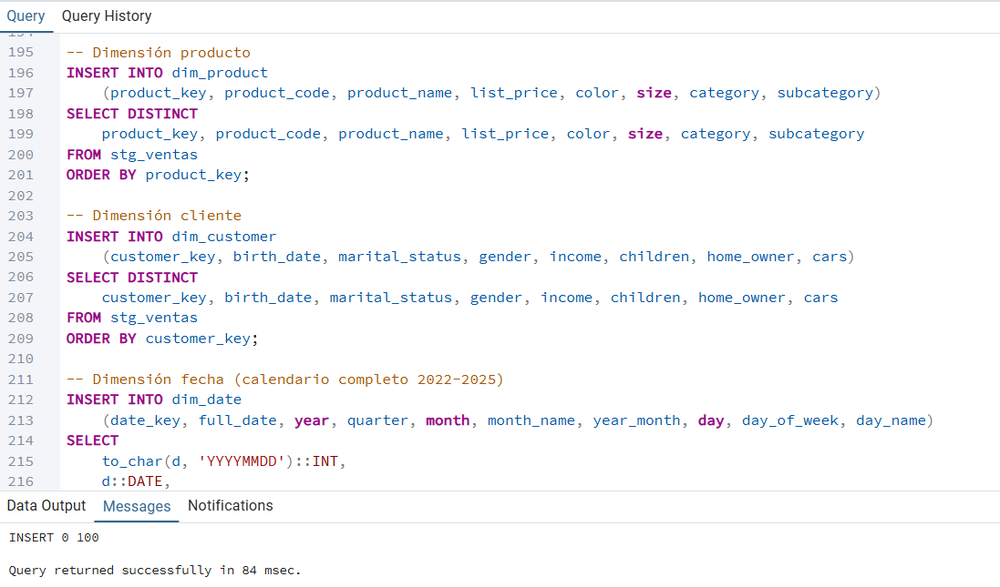

**Figura 25.** Carga de la tabla de hechos fact_sales.

## 4.10. Verificación de la carga
Se contó el número de filas de cada tabla del modelo y se comparó el total de ventas de staging con el de la tabla de hechos (Figura 26):

```sql
SELECT 'dim_product'  AS tabla, COUNT(*) AS filas FROM dim_product
UNION ALL SELECT 'dim_customer', COUNT(*) FROM dim_customer
UNION ALL SELECT 'dim_date',     COUNT(*) FROM dim_date
UNION ALL SELECT 'fact_sales',   COUNT(*) FROM fact_sales;

SELECT (SELECT SUM(sales_amount) FROM stg_ventas) AS total_staging,
       (SELECT SUM(sales_amount) FROM fact_sales)  AS total_hechos;
```

El modelo quedó con 9 productos, 10 clientes, 1461 fechas y 100 ventas, y los totales de staging y hechos coinciden, lo que confirma que no se perdió ni duplicó ninguna venta durante la carga.

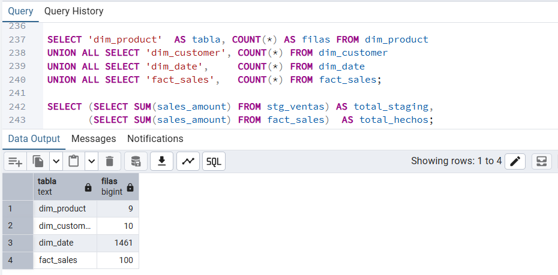

**Figura 26.** Conteos por tabla y comparación de totales de ventas.

## 4.11. Consultas de negocio en SQL
Cada consulta parte de `fact_sales` y se une con la dimensión que aporta el contexto de análisis.

**Consulta 1. ¿Cuántas ventas se realizaron por categoría de producto y mes?** (Figura 27)

```sql
SELECT p.category,
       d.year_month,
       COUNT(*) AS total_ventas
FROM fact_sales f
JOIN dim_product p ON f.product_key = p.product_key
JOIN dim_date d    ON f.order_date_key = d.date_key
GROUP BY p.category, d.year_month
ORDER BY d.year_month, p.category;
```

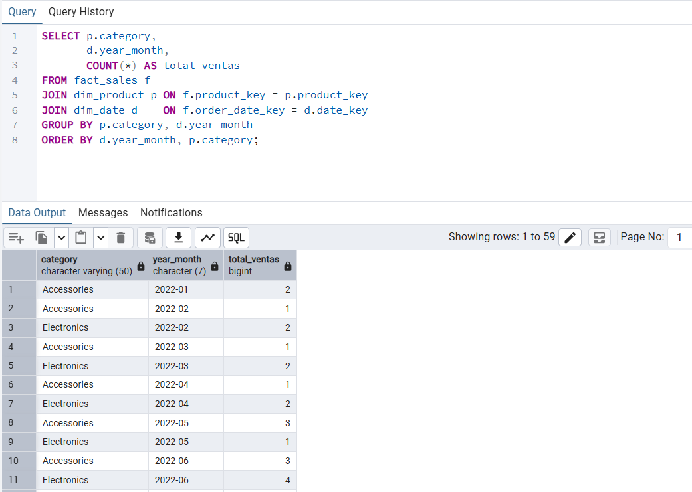

**Figura 27.** Resultado de la consulta 1: ventas por categoría y mes.

**Consulta 2. ¿Cuál es el ingreso total por cliente y género?** (Figura 28)

```sql
SELECT c.customer_key,
       c.gender,
       SUM(f.sales_amount) AS ingreso_total
FROM fact_sales f
JOIN dim_customer c ON f.customer_key = c.customer_key
GROUP BY c.customer_key, c.gender
ORDER BY ingreso_total DESC;
```

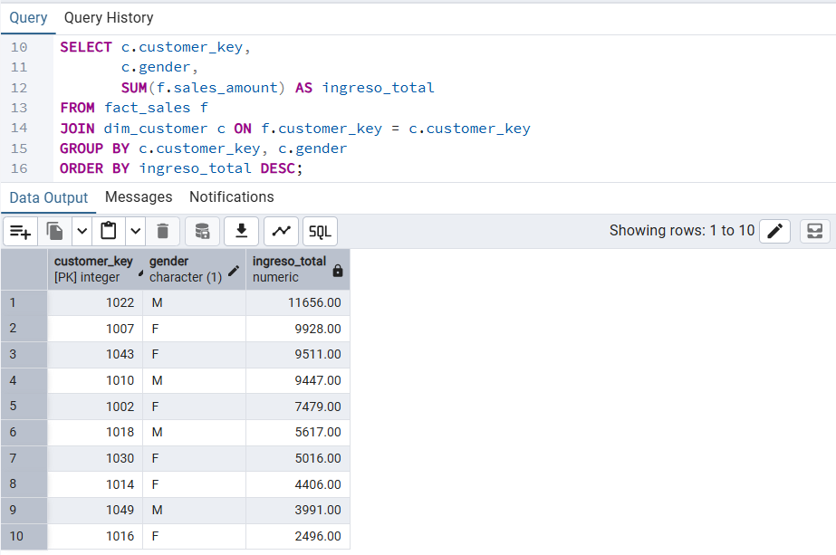

**Figura 28.** Resultado de la consulta 2: ingreso total por cliente y género.

**Consulta 3. ¿Cuál es la cantidad total vendida por producto?** (Figura 29)

```sql
SELECT p.product_key,
       p.product_name,
       SUM(f.quantity) AS cantidad_total
FROM fact_sales f
JOIN dim_product p ON f.product_key = p.product_key
GROUP BY p.product_key, p.product_name
ORDER BY cantidad_total DESC;
```

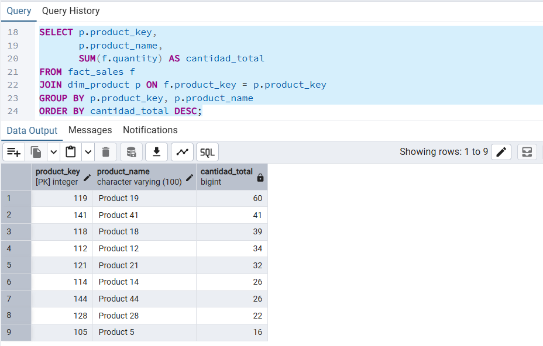

**Figura 29.** Resultado de la consulta 3: cantidad total por producto.

**Consulta 4. ¿Cuál fue la cantidad enviada por mes de envío?** (Figura 30)

```sql
SELECT d.year_month AS mes_envio,
       SUM(f.quantity) AS cantidad_enviada
FROM fact_sales f
JOIN dim_date d ON f.ship_date_key = d.date_key
GROUP BY d.year_month
ORDER BY d.year_month;
```

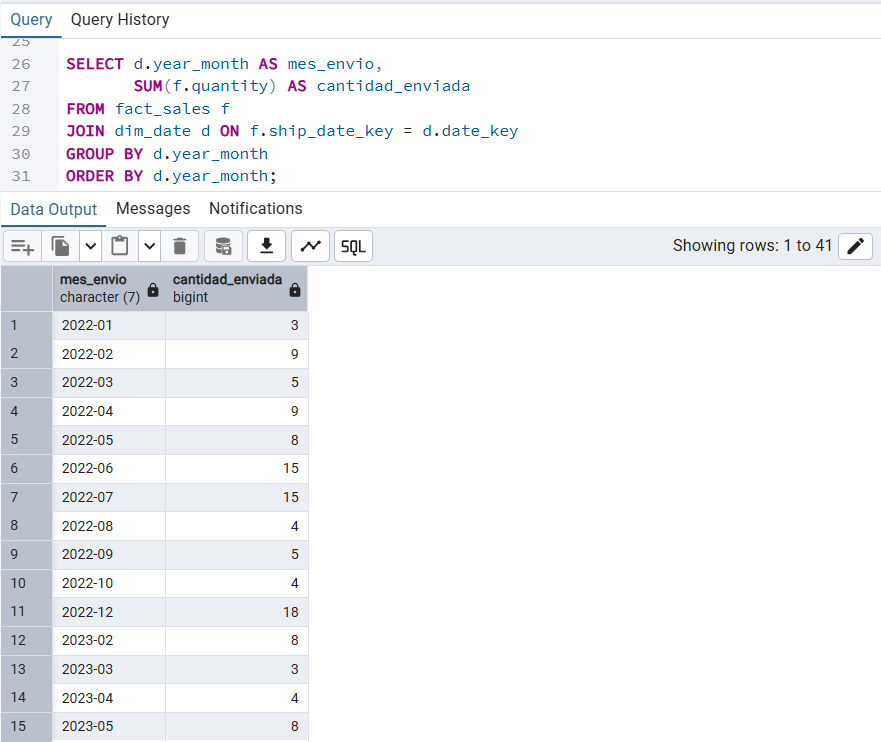

**Figura 30.** Resultado de la consulta 4: cantidad enviada por mes de envío.

**Consulta 5. ¿Cuánto se vendió por tamaño de producto y estado civil del cliente?** (Figura 31)

```sql
SELECT p.size,
       c.marital_status,
       SUM(f.sales_amount) AS monto_vendido,
       SUM(f.quantity)     AS unidades_vendidas
FROM fact_sales f
JOIN dim_product p  ON f.product_key = p.product_key
JOIN dim_customer c ON f.customer_key = c.customer_key
GROUP BY p.size, c.marital_status
ORDER BY p.size, c.marital_status;
```

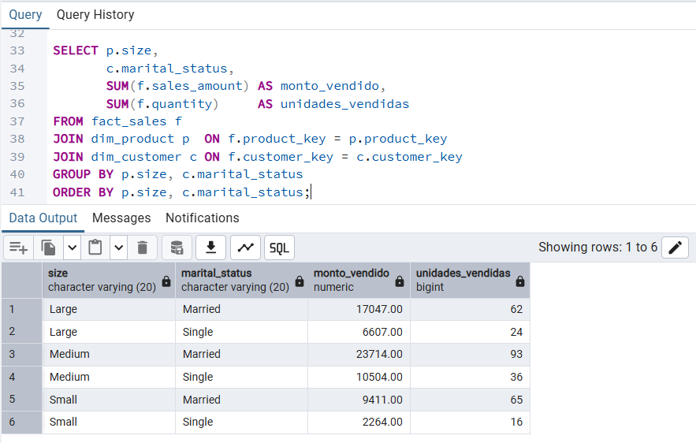

**Figura 31.** Resultado de la consulta 5: ventas por tamaño y estado civil.

Las consultas 1 y 4 comparten estructura, pero la primera une con `order_date_key` y la cuarta con `ship_date_key`: una misma tabla `dim_date` responde tanto a "cuándo se pidió" como a "cuándo se envió". La consulta 5 es la única que cruza dos dimensiones a la vez (producto y cliente).

## 4.12. Diagrama en Power Pivot
Las cuatro tablas del modelo se exportaron a CSV desde pgAdmin (UTF-8, encabezado activado, delimitador coma) y se cargaron al Modelo de datos de Excel mediante *Datos > Obtener datos > Desde texto/CSV*, con la opción *Solo crear conexión*. Se recurrió a esta vía porque el conector nativo de PostgreSQL requería el componente Npgsql, no disponible en el equipo.

En la Vista de diagrama se crearon cuatro relaciones de uno a varios, con `fact_sales` en el centro. Primero se creó la relación `order_date_key` → `dim_date.date_key`, de modo que la fecha de pedido sea la relación activa. La relación `ship_date_key` → `dim_date.date_key` quedó **inactiva** (línea punteada), porque Power Pivot admite una sola relación activa entre dos tablas. Es la representación en Power Pivot de la dimensión fecha con doble rol (Figuras 32 y 33).

**Tabla 2.** Relaciones del modelo en Power Pivot.

| Tabla de hechos (lado varios) | Dimensión (lado uno) | Cardinalidad | Estado |
| :--- | :--- | :--- | :--- |
| `fact_sales.order_date_key` | `dim_date.date_key` | 1:* | Activa |
| `fact_sales.ship_date_key` | `dim_date.date_key` | 1:* | Inactiva |
| `fact_sales.product_key` | `dim_product.product_key` | 1:* | Activa |
| `fact_sales.customer_key` | `dim_customer.customer_key` | 1:* | Activa |

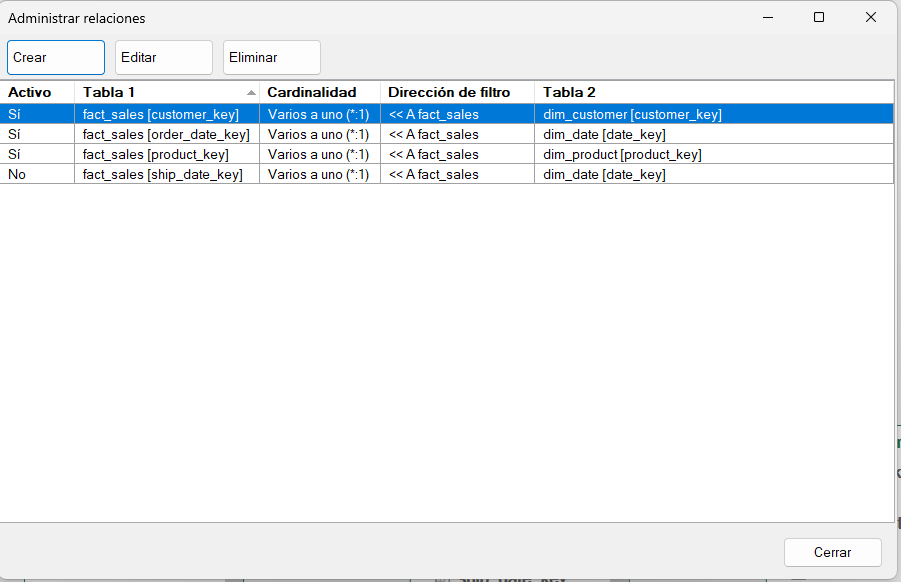

**Figura 32.** Cuadro Administrar relaciones con las cuatro relaciones del modelo.


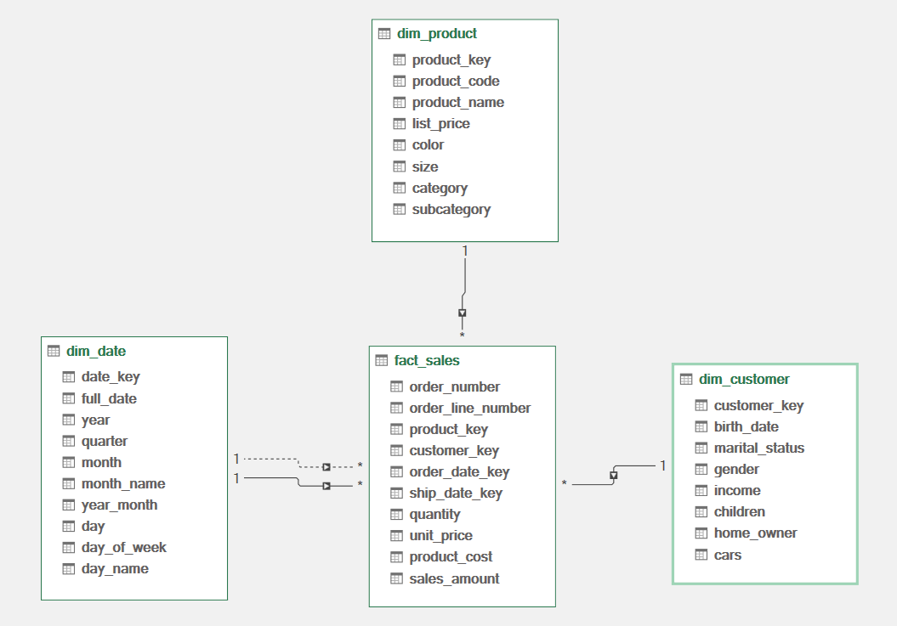

**Figura 33.** Vista de diagrama del esquema estrella en Power Pivot.

## 4.13. Verificación con tablas dinámicas
Para comprobar que el modelo de Power Pivot es consistente con las consultas SQL, se resolvieron las cinco preguntas con tablas dinámicas sobre el Modelo de datos (Figura 34). Las consultas 1, 2, 3 y 5 usan la relación activa (fecha de pedido). La consulta 4 requirió la medida DAX `Cantidad Enviada`, que activa la relación inactiva dentro del cálculo mediante `USERELATIONSHIP`, ya que una tabla dinámica solo utiliza por defecto la relación activa.

```
Total Ventas   := COUNTROWS(fact_sales)

Cantidad Enviada :=
CALCULATE(
    SUM(fact_sales[quantity]),
    USERELATIONSHIP(fact_sales[ship_date_key], dim_date[date_key])
)
```

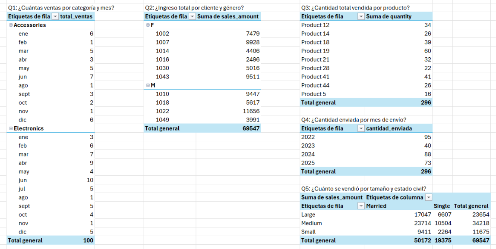

**Figura 34.** Tablas dinámicas de verificación sobre el Modelo de datos.

# 5. Validación y evidencias

## 5.1. Tabla de evidencias por actividad
La Tabla 3 resume las actividades realizadas, la herramienta empleada, las figuras que las respaldan y su estado.

**Tabla 3.** Evidencias por actividad.

| Actividad | Herramienta | Evidencia | Estado |
| :--- | :--- | :--- | :--- |
| Staging e importación de products.csv | pgAdmin 4 | Figuras 1 a 7 | Completado (699 registros) |
| Limpieza de products.csv | pgAdmin 4 | Figuras 8 a 10 | Completado sin errores |
| Creación y carga de dim_product | pgAdmin 4 | Figuras 11 a 13 | Completado (699 registros) |
| Consultas de análisis de dim_product | pgAdmin 4 | Figuras 14 a 18 | Completado sin errores |
| Staging, importación y validación de ventas | pgAdmin 4 | Figuras 19 a 22 | Completado (100 registros) |
| DDL del esquema estrella | pgAdmin 4 | Figura 23 | Completado sin errores |
| DML de dimensiones y hechos | pgAdmin 4 | Figuras 24 a 26 | Completado sin errores |
| Consultas de negocio (5) | pgAdmin 4 | Figuras 27 a 31 | Resultados validados |
| Diagrama del modelo | Power Pivot | Figuras 32 y 33, Tabla 2 | Completado |
| Verificación con tablas dinámicas | Excel (Modelo de datos) | Figura 34 | Totales coincidentes |

## 5.2. Criterios de calidad
La validación consistió en contrastar los resultados obtenidos con los valores de control calculados de forma independiente a partir de los archivos originales (Tabla 4). Todos los controles coincidieron.

**Tabla 4.** Controles de calidad del modelo.

| Control | Valor esperado | Resultado |
| :--- | :--- | :--- |
| Registros, IDs únicos, categorías y subcategorías en `stg_products` | 699, 699, 10 y 53 | Coincide |
| Registros en `dim_product` (parte guiada) | 699 | Coincide |
| Filas, pedidos únicos, productos, clientes, categorías y subcategorías en `stg_ventas` | 100, 100, 9, 10, 2 y 6 | Coincide |
| Ventas con `sales_amount ≠ quantity × unit_price` | 0 | Coincide |
| Filas en `dim_product`, `dim_customer`, `dim_date` y `fact_sales` | 9, 10, 1461 y 100 | Coincide |
| Total de ventas en staging frente a hechos | Iguales (69547) | Coincide |
| Consulta 1: filas y suma de ventas | 59 filas, total 100 | Coincide |
| Consulta 2: filas, total y primer cliente | 10 filas, 69547, cliente 1022 (11656) | Coincide |
| Consulta 3: filas, total y primer producto | 9 filas, 296, Product 19 (60) | Coincide |
| Consulta 4: filas y total | 41 filas, 296 | Coincide |
| Consulta 5: filas y total | 6 filas, 69547 | Coincide |
| Tabla dinámica de control (suma de ventas) | 69547 | Coincide |

La coincidencia entre los totales de las consultas 3 y 4 (296 unidades) constituye además una prueba cruzada: la cantidad total vendida y la cantidad total enviada deben ser iguales, aunque se distribuyan en meses distintos.

# 6. Conclusiones
- El uso de una zona de staging permitió validar y limpiar los datos antes de integrarlos al modelo, sin modificar los archivos fuente. Los controles de conteos y de totales dieron certeza de que la carga fue completa en cada etapa.
- La clasificación de las columnas en dimensiones, medidas y dimensiones degeneradas, y la definición previa de la granularidad (una línea de pedido), permitieron diseñar un esquema estrella consistente. La clave primaria compuesta de `fact_sales` es la implementación física de esa granularidad.
- Una sola `dim_date` con dos claves foráneas en la tabla de hechos resolvió la fecha de pedido y la de envío sin duplicar tablas. En SQL la distinción se hace con el `JOIN` y en Power Pivot mediante una relación inactiva activada con `USERELATIONSHIP`.
- En el esquema estrella las consultas de negocio se reducen a un `JOIN` entre la tabla de hechos y una o dos dimensiones, y los mismos totales obtenidos en SQL y en las tablas dinámicas confirman la consistencia del modelo.
- El conector nativo de Excel para PostgreSQL depende de componentes adicionales. Exportar las tablas a CSV resultó una alternativa válida para llevar el modelo a Power Pivot, con la precaución de revisar el formato de los decimales al cargar.

# 7. Referencias bibliográficas
[1] PostgreSQL Global Development Group, «PostgreSQL documentation». [En línea]. Disponible en: [https://www.postgresql.org/docs/](https://www.postgresql.org/docs/).

[2] Microsoft, «Power Pivot: análisis de datos eficaz y modelado de datos en Excel», Soporte de Microsoft. [En línea]. Disponible en: [https://support.microsoft.com/](https://support.microsoft.com/).

[3] Martínez, D, «Práctica 4: Modelo físico dimensional en PostgreSQL», guía de laboratorio de Business Intelligence, Escuela Politécnica Nacional, Facultad de Ingeniería de Sistemas, 2026.

# 8. Declaración de uso de la IA
Para la elaboración de este informe, se declara un uso de Inteligencia Artificial (LLM) del 20%, utilizado como asistente de guía paso a paso, redacción y estructuración del documento. El porcentaje restante corresponde a la ejecución de los scripts en PostgreSQL, la construcción del modelo en Power Pivot, la validación de resultados y la captura de evidencias.